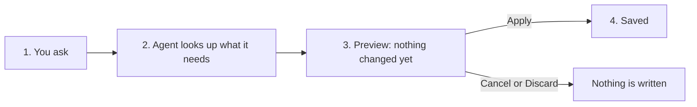

## The page is the context

The AI agent works on what you have open. The context line at the top of the window shows the module, language, workspace, and page. *This page* and *here* in your request mean that page, unless you name another one or pass a file UID.

## The four steps of every request

1. **You ask** in your own words, in any language. Click a suggestion or pick an action with `/`.
2. **The agent looks up what it needs**, for example missing alt text, the last scan result, or file metadata. Read steps run automatically and appear as steps marked **completed**.
3. **For a change, it shows a preview** marked **Preview — nothing changed yet**. The preview lists exactly what will be written: file, language, decorative flag, scan scope, and so on.
4. **You decide.** Click **Apply** to write the change, or **Cancel** to discard it.

The agent never skips step 3 for a change. If it is unsure, it asks a follow-up question instead of guessing.

## Two kinds of T3AA actions

Every T3AA tool declares whether it only reads or asks before changing. The `/` picker and preview cards show this.

| Label | What happens | T3AA examples |
|---|---|---|
| **Only reads** | Runs immediately. You see a step and an answer. | Find images without alt text, Show alt text drafts, Show accessibility issues, Check page speed, Fix suggestions, Summarize content |
| **Asks before changing** | Shows a preview. Writes only after **Apply**. | Mark image as decorative, Approve alt drafts, Queue folder for alt text, Run accessibility scan, Generate voice-over, Update file metadata |

## DualMode tools

Two T3AA tools support **DualMode** (the agent model can draft content, or T3AA can generate it natively inside TYPO3):

| Tool | Role |
|---|---|
| `t3aa_update_file_metadata` | Write + previewable: generate or update alt text, title, and description |
| `t3aa_summarize_content` | Read DualMode: summarize page or content element text |

Which path runs depends on AI Foundation MCP mode (**Context** vs **Native**). Details: [AI Foundation: How it works](/ExtNsT3AF/AskAiAgent/HowItWorks/Index).

## Live or draft workspace

- In **Live**, an applied change is public immediately. The preview may say *On confirm this goes live on the website.*
- In a draft workspace, the change stays in that workspace until it is published.

Workspace selection and enforcement are AI Foundation settings. See [Live or draft workspace](/ExtNsT3AF/AskAiAgent/HowItWorks/Index#live-or-draft-workspace).

## What you need before you start

- **TYPO3** with **AI Foundation** (`ns_t3af`) and **T3AA** (`ns_t3aa`) installed and active.
- An **AI provider** configured in AI Foundation (for example OpenAI). Voice-over uses the editor’s **default audio provider** (OpenAI or ElevenLabs).
- A valid **T3AA license**. Scans use the scan quota of the license.
- Backend permissions for the files and pages you ask about.

## Data protection

Your messages and the content the agent reads are sent to the AI provider shown in the message field. Your backend permissions and AI Permissions of your user group always apply. See [DPA & GDPR](/ExtNsT3AA/DPAandGDPR/Index).

## Related

- [Your first accessibility request](/ExtNsT3AA/AskAiAgent/StepByStep/Index)
- [T3AA tools](/ExtNsT3AA/AskAiAgent/Tools/Index)
- [AI Foundation: How it works](/ExtNsT3AF/AskAiAgent/HowItWorks/Index)
