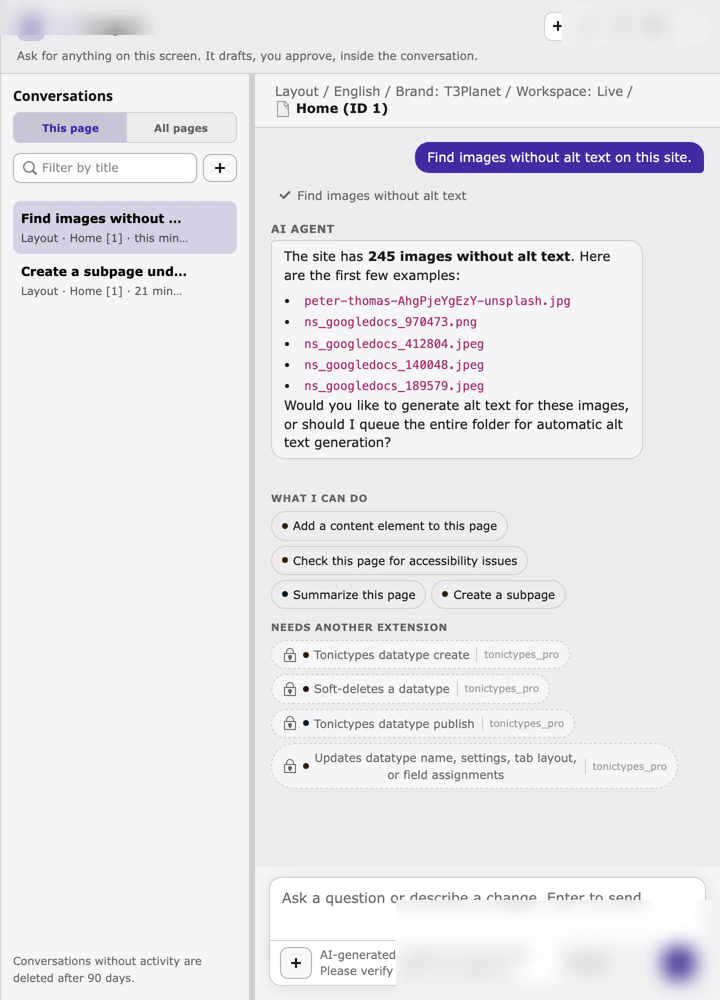
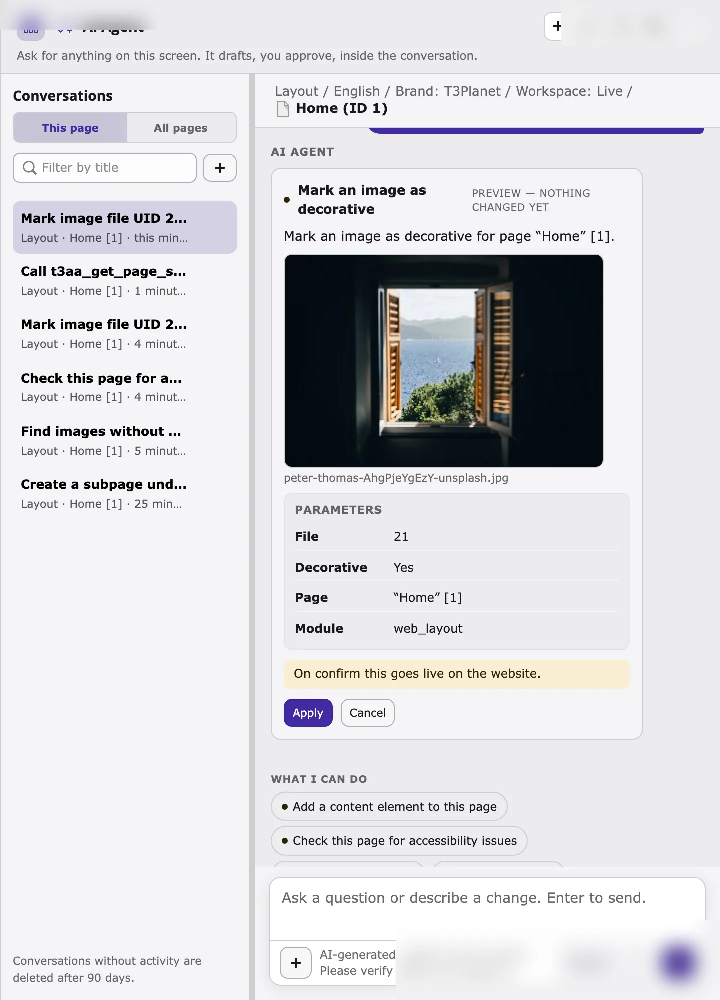
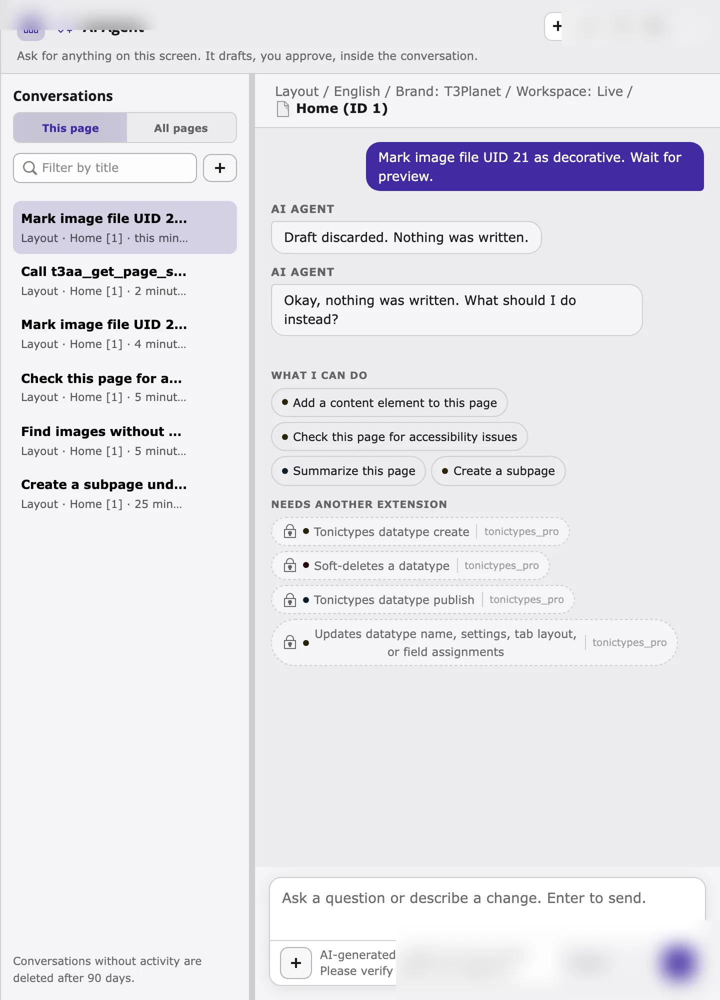
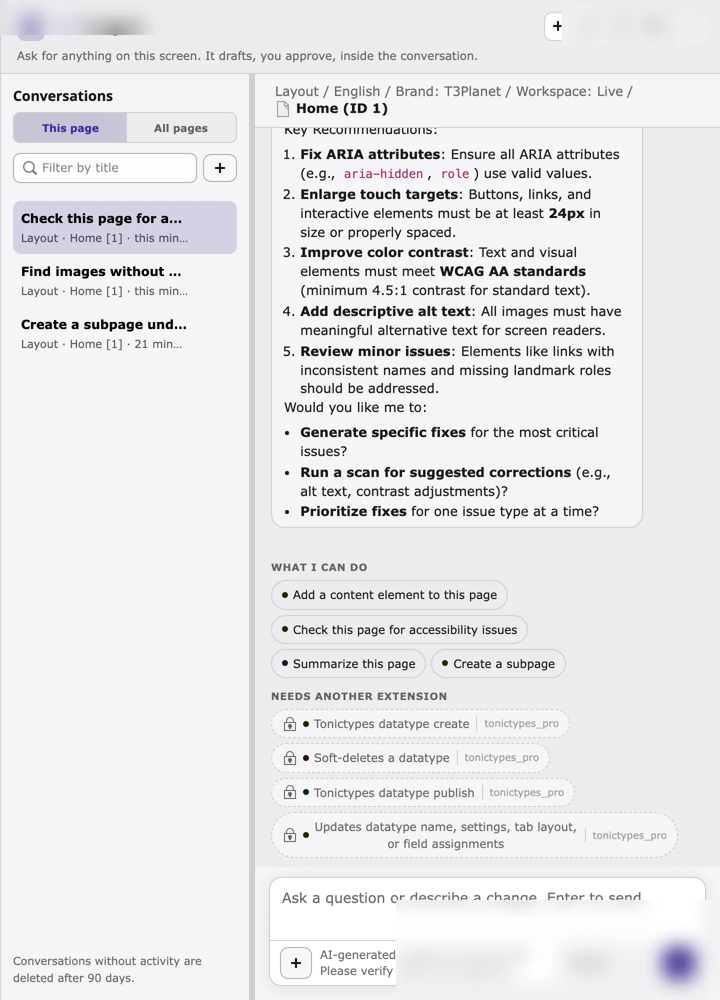

This walkthrough uses one page and three requests, from safe to more powerful. Use a test page, or a draft workspace, for your first try.

## Step 1: Open the AI agent on your page

1. Select the page in the page tree, for example in **Content > Layout**.
2. Click **Ask AI Agent** in the top bar, or press `Ctrl/Cmd+Shift+K`.
3. On first use, read the AI notice and confirm it.
4. Check the context line below the title. It must show the page you want to work on.
5. Choose an AI provider in the footer if needed (for example **OpenAI**).

<Tip>
If the context line shows the wrong page, close the agent, select the right page, and open it again.
</Tip>

## Step 2: Start with a request that only reads

Type a request that does not change anything:

```text
Which images have no alt text?
```

The agent runs the T3AA step **Find images without alt text** (marked **completed**) and answers with file paths and UIDs. Decorative images are left out. Nothing is written. This is the safest way to see how the agent works with T3AA.



<Note>
The list can still include many fileadmin assets (for example PWA icons). Prefer a follow-up such as *"Only list images in fileadmin/user_upload"* or use storage UID `1` with a smaller limit when you work through MCP. See [Troubleshooting](/ExtNsT3AA/AskAiAgent/Troubleshooting/Index#noisy-missing-alt-list).
</Note>

## Step 3: Preview a change, then cancel

```text
Mark file 141 as decorative.
```

You can also pass a file path instead of a UID, for example `Mark this "/user_upload/hero.webp" image as decorative.`



1. The card is marked **Preview — nothing changed yet**.
2. Check the **Parameters**: file UID or file path, language, decorative flag, and page.
3. Read the hint at the bottom. In **Live**, it may say *On confirm this goes live on the website.*
4. Click **Cancel** (or **Discard**) to write nothing. After cancel, the agent confirms that nothing was written.



You can click **Apply** instead when you are ready to save. For documentation and first practice, **Cancel** is the safe choice.

## Step 4: Optional — ask about accessibility issues

```text
What accessibility issues does this page have?
```

This **only reads** the last scan result. It does not start a new scan.

To run a new scan (and use scan quota), ask for it explicitly:

```text
Scan this page for accessibility problems.
```

```text
Run a WCAG scan on this page.
```

Those requests show a **scan** preview. Confirm with **Apply** only when you intend to scan. The screenshot below is the **issues** answer (read-only), not a scan preview.



## Next steps

- Browse all T3AA actions in [T3AA tools](/ExtNsT3AA/AskAiAgent/Tools/Index).
- Copy requests from [Example requests](/ExtNsT3AA/AskAiAgent/ExampleRequests/Index).
- For module workflows (queues, Fix Hub, bulk scans), see the [Feature Guide](/ExtNsT3AA/FeatureGuide/Index).
- If something does not work, see [Troubleshooting](/ExtNsT3AA/AskAiAgent/Troubleshooting/Index).
