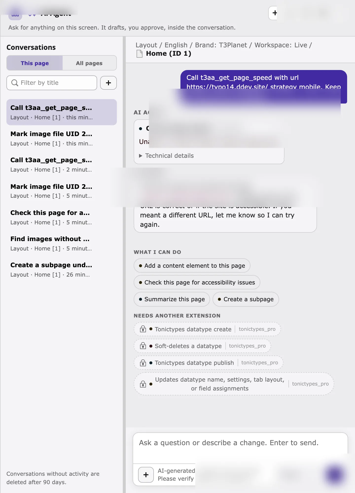

For general AI agent messages (credits, busy agent, turn limits), see [AI agent troubleshooting](/ExtNsT3AF/AskAiAgent/Troubleshooting/Index) in the AI Foundation manual.

## T3AA tools are missing

**AI Foundation > AI Agent > Overview** does not list **AI Accessibility** / `ns_t3aa` under tools by extension, or the agent never uses T3AA tools.

- Check that `ns_t3aa` and `ns_t3af` are installed and active, then clear all caches.
- T3AA registers MCP tools only when AI Foundation’s MCP interfaces are present. Without `ns_t3af`, the tools do not appear.
- Compare **Executable** and **Locked** for T3AA on the Overview tab. Check that the T3AA license is active.
- Check **AI Foundation > AI Agent > Severity policy**. Tools listed as **Unclassified** are locked.
- Check that the backend user group has AI agent access in [AI Permissions](/ExtNsT3AF/Configuration/AIPermissions/Index).

## No AI provider / empty provider list

The agent footer has no usable provider, or turns fail before a T3AA tool runs.

- Configure at least one provider in AI Foundation (for example OpenAI).
- Select the provider in the agent footer **before** the first message of the conversation.
- After the first answer, the provider is fixed for that conversation — start a **New conversation** to switch.

## PageSpeed: Unable to resolve {#pagespeed-unable-to-resolve}

```text
Unable to resolve https://typo14.ddev.site/
```



`t3aa_get_page_speed` calls Google PageSpeed Insights. Google must reach the page URL from the public internet.

- Local DDEV hosts (`*.ddev.site`) are not resolvable by Google — this failure is expected on local projects.
- Backend Lighthouse / scan jobs that refuse local or private hosts behave the same way for `*.ddev.site`.
- Use a publicly reachable staging or production URL, or run PageSpeed from an environment Google can fetch.
- This is a read-only tool: the error does not change any TYPO3 data.
- The agent’s PageSpeed result is **not** written to the T3AA Lighthouse report tab in the backend. Use the module Lighthouse workflow when you need a stored report.

## The missing-alt list looks too noisy {#noisy-missing-alt-list}

*Which images have no alt text?* can still include many `fileadmin` assets (for example PWA icons or upload leftovers) even though decorative images and extension public assets under `typo3conf/ext`, `typo3/sysext`, `_assets`, and `_processed_` are excluded.

- Ask a narrower follow-up, for example *"Only list images in fileadmin/user_upload"* or name a folder.
- For MCP clients, pass `storageUid=1` (or the correct fileadmin storage) and a smaller `limit`.
- Mark true icons and logos as decorative when that is correct for your site.

## Permissions or "No file found"

Write tools and some reads fail when the backend user cannot access the file or page.

- Confirm the file UID exists and is readable for your user.
- Confirm the page is in a site the user may edit.
- The agent never exceeds your backend permissions.

## I asked for issues, but expected a new scan

You asked *"What accessibility issues does this page have?"* (or a similar **issues** question) and only got the last scan result — or you expected a scan preview and did not get one.

- Showing issues from the **last** scan is a read (`t3aa_accessibility_issues`). It never starts a new scan.
- Running a **new** scan is a write (`t3aa_accessibility_scan_run`) and uses scan quota.
- Ask to **scan**, for example *"Scan this page for accessibility problems"* or *"Run a WCAG scan on this page"*, then click **Apply** on the scan preview.
- *"Check this page for accessibility problems"* / *"What accessibility issues…"* **only read** the last result — they do not start a scan.

## The agent keeps asking to continue

The agent replies with *I am not finished yet… Say “continue”* (or similar) before the preview or next card appears.

- Type `continue`, or click a suggested action, so the turn can finish the remaining steps (for example attaching a file or opening the next image-text card).
- Start a **New conversation** if the chat history is long or mixed with unrelated requests.
- If it loops after every Keep / Apply on named files, pull the latest `ns_t3af` and clear caches — multi-file alt-text Keep should continue to the next named file in the same flow.

## Delete images without alt text did nothing

You asked to delete images that have no alt text.

- The agent **lists** those images and **does not delete** files. Deletion is blocked for safety; remove files yourself in the File List module if needed.

## Applied by mistake

After **Apply**, use **Undo** on the result card when it is offered. In a draft workspace, the change stays in that workspace until it is published.

## Related

- [AI Foundation troubleshooting](/ExtNsT3AF/AskAiAgent/Troubleshooting/Index)
- [T3AA tools](/ExtNsT3AA/AskAiAgent/Tools/Index)
- [Known problems](/ExtNsT3AA/KnownProblems/Index)
