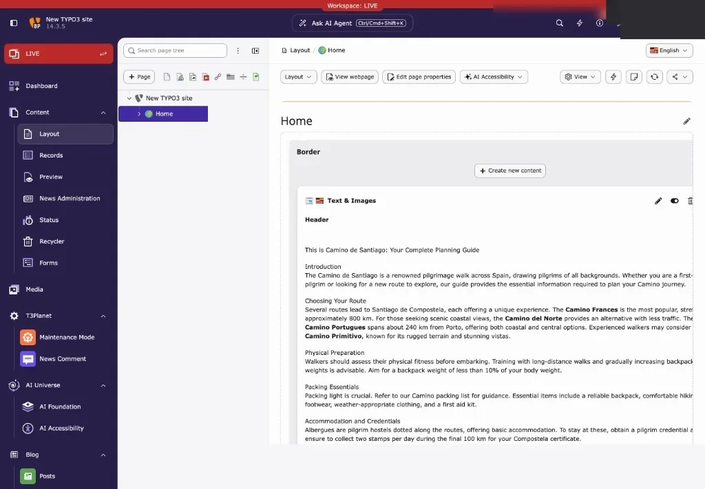
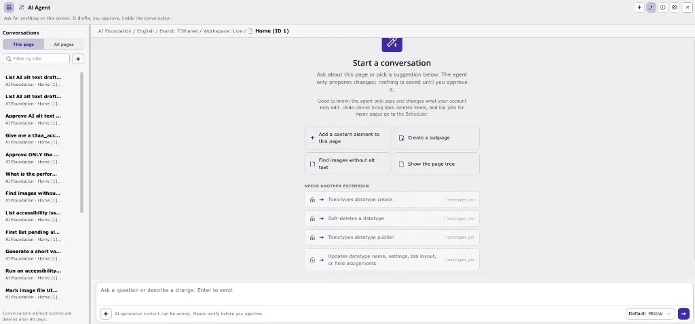
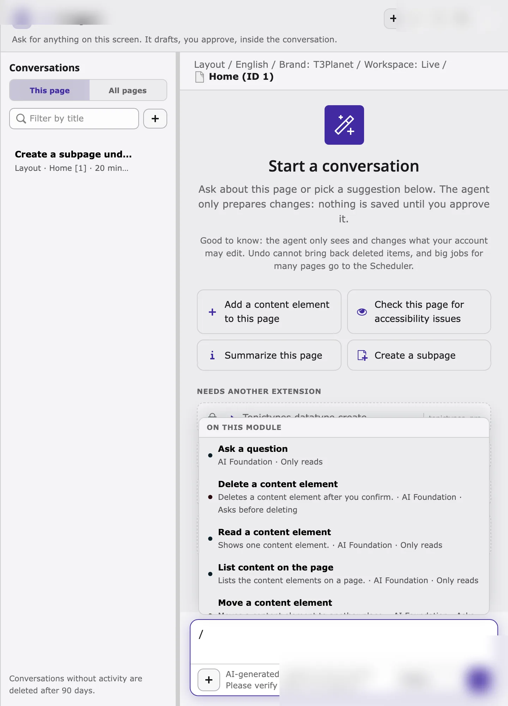

## The Ask AI Agent button

- **Ask AI Agent** sits in the center of the backend top bar and is available in every backend module. It is provided by **AI Foundation** (`ns_t3af`), not by the AI Accessibility module alone.
- The button shows the keyboard shortcut. The default is `Ctrl+Shift+K` (Windows, Linux) or `Cmd+Shift+K` (macOS), which keeps `Ctrl/Cmd+K` free for TYPO3 Live Search.
- The **AI Accessibility** entry in the left module menu opens the standalone T3AA tabs (Dashboard, AI Alt Text, Scans, and so on). That is separate from the Ask AI Agent chat window.

## Open the AI agent in three steps

1. Select the page you want to work on in the page tree, for example in **Content > Layout**.
2. Click **Ask AI Agent**, or press `Ctrl/Cmd+Shift+K`.
3. The AI agent window opens on top of the page. Check that the context line shows the right page, then type your request.

Opening the agent on a page continues the latest conversation for that page. Press `Esc` or click **Close** to close the window. Your work in the backend stays open behind it.

A new conversation starts with suggestions for the current screen. With T3AA installed, suggestions can include accessibility actions such as **Check this page for accessibility issues** (reads the last scan) or **Summarize this page**, next to AI Foundation actions such as adding a content element. To run a new scan, ask *"Scan this page for accessibility problems"* or *"Run a WCAG scan…"*.

## The window, part by part

The shared agent chrome (header icons, conversations, attach, provider picker) is documented in [AI Foundation: Where the AI agent opens](/ExtNsT3AF/AskAiAgent/WhereOpens/Index). For T3AA work, pay special attention to:

| Part | Why it matters for T3AA |
|---|---|
| **Context line** | Module, language, workspace, and page. *This page* in your request means this page. Scans, issues, summaries, and voice-over use it. |
| **Steps** | Each T3AA tool run appears as a step (for example **Find images without alt text**). Expand a step to see the technical tool name (`t3aa_…`). |
| **Preview cards** | Write tools show **Preview — nothing changed yet** until you click **Apply** or **Cancel**. |
| **What I can do** | Suggested next requests for this screen, including T3AA accessibility prompts when they fit. |
| **AI model** | Provider used for the conversation (for example **Default: OpenAI**). Choose it before the first message. |

### Slash picker

Type `/` in the message field to browse tools by their name in the agent. T3AA tools appear under the AI Accessibility / `t3aa_` group when the extension is active.

## Related

- [How it works](/ExtNsT3AA/AskAiAgent/HowItWorks/Index)
- [AI Foundation: Ask AI agent](/ExtNsT3AF/AskAiAgent/Index)
- [Feature Guide](/ExtNsT3AA/FeatureGuide/Index)
