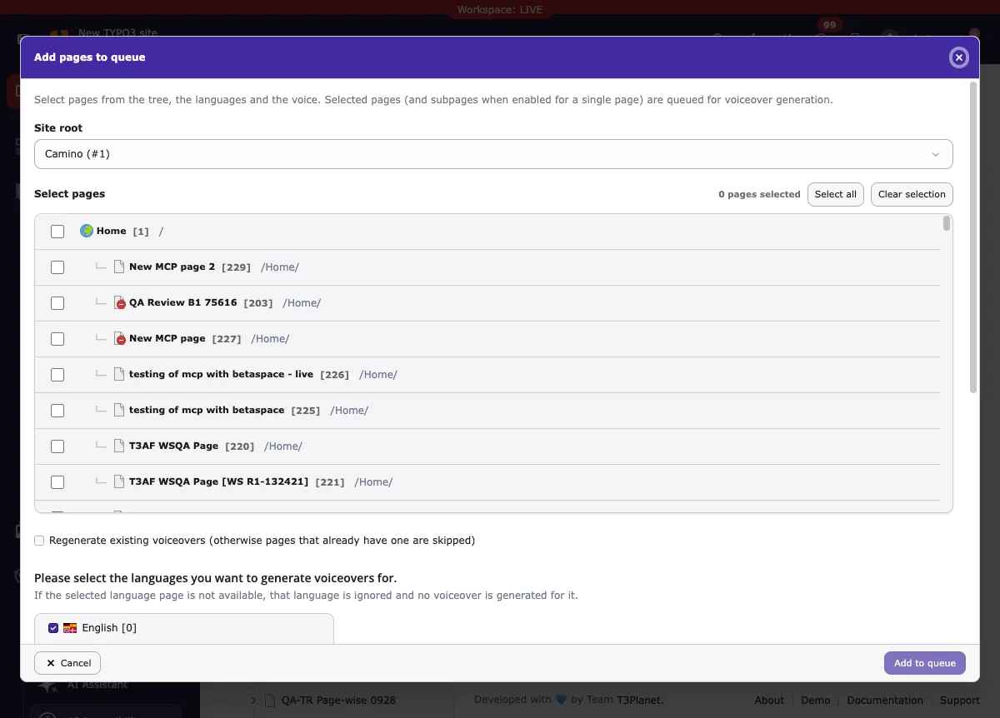
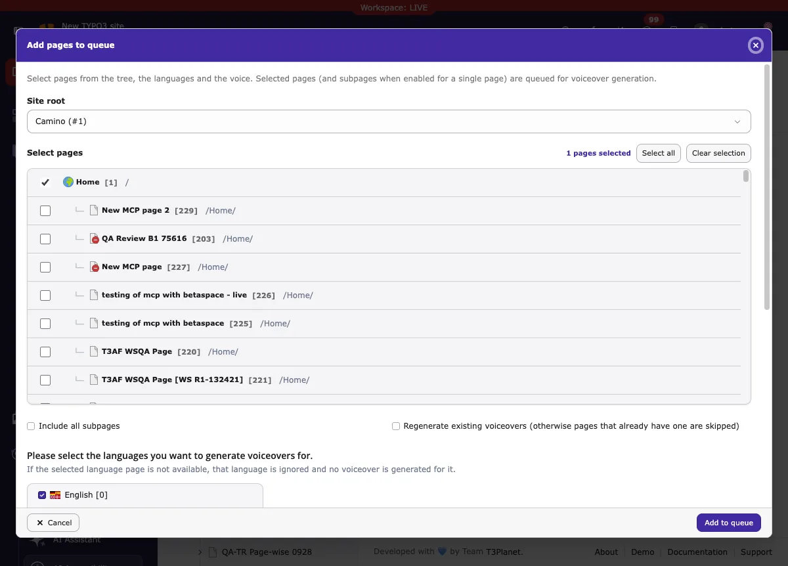
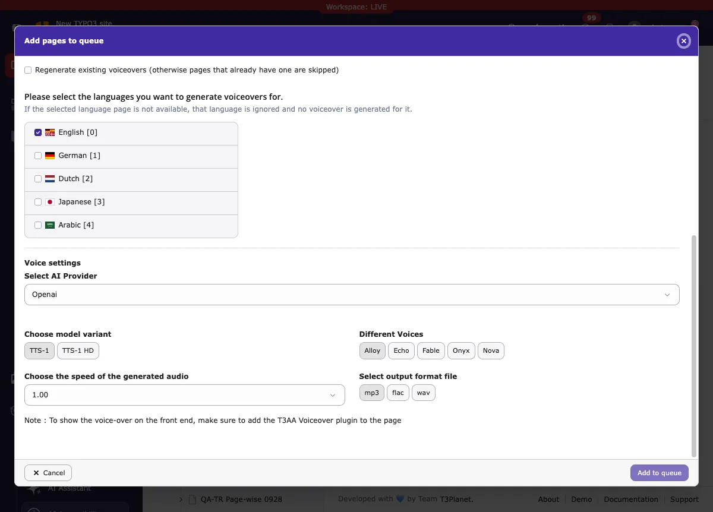
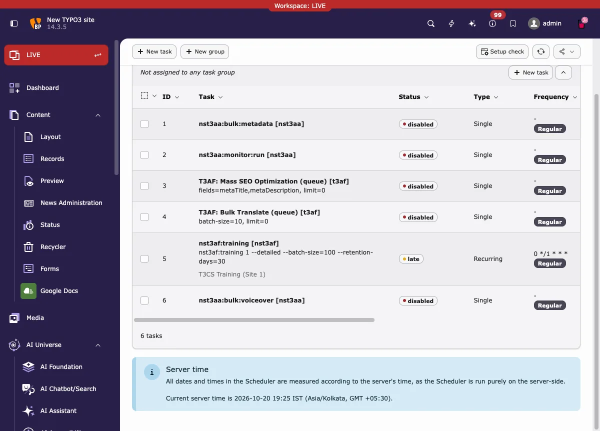
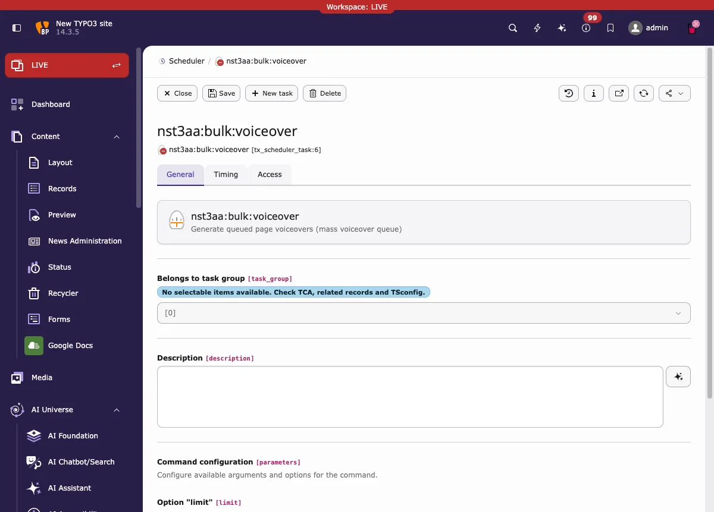
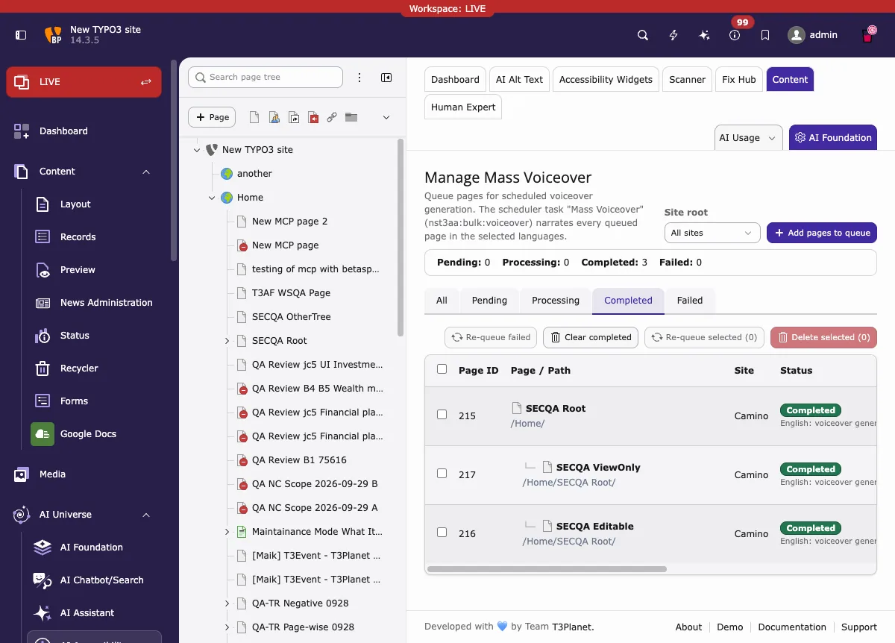

With **Mass Voiceover**, you add many pages to one queue. One Scheduler task
then creates the voiceover for every queued page, in every language you
selected.

Use it when a website has many pages that need a voiceover. You prepare the
queue once. After that, the Scheduler task does the work in the background.

This is different from [AI Voiceover](/en/latest/ExtNsT3AA/FeatureGuide/AIVoiceover/Index),
where you create the voiceover for one page at a time.

<div className="t3-embed"><iframe src="https://app.supademo.com/embed/cmvgsbjat002vqmkpk0v4sk1x?embed_v=2&utm_source=embed" loading="lazy" title="T3AA - Mass Voiceover" allow="clipboard-write; fullscreen" frameBorder="0" webkitallowfullscreen="true" mozallowfullscreen="true" allowfullscreen></iframe></div>

## Before you start

You need:

* The **AI Accessibility** module (T3AA) in your TYPO3 backend.
* A backend user that is allowed to change the Mass Voiceover queue. Without
  this permission, **Add pages to queue**, the settings (gear) button,
  **Delete**, and all bulk buttons (**Re-queue failed**, **Clear completed**,
  **Re-queue selected**, **Delete selected**) are hidden. Pages the user
  cannot edit are skipped when they are added to the queue.
* A speech (text-to-speech) provider in **AI Foundation → AI Providers**,
  with a valid API key. The supported speech providers are **OpenAI**,
  **OpenAI-compatible**, **ElevenLabs** (with your own ElevenLabs key) and
  **T3Planet Credits**. Mistral cannot be used for speech. Note: ElevenLabs
  cannot be used when your site runs in T3Planet Credits mode.
* The TYPO3 **Scheduler** module, so the task can run. The task can also be
  started from the command line (see below).

<Note>
The voiceover is not shown on the website automatically. Add the
**AI Accessibility-Voiceover** content element to the page to play it.
See [AI Voiceover](/en/latest/ExtNsT3AA/FeatureGuide/AIVoiceover/Index).
</Note>

## Open Mass Voiceover

1. Open **AI Accessibility** in the left backend menu.
2. Select a page in the page tree.
3. Open the **Content** tab.
4. On the **Mass Voiceover** card, click **Manage Mass Voiceover**.

The **Manage Mass Voiceover** screen opens. The text under the title explains
the idea: "Queue pages for scheduled voiceover generation. The scheduler task
"Mass Voiceover" (nst3aa:bulk:voiceover) narrates every queued page in the
selected languages."


The **Manage Mass Voiceover** screen with the queue, the status summary and
the status tabs.

## The Manage Mass Voiceover screen

From top to bottom, you see:

* **Site root** — a filter. Choose **All sites** to see the queue entries of
  all sites, or choose one site root to see only its pages.
* **Add pages to queue** — opens the wizard that adds pages to the queue
  (see next section).
* The **status summary** — how many entries are **Pending**, **Processing**,
  **Completed** and **Failed**.
* The **status tabs** — **All**, **Pending**, **Processing**, **Completed**
  and **Failed**. Click a tab to see only entries with that status.
* **Re-queue failed** — sets failed entries back to **Pending**, so the
  next run tries them again. If you selected rows with the checkboxes, only
  the selected rows are re-queued; otherwise all failed entries of the site
  chosen in the **Site root** filter are re-queued.
* **Clear completed** — removes the completed entries of the site chosen in
  the **Site root** filter from the list. The voiceover files on the pages
  are kept.
* **Re-queue selected (n)** and **Delete selected (n)** — work on the rows
  you selected with the checkboxes. They are inactive until you select at
  least one row. **Delete selected** removes the queue entries. Existing
  voiceovers on the pages are kept.
* The **queue table** with one row per page:
  * **Page ID** and **Page / Path** — the page and where it is in the tree.
    Subpages are shown indented under their parent page.
  * **Site** — the site the page belongs to.
  * **Status** — a badge (for example **Completed** or **Failed**) and a
    short message per language, for example "English: voiceover generated"
    or "German: ignored, page not available in this language".
  * **Mode** — **Generate** when Regenerate was not chosen for this entry,
    or **Regenerate** when it was. The Mode only shows this choice; it does
    not check whether the page already has a voiceover.
  * **Languages** — the languages selected for this entry, shown as flags.
  * **Voice** — the provider, model and voice used for this entry.
  * **Last processed** — when the entry was last worked on.
  * **Action** — the **settings (gear)** button to change the entry, and
    **Delete** to remove the entry from the queue. The gear button is only
    shown when you have the modify permission, and not for **Completed** or
    **Processing** entries.
* **Pagination** at the bottom, when the queue has many entries.

## Add pages to the queue

1. Click **Add pages to queue**.
2. If the site is not already known, choose it in **Site root**. The page
   tree loads straight away — when the site is known, or as soon as you
   pick one.

   

   The wizard with the site choice and the page tree.

3. In **Select pages**, tick the pages you want. Nothing is pre-ticked —
   the counter above the tree starts at 0 and shows how many pages are
   selected. Folders, shortcuts and similar page types that cannot be
   voiced over are greyed out. Hidden pages are included in the tree.
   **Select all** ticks all pages in the tree and **Clear selection**
   removes all ticks. When you select exactly one page, the option
   **Include all subpages** is shown. Tick it to queue that page together
   with all its subpages; only pages that can be voiced over are added.

   

   Select the pages in the tree. The languages and the voice settings are
   below the tree.

4. Set the options under the tree (they are explained in the next section):
   **Regenerate existing voiceovers**, the **languages**, and the
   **Voice settings**.
5. Click **Add to queue**. The wizard closes and the new entries appear in
   the list with the status **Pending**.

## Settings: regenerate, languages and voice

The same settings are used in the **Add pages to queue** wizard and in the
settings window of a queue entry. To change an existing entry, click its
**settings (gear)** button, change the values, and click
**Save and re-queue**. Saving sets the entry back to **Pending**, so the
next run uses your new settings. **Completed** entries have no gear button:
use **Re-queue selected** to set such an entry back to **Pending** first,
then click the gear button before the next run starts. Re-queuing a
**Completed** entry turns on **Regenerate** for that entry, so the next run
creates a new voiceover even though the page already has one. The skip rule
below does not apply to such entries.



The languages and the voice settings in the wizard.

* **Regenerate existing voiceovers** — if a page already has a voiceover and
  this option is off, that page is skipped in the next run. Turn it on when
  the text of the page changed and you want a new voiceover.
* **Languages** — tick the languages you want to generate. The wizard text
  says: "Please select the languages you want to generate voiceovers for.
  If the selected language page is not available, that language is ignored
  and no voiceover is generated for it." So a missing translation does not
  stop the run; that language is simply skipped.
* **Voice settings**:
  * **Select AI Provider** — the speech provider from AI Foundation:
    OpenAI, OpenAI-compatible, ElevenLabs or T3Planet Credits. The next
    fields depend on the provider.
  * **Choose model variant** — for example **TTS-1** or **TTS-1 HD** for
    OpenAI, or an ElevenLabs model such as **Eleven Multilingual v2**.
  * **Different Voices** — the voice, for example **Alloy**, **Echo**,
    **Fable**, **Onyx** or **Nova** for OpenAI, or one of the ElevenLabs
    voices.
  * **Choose the speed of the generated audio** — from **0.25** (slow) to
    **4.00** (fast). The normal value is **1.00**.
  * **Select output format file** — **mp3**, **flac** or **wav**.

Under the settings, the wizard also reminds you: "To show the voice-over on
the front end, make sure to add the T3AA Voiceover plugin to the page."

## Run the Scheduler task

Queue entries are not processed at once. They wait with the status
**Pending** until the Scheduler task runs.

### Set up the task in the Scheduler

1. Open **Scheduler** in the left backend menu (System).
2. If the task **nst3aa:bulk:voiceover** is already in the list, you can
   edit it. Otherwise click **New task** and choose the console command
   **nst3aa:bulk:voiceover** ("Generate queued page voiceovers (mass
   voiceover queue)").

   

   The **nst3aa:bulk:voiceover** task in the Scheduler task list.

3. In the task form you can set:
   * **Command configuration → Option "limit"** — the maximum number of
     queue entries per run. The standard value is **20**. Use 0 to process
     all pending entries in one run.
   * **Schedule** — **Single** for one run, or **Recurring** to run again
     and again. For a recurring task, set **Frequency** (in seconds, or as a
     cron command), **Start at** and, if needed, **Run periodically until**.
   * **Allow Parallel Execution** — keep this off. The task locks itself, so
     two runs cannot work on the queue at the same time.
   * **Enabled** — the task only runs when it is enabled.
4. Save the task.



The task form with the **limit** option, the schedule and the **Enabled**
setting.

To test the task, use the **Execute now** (play) button in the task row of
the Scheduler list. You do not need to wait for the next planned run.

### Or run it from the command line

```bash
typo3 nst3aa:bulk:voiceover --limit=20
```

With `--limit=0`, all pending entries are processed. The command shows one
line per page with the result per language, and a summary at the end.

### What happens during a run

For every **Pending** entry, the task reads the page text in each selected
language and creates one audio file per language. The file is saved to the
page (Page Properties → **AI Accessibility** tab → **Voiceovers** field).

* Pages without a translation in a selected language are skipped for that
  language ("ignored, page not available in this language").
* Pages that already have a voiceover are skipped, unless **Regenerate
  existing voiceovers** was set for the entry, or the entry was re-queued
  from **Completed** (which turns on Regenerate for that entry).
* If any selected language fails, the whole entry is marked **Failed**.
  Languages that worked keep their voiceover files.
* If the speech provider saved on an entry was removed or disabled, the
  default speech provider is used for that entry.
* If a page waits for a Mass Translation, the entry stays in the queue and
  is processed in a later run.

## Check the result

1. Go back to **Manage Mass Voiceover**.
2. Look at the status summary and open the **Completed** or **Failed** tab.
3. Read the message in the **Status** column of each row. It tells you the
   result per language, for example:
   * "English: voiceover generated"
   * "German: ignored, page not available in this language"



The **Completed** entries. Each row shows the result per language in the
**Status** column.

To check one page:

1. Open the page in the **Page** module, or open its page properties.
2. Open the **AI Accessibility** tab and check the **Voiceovers** field. The
   generated audio file is stored there.
3. If the page has the **AI Accessibility-Voiceover** content element, open
   the page on the website and play the audio.

## Example

An editor maintains a website with information pages in English and German.
Many pages need a voiceover, and new pages are added often.

1. The editor opens **Manage Mass Voiceover** and clicks
   **Add pages to queue**.
2. In the wizard, the editor chooses the site, ticks the pages, and selects
   the languages **English** and **German**.
3. The editor selects the speech provider and a voice, and clicks
   **Add to queue**. All entries are now **Pending**.
4. The Scheduler task **nst3aa:bulk:voiceover** runs (for example every
   night, or once with **Execute now**).
5. After the run, the editor opens the **Completed** tab. Pages with an
   English and a German version now have both voiceovers. A page without a
   German version shows "German: ignored, page not available in this
   language" and is still **Completed**.

The page names in your website will be different. The steps and the messages
are the same.

## Troubleshooting

### The entry is Failed and the message says "Could not fetch content from page with ID (%s)."

The page has no readable text (for example, it has no content elements), so
no voiceover can be created.

* Add content to the page, or remove the entry from the queue with
  **Delete**.
* Then use **Re-queue failed** and run the task again.

### The Scheduler shows "Task failed to execute successfully."

The Scheduler task reports this when any page in the run failed (for
example with an API 429 error). This is expected and not a crash: the
other pages of the run are still processed. Open the **Failed** tab to see
which entries failed, fix the cause, and re-queue them.

### The message says "API key is not available, Please Add API key in settings."

No speech provider is enabled. Enable a speech provider (OpenAI,
OpenAI-compatible, ElevenLabs or T3Planet Credits) in
**AI Foundation → AI Providers**, then re-queue the entry and run the task
again.

### The message shows a provider error, for example "HTTP 429 ... You have no credits remaining."

The speech provider has no credits left, or the API key is not valid.

* Check the provider and its credits in **AI Foundation → AI Providers**.
* Fix the key or add credits, then use **Re-queue failed** and run the task
  again.

### A language shows "ignored, page not available in this language."

The page has no translation in that language. This is not an error. The
language is skipped, and the entry can still be **Completed**. Create the
translation first if you need a voiceover in that language.

### Nothing happens; all entries stay Pending.

* Check in the **Scheduler** that the **nst3aa:bulk:voiceover** task exists,
  is **Enabled**, and has a valid schedule.
* Or run the task once with **Execute now**, or from the command line, and
  check the **Last Execution** time in the Scheduler list.

### The status message in the list is cut off.

The **Status** column shows a short form of long messages. Move the mouse
over the message to read the full text in the tooltip.

## Limitations and good practices

* One run processes at most the number of entries set in **limit**
  (standard: 20). With a long queue, use a recurring task or a higher limit.
* Only one run works on the queue at a time. The task locks itself while it
  runs.
* An entry that stays in **Processing** for more than one hour (for example
  after a server problem) is set back to **Pending** by the next run.
* The voiceover is created from the readable text of the page. Pages with
  very long text need more provider credits and more time.
* Queue only the pages you need. Every generated language uses provider
  credits.
* Use **Regenerate existing voiceovers** only when the page text changed.
  Otherwise, pages with a voiceover are skipped and cost nothing.
