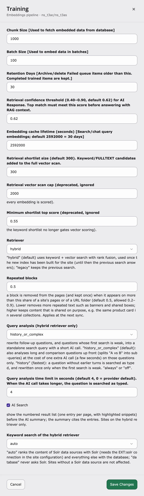

## Purpose

The **Training Center** shows every piece of content the AI has learned or still needs to learn. Use it to check progress, fix failed items and start the training by hand.

You find it in **AI Universe → AI Chatbot/Search → Training Center**.

<div className="t3-embed"><iframe src="https://app.supademo.com/embed/cmracqklk0e92qmhxeuqwubf8?utm_source=link" loading="lazy" title="T3AC Training Center Demo" allow="clipboard-write; fullscreen" frameBorder="0" webkitallowfullscreen="true" mozallowfullscreen="true" allowfullscreen></iframe></div>
View the training queue (items collected from all data sources) and control training and cleanup.

## What you see

{/* - **Summary counts**: Total items, Pending, Embedding (processing), Completed, Failed, and Tokens used. */}

- **Counts** at the top: **Total**, **Pending**, **Processing**, **Completed**, **Failed** and **Tokens** (how much AI was used).
- **All Sources** – your data sources and how many items each has.
- **Training Queue** – a list of all items with **Item**, **Status**, **Tokens**, **Created** and **Actions**.
- **Filters** – by data source, by status (**All Statuses**) or by search text.


**What the status means**

- **Pending** – waiting to be learned.
- **Processing / Embedding** – being learned right now.
- **Completed** – learned. The chatbot can use it.
- **Failed** – something went wrong. Try **Re-queue**.

## Actions

### Sync

Reads the content of the data source again (same as on the **Data Source** tab).

### Reset (Re-queue)

1. Select a **Failed** (or **Completed**) item.
2. Click **Re-queue**.
3. It goes back to **Pending** and is learned again at the next training run.

{/* ### Delete

Removes selected queue items. */}

### Delete

1. Select the items.
2. Click **Delete**.

The chatbot no longer uses this content.

<Info>
Deleted items will not be trained again unless they are added again by a new sync.
</Info>

{/* ### Run training

Use the link to the **Scheduler** module and run the **T3AC Training** task for this site.

When the task runs, it:

- Processes all **Pending** queue items (generates embeddings).
- Runs cleanup of old completed/failed items according to the retention setting. */}

### Run training

1. Click **Run Task Now**. The Scheduler opens.
2. Run the task **T3CS Training (Site N)** for your website.

The task learns all **Pending** items and removes old **Failed** items after the number of days in **Retention Days**. Learned items are kept.

{/* SUPADEMO NEEDED: Training Center: re-queue and run */}

## Training behaviour (simple terms)

- Only **Pending** items are learned.
- Learning means your text is sent to your AI service and the result is saved for the chatbot and AI Search.
- Afterwards the item is **Completed**, or **Failed** if there was an error.
- How often training runs depends on the **Sync Interval** of your data sources – and the Scheduler must be running on your server.


## Training settings {#training-settings}

How content is split, embedded and cached is set on the shared **Training** card (**AI Universe → AI Foundation → AI Features → Training**, badge **AI Chatbot/Search**). The card is shared: the same values apply to AI Chatbot and AI Search. Most websites can keep the defaults. Click **Configure** on the card to open the settings drawer, change a value and click **Save**.



The same settings are also described for [AI Search](/en/latest/ExtNsT3AS/Configuration/TrainingCenter/Index#training-settings).

### Training options explained {#retrieval-options}

**Chunk Size** – default: `1000`

How many records are read from the database at a time while the content is prepared for training. When to change: lower it if the training stops because the server runs out of memory; raise it on strong servers to train large sites faster.

**Batch Size** – default: `100`

How many items are sent to the AI provider in one request when the embeddings are created. Also used by the `--batch-size` option of the training command. When to change: lower it if your AI provider reports rate limits or time-outs; raise it to train faster when your provider allows larger requests.

**Retention Days** – default: `30`

After how many days old **Failed** queue items are archived (CSV in `var/log/t3cs`) or deleted by the cleanup step. Completed (trained) items are always kept. When to change: raise it if you want to look into failed items for longer; lower it to keep the queue table small.

**Embedding cache lifetime (seconds)** – default: `2592000` (30 days)

How long the embeddings of visitor questions in search and chat are cached. A question that was asked before is answered without a new embedding call, which is faster and saves AI credits. When to change: lower it if you often switch the embedding provider or model; shorter values mean more AI calls.

**Repeated blocks** – default: `0.5` (allowed `0.2`–`0.9`)

Removes text that repeats on many pages, such as promo banners, "shop the video" boxes, call-to-action boxes or legal notes. Such a block is kept once instead of on every page, so it does not push real content out of answers. A block counts as repeated when it appears on more than this share of the pages – across the whole site or within one URL folder (for example all `/products/` pages). Empty or invalid values use `0.5`.

- Lower (for example `0.3`) – removes more repeated text.
- Higher (for example `0.7`) – keeps content that is shared on purpose, for example the same product card in several collections.

When to change: lower it if answers keep quoting banners; raise it if shared content is missing in answers. It applies at the next sync, so run **Sync** and the training afterwards.

**Query analysis time limit** – default: `4` seconds

Follow-up questions (for example "and how much is it?") are turned into a standalone search query with a short AI call. This setting is how long that call may take. If it takes longer, the question is searched as typed, so a slow AI service cannot block the answer. `0` uses the time limit of the AI provider. When to change: raise it if your AI provider is often slow and follow-up answers miss; lower it if answers must start faster.

**AI Search (result list)** – default: on

AI Search shows a numbered result list – one entry per page, with highlighted snippets – before the AI summary. The summary refers to these entries. Switch it off to show only the AI summary. It does not affect the chatbot.

<Accordion title="All training settings and their defaults">

| Setting | Default | What it does |
|---|---|---|
| Chunk Size | 1000 | How many records are read from the database at a time. Lower it if your server runs out of memory. |
| Batch Size | 100 | How many items are sent to the AI provider in one go. |
| Retention Days | 30 | After how many days old **Failed** queue items are archived or deleted. Completed (trained) items are kept. |
| Embedding cache lifetime | 2592000 | How long (in seconds) search and chat questions are cached. 2592000 = 30 days. |
| Repeated blocks | 0.5 | A block (banner, shared box) that appears on more than this share of a site's pages or of one URL folder is removed from the pages and kept once (0.2–0.9). Applies at the next sync. |
| Query analysis time limit | 4 | Seconds (0 = provider default). If the AI call for a follow-up question takes longer, the question is searched as typed. |
| AI Search (result list) | on | AI Search shows a numbered result list (one entry per page, with highlighted snippets) before the AI summary. |
| Maximum Requests per Minute | 10 | **Rate Limiting** card. How many search or chat requests one visitor may send per minute. |
| Suspicious Pattern Threshold | 3 | **Rate Limiting** card. How many suspicious requests are allowed before a visitor is blocked. |
| Cache Lifetime (seconds) | 60 | **Rate Limiting** card. How long the rate limit counter is kept. |
| Maximum Links to Crawl | 30 | **Rate Limiting** card. How many links are read per sitemap or web page source in one run. |

</Accordion>

### Command line {#command-line}

The same commands are described for [AI Search](/en/latest/ExtNsT3AS/Configuration/TrainingCenter/Index#command-line).

<Accordion title="For developers: run training on the command line">
You can start the training yourself on the command line instead of waiting for the Scheduler, for example to test it or to train everything again. The commands come from the shared AI Chatbot/Search core and work the same for AI Chatbot and AI Search.

Run them with `vendor/bin/typo3` (Composer), `php typo3/sysext/core/bin/typo3` (non-Composer) or `ddev typo3` (DDEV).

**Training – `nst3af:training [rootPageId]`**

Syncs the data sources of a site, trains all **Pending** items (creates the embeddings) and cleans up old **Failed** items. `rootPageId` is the ID of the site root page. The aliases `t3cs:training` and `aiuniverse:training` run the same command.

| Option | What it does |
|---|---|
| `--source=ID` | Only process the data source with this ID. |
| `--detailed` | Show each page URL or file while it is processed. |
| `--dry-run` | Show what would happen; no AI calls, no database changes. |
| `--limit=N` | Process at most N items per data source (default: all). |
| `--batch-size=N` | Items sent to the AI provider in one go (default: **Batch Size** setting or 100). |
| `--queue-failed` | Put **Failed** items back to **Pending** before training. |
| `-f`, `--force` | Train everything again (Completed, Failed and Processing items go back to Pending). |
| `--skip-cleanup` | Train without the cleanup step. |
| `--cleanup-only` | Only run the cleanup, no training. |
| `--retention-days=N` | Archive/delete **Failed** items older than N days (default: **Retention Days** setting or 30). Completed items are kept. |
| `--no-archive` | Delete old items without writing a CSV archive first. |
| `--optimize-db` | Run `OPTIMIZE TABLE` after the cleanup. |

```bash
# Composer
vendor/bin/typo3 nst3af:training 1 --detailed
# Non-Composer
php typo3/sysext/core/bin/typo3 nst3af:training 1 --detailed
# DDEV: test first, then train only data source 5 again
ddev typo3 nst3af:training 1 --dry-run
ddev typo3 nst3af:training 1 --source=5 --force
```

**Run the Scheduler task – `scheduler:run --task=<taskUid> -f`**

Runs the site's **T3CS Training (Site N)** task directly, with the options saved on the task. The task UID is shown in the Scheduler module.

```bash
vendor/bin/typo3 scheduler:run --task=12 -f
```

**Compound words – `t3cs:keyword:compounds`**

Adds the parts of compound words (for example "Sonnen" and "schutz" from "Sonnenschutz") to the keyword index of already trained content, so the keyword search also finds the single words. No AI calls, no new embeddings. Run it after a training on sites with compound words, for example German.

| Option | What it does |
|---|---|
| `-s`, `--site=ID` | Only this site root page (default: every site with indexed content). |
| `--dry-run` | Count and show examples, write nothing. |
| `--show=N` | Number of examples to print (default 10). |

```bash
vendor/bin/typo3 t3cs:keyword:compounds --site=1 --dry-run
vendor/bin/typo3 t3cs:keyword:compounds --site=1
```

See all options with `vendor/bin/typo3 nst3af:training --help`.
</Accordion>

## Related

- [Data Source](/en/latest/ExtNsT3AC/FeatureGuide/DataSource/Index) – add or sync the content that is trained
- [Scheduler](/en/latest/ExtNsT3AC/FeatureGuide/DataSource/Index#scheduler) – the task **T3CS Training (Site N)**
- [Dashboard](/en/latest/ExtNsT3AC/FeatureGuide/Dashboard/Index) – training status and **Run All**

{/* Original text before the 8 Oct 2026 simplification (kept for reference):

Queue item statuses:

- **Pending** – Waiting to be processed.
- **Processing / Embedding** – Currently being sent to the embeddings service.
- **Completed** – Successfully trained.
- **Failed** – Error during training.

Refreshes content from the data source into the queue (same as in the **Data Source** tab).

Puts a **failed** or **completed** item back to **Pending** so it will be processed again on the next training run.

- Only items in status **Pending** are processed when training runs.
- **Processing** means: the text is sent to the configured embeddings service, and the result is stored for search/chatbot usage.
- After success, the item is marked **Completed**; on error, **Failed**.
- How often training runs depends on the Sync interval of your data sources and on the Scheduler actually being triggered (e.g. via cron).
*/}
