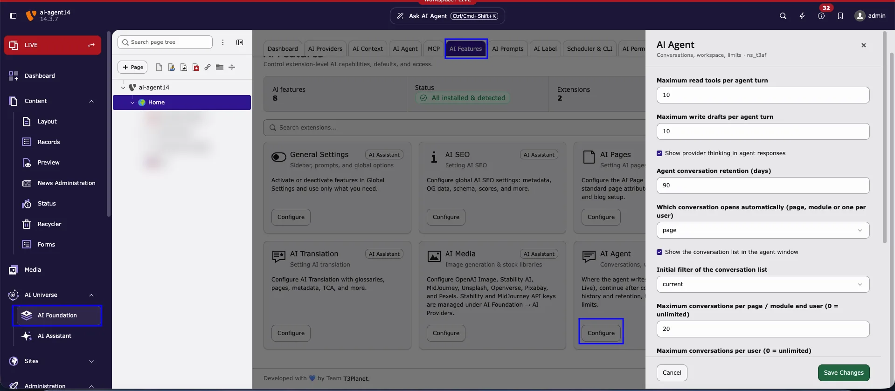

<a id="ask-ai-agent-feature-settings"></a>

**Path:** **AI Foundation > AI Features > AI Agent > Configure**

The **AI Agent** feature settings control how much work the AI agent may do in one turn, how long conversations are kept, and which conversation opens when an editor clicks **Ask AI Agent**.

<Info>
- Only **administrators** can change these settings.
- The settings apply to the **whole installation** and to every backend user who works with the AI agent.
- **Nothing is stored until you click** **Save Changes**.
</Info>

<a id="ask-ai-agent-feature-settings-open"></a>

## Open the settings



***AI Foundation > AI Features > AI Agent > Configure** in the backend. The drawer on the right shows the first settings; scroll down in the drawer to see the rest. All 14 settings are described below.*

<Steps>
  <Step title="Open AI Foundation">
    In the module menu, click **AI Universe > AI Foundation**.
  </Step>
  <Step title="Select AI Features">
    Click the **AI Features** tab in the module navigation.
  </Step>
  <Step title="Find the AI Agent card">
    Scroll to the **AI Agent** card (subtitle *Conversations, workspace, limits*). You can also type *agent* in the search field above the cards.
  </Step>
  <Step title="Click Configure">
    The **AI Agent** settings drawer opens on the right side.
  </Step>
  <Step title="Change the fields and save">
    Adjust the fields described below, then click **Save Changes**. Click **Cancel** to close the drawer without saving.
  </Step>
</Steps>

<a id="ask-ai-agent-feature-settings-overview"></a>

## All settings at a glance

The numbers follow the order of the fields in the drawer, from top to bottom.

| No. | Field | Default | Controls |
|---|---|---|---|
| 1 | **Maximum read tools per agent turn** | `10` | Work limit per turn |
| 2 | **Maximum write drafts per agent turn** | `10` | Work limit per turn |
| 3 | **Show provider thinking in agent responses** | On | Answer display |
| 4 | **Agent conversation retention (days)** | `90` | Clean-up |
| 5 | **Which conversation opens automatically (page, module or one per user)** | `page` | Conversations |
| 6 | **Show the conversation list in the agent window** | On | Conversations |
| 7 | **Initial filter of the conversation list** | `current` | Conversations |
| 8 | **Maximum conversations per page / module and user (0 = unlimited)** | `20` | Conversation limits |
| 9 | **Maximum conversations per user (0 = unlimited)** | `200` | Conversation limits |
| 10 | **Continue the task after the editor confirms or declines a card** | On | Multi-step tasks |
| 11 | **Earlier messages sent to the AI per turn, in tokens** | `6000` | History size |
| 12 | **Tool search for the AI Agent** | `Auto` | Tool search |
| 13 | **Embedding provider identifier** | *empty* | Tool search |
| 14 | **Minimum embedding similarity for tool search results** | `0.0` | Tool search |

<Tip>
The defaults work well for most installations. Change a value only when you have a concrete reason, for example to reduce AI usage or to keep conversations for a shorter time.
</Tip>

<a id="ask-ai-agent-feature-settings-limits"></a>

## Limits per turn (1–2)

A **turn** is one request of the editor and the AI agent's answer to it.

<a id="ask-ai-agent-max-read-tools"></a>

### Maximum read tools per agent turn

**Type:** integer · **Default:** `10`

How many **read tools** the AI agent may call in one turn, for example to load the page, list its content elements, or search the page tree. The minimum is `1`.

When the limit is reached, the AI agent stops and shows **Read tool budget reached (10 per turn). Send another message to continue.** Send a new message to let it continue.

<a id="ask-ai-agent-max-write-drafts"></a>

### Maximum write drafts per agent turn

**Type:** integer · **Default:** `10`

How many **change drafts** (change cards) the AI agent may prepare in one turn. Drafts are only proposals: nothing is saved until the editor clicks **Apply**. Set `0` to stop the AI agent from preparing any change.

When the limit is reached, the AI agent shows **Write draft budget reached (10 per turn). Apply or discard drafts, then continue.**

<Note>
Lower limits reduce AI usage and credits per request. Higher limits help with larger tasks, for example *"Add a header and a text element to each subpage"*.
</Note>

<a id="ask-ai-agent-feature-settings-answers"></a>

## Answers and history (3–4)

<a id="ask-ai-agent-show-thinking"></a>

### Show provider thinking in agent responses

**Type:** boolean · **Default:** on

Some AI providers return their reasoning ("thinking") together with the answer. When enabled, the AI agent shows this reasoning in its response so editors can follow how it reached the result. Disable it for shorter, cleaner answers.

<a id="ask-ai-agent-retention-days"></a>

### Agent conversation retention (days)

**Type:** integer · **Default:** `90`

Conversations without activity for this number of days are moved to the trash and removed **7 days later**. The clean-up runs with the console command `t3af:agent:conversations:cleanup`; schedule it in the **Scheduler** module (task *Execute console commands*).

```bash Run the clean-up manually
vendor/bin/typo3 t3af:agent:conversations:cleanup
```

<a id="ask-ai-agent-feature-settings-conversations"></a>

## Conversations (5–9)

These settings control the conversation list in the AI agent window. See also [Conversations](/en/latest/ExtNsT3AF/AskAiAgent/Conversations/Index).

<a id="ask-ai-agent-conversation-scope"></a>

### Which conversation opens automatically (page, module or one per user)

**Type:** string · **Default:** `page`

Decides which conversation the AI agent shows when an editor opens it:

- `page` — The latest conversation of this **page in this module**. Each page has its own conversations. Recommended, because the AI agent works on the page you are editing.
- `module` — The latest conversation of this **backend module**, for every page.
- `user` — **One conversation per user**: the latest conversation, wherever it was started.

<a id="ask-ai-agent-session-list"></a>

### Show the conversation list in the agent window

**Type:** boolean · **Default:** on

Shows the conversation list in the AI agent window, so editors can switch, rename, and delete conversations. When disabled, editors only see the conversation that opens automatically.

<a id="ask-ai-agent-session-list-filter"></a>

### Initial filter of the conversation list

**Type:** string · **Default:** `current`

The filter that is active when the conversation list opens:

- `current` — Only the conversations of **this page** (**This page**).
- `all` — The conversations of **all pages** (**All pages**).

Editors can always change the filter in the list.

<a id="ask-ai-agent-max-sessions-scope"></a>

### Maximum conversations per page / module and user (0 = unlimited)

**Type:** integer · **Default:** `20`

How many conversations one user keeps for one page or module (depending on setting 5). When a user starts a new conversation beyond this limit, the **oldest** conversations are moved to the trash. `0` means no limit.

<a id="ask-ai-agent-max-sessions-user"></a>

### Maximum conversations per user (0 = unlimited)

**Type:** integer · **Default:** `200`

How many conversations one user keeps in total, across all pages and modules. Beyond this limit, the **oldest** conversations are moved to the trash. `0` means no limit.

<Warning>
Conversations removed by a limit cannot be restored by the editor. Keep the limits high enough for your editors' daily work.
</Warning>

<a id="ask-ai-agent-feature-settings-more"></a>

## More settings (10–14)

Scroll down in the drawer to see these settings.

<a id="ask-ai-agent-continue-after-confirm"></a>

### Continue the task after the editor confirms or declines a card

**Type:** boolean · **Default:** on

After the editor clicks **Apply** or **Cancel** on a change card, the AI agent continues with the next step of the request without a new message. This makes multi-step requests work, for example *"Create the page, then add two headers"*. When disabled, the editor must send a new message for each step.

<a id="ask-ai-agent-history-token-budget"></a>

### Earlier messages sent to the AI per turn, in tokens

**Type:** integer · **Default:** `6000`

How much of the earlier conversation is sent to the AI provider with each turn (1 token is about 4 characters). Older messages are left out. A higher value gives the AI agent more memory of the conversation but uses more credits. Allowed range: `500` to `100000`.

<a id="ask-ai-agent-embedding-source"></a>

### Tool search for the AI Agent

**Type:** string · **Default:** `auto`

How the AI agent finds the right tool for a request:

- `auto` — Uses embeddings of the AI provider when available, otherwise keyword search.
- `provider` — Always uses embeddings of the AI provider.
- `none` — Keyword search only, no embedding requests.

<a id="ask-ai-agent-embedding-provider"></a>

### Embedding provider identifier

**Type:** string · **Default:** (empty)

The AI provider used for tool search embeddings. Leave empty to use the default provider from **AI Foundation > AI Providers**.

<a id="ask-ai-agent-min-similarity"></a>

### Minimum embedding similarity for tool search results

**Type:** float · **Default:** `0.0`

Tools with a lower similarity score (`0.0` to `1.0`) are not offered to the AI agent. `0.0` keeps all results. Raise it carefully: a high value can hide tools the AI agent needs.

<a id="ask-ai-agent-feature-settings-next"></a>

## Related

- [Conversations](/en/latest/ExtNsT3AF/AskAiAgent/Conversations/Index) — start, switch, rename, and delete conversations.
- [AI Agent module tabs](/en/latest/ExtNsT3AF/AskAiAgent/AiAgentModule/Index) — status, tools, and governance of the AI agent.
- [Where the AI agent opens](/en/latest/ExtNsT3AF/AskAiAgent/WhereOpens/Index) — where the AI agent opens.
