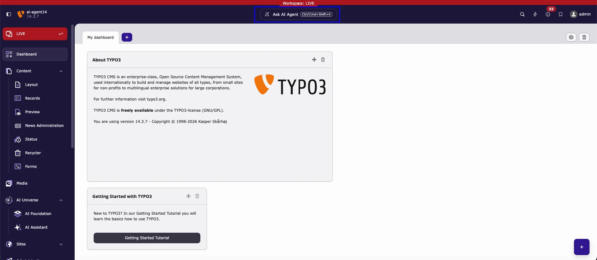

The **AI agent** is a helper inside the TYPO3 backend. It works on the **page you are editing**: you describe a task in plain language, the AI agent reads that page and its content, and it prepares the change for you. You review the change and decide whether it is saved.

You open it with the **Ask AI Agent** button in the backend top bar.

*The **Ask AI Agent** button in the center of the backend top bar (highlighted). Click it, or press <kbd>Ctrl/Cmd+Shift+K</kbd>, to open the AI agent.*

## Get started in three steps

<Steps>
  <Step title="Select the page first">
    Open **Content > Layout** (or another page module) and click the page you want to work on in the page tree. The AI agent uses this page as its context.
  </Step>
  <Step title="Click Ask AI Agent">
    Click **Ask AI Agent** in the top bar, or press <kbd>Ctrl/Cmd+Shift+K</kbd>. The AI agent window opens and shows the selected page in its context line.
  </Step>
  <Step title="Ask, review, apply">
    Type what you need, for example *"Summarize the content of this page"*, and press <kbd>Enter</kbd>. When the AI agent proposes a change, read the change card and click **Apply** to save it, or cancel it.
  </Step>
</Steps>

<Info>
- **Nothing is saved until you click** **Apply**.
- An applied change is saved in the **selected workspace**: in **Live** it is public immediately; in a draft workspace it stays in that workspace until it is published.
- The AI agent has **your** backend permissions — never more.
</Info>

<Tip>
New to the AI agent? Continue with [Where the AI agent opens](/en/latest/ExtNsT3AF/AskAiAgent/WhereOpens/Index). It shows, with screenshots, where the AI agent opens and what each part of its window does.
</Tip>

## All topics

Read the pages in this order:

| Page | What you learn |
|---|---|
| [Where the AI agent opens](/en/latest/ExtNsT3AF/AskAiAgent/WhereOpens/Index) | Where to find the AI agent in the backend, and what each part of its window does. |
| [At a glance](/en/latest/ExtNsT3AF/AskAiAgent/AtAGlance/Index) | The whole workflow and the key warnings on one screen. |
| [How it works](/en/latest/ExtNsT3AF/AskAiAgent/HowItWorks/Index) | How the page context is used, and the four steps of every request. |
| [Before you start](/en/latest/ExtNsT3AF/AskAiAgent/BeforeYouStart/Index) | Requirements: AI provider, access, permissions. |
| [Use the AI agent step by step](/en/latest/ExtNsT3AF/AskAiAgent/StepByStep/Index) | Open the AI agent on a page, ask, read the answer, apply or cancel a change. |
| [Example requests](/en/latest/ExtNsT3AF/AskAiAgent/ExampleRequests/Index) | Ready-to-use requests with AI Foundation tools. |
| [Keyboard shortcuts](/en/latest/ExtNsT3AF/AskAiAgent/KeyboardShortcuts/Index) | Keyboard shortcuts and how to change them. |
| [Conversations](/en/latest/ExtNsT3AF/AskAiAgent/Conversations/Index) | Start, switch, rename, and delete conversations. |
| [AI Agent module tabs](/en/latest/ExtNsT3AF/AskAiAgent/AiAgentModule/Index) | The five tabs of **AI Foundation > AI Agent**. |
| [AI agent settings](/en/latest/ExtNsT3AF/AskAiAgent/FeatureSettings/Index) | Administrators: limits, conversation retention, and conversation list settings in **AI Foundation > AI Features > AI Agent**. |
| [Troubleshooting](/en/latest/ExtNsT3AF/AskAiAgent/Troubleshooting/Index) | Common messages and how to solve them. |

## Related

- [MCP Server](/en/latest/ExtNsT3AF/Integrations/MCPServer/Index) — connect external AI clients such as Cursor or Claude Desktop to TYPO3.
- [AI Providers](/en/latest/ExtNsT3AF/Configuration/AIProviders/Index) — configure providers and models with tool calling.
