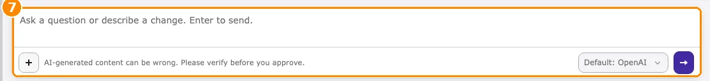
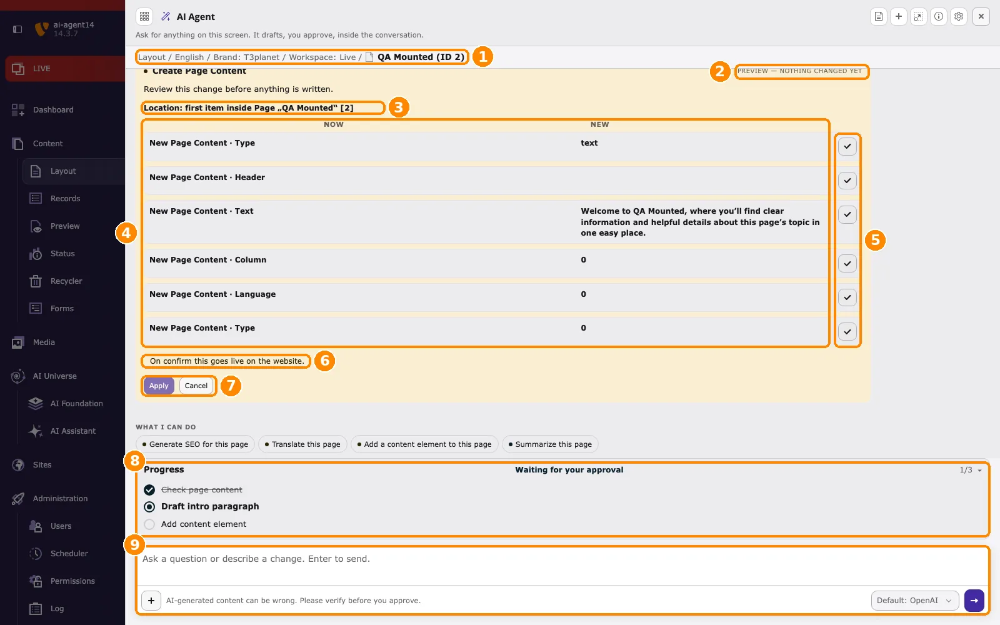

<a id="ask-ai-agent-steps"></a>

## Step 1: Open the AI agent on your page

The AI agent works on the page you are editing. Select the page first.

1. Go to **Content > Layout** and select the page you want to work on in the page tree.
2. Click **Ask AI Agent** in the top bar, or press <kbd>Ctrl/Cmd+Shift+K</kbd>. The AI agent window opens on top of the page.
3. On first use, read the AI disclosure notice and click **Got it**.
4. Check the **context line** below the title. It shows the page the AI agent works on. Requests and changes apply to this page.

<Info>
If the context line shows the wrong page, close the AI agent, select the right page in the page tree, and open the AI agent again.
</Info>

## Step 2: Ask a question

1. Click into the message field at the bottom of the window.
2. Type a short request in your own words, for example:

   ```text
   Show me the details of this page.
   ```

3. **Optional:** in a new conversation, choose the AI provider in the dropdown below the message field. **Default: …** uses the default provider. After the first answer, the provider is fixed for this conversation.
4. Press <kbd>Enter</kbd> or click the send button.



*The message field with the AI provider dropdown next to the send button.*

<Tip>
Start with a question that only reads data. It is the safest way to learn how the AI agent works.
</Tip>

## Step 3: Read the answer

1. Wait until the answer is complete. Each tool the AI agent runs is shown as a step marked **completed**.
2. For tasks with several steps, follow the **Progress** list. A step that changes data waits for your approval.
3. If the AI agent asks a follow-up question (`ask_clarification`), answer it in the message field. The AI agent asks instead of guessing.

## Step 4: Apply or cancel a change

When your request requires a change, the AI agent prepares a **change card** instead of writing data.



*A change card waiting for approval. The numbers match the steps below.*

1. Check the **context line** (1). It shows the page the change applies to.
2. Check the **preview badge** (2). **Preview — nothing changed yet** confirms that nothing has been written.
3. Check the **location** (3): where the record will be created or changed.
4. Compare each field (4): **Now** is the current value, **New** is the proposed value.
5. Use the **check button** (5) next to a field to include it or leave it out.
6. Read the **hint** (6) at the bottom of the card. It tells you where the change is saved. In the Live workspace it reads **On confirm this goes live on the website.**
7. Click **Apply** (7) to write the change, or **Cancel** to discard it. After **Cancel**, nothing is written.
8. The **Progress** list (8) shows **Waiting for your approval** and continues with the next step after your decision.
9. To change the request instead, type in the **message field** (9).

After **Apply**, the card shows **Changes applied** (see number 5 in the screenshot under [How it works](/en/latest/ExtNsT3AF/AskAiAgent/HowItWorks/Index)). To revert the change, click **Undo**.

<Warning>
An applied change is saved in the **selected workspace**. In **Live** it is public immediately. In a draft workspace it stays in that workspace until it is published. To review changes before they go live, switch to a draft workspace first.
</Warning>

<Warning>
**Deleting needs two clicks.** The card is shown in red and states that the action cannot be undone. The first click (**Confirm (1 of 2)**) only arms the action; the second click (**Apply (2 of 2)**) runs it. **Undo** restores changed values, but it **cannot** restore deleted items.
</Warning>
