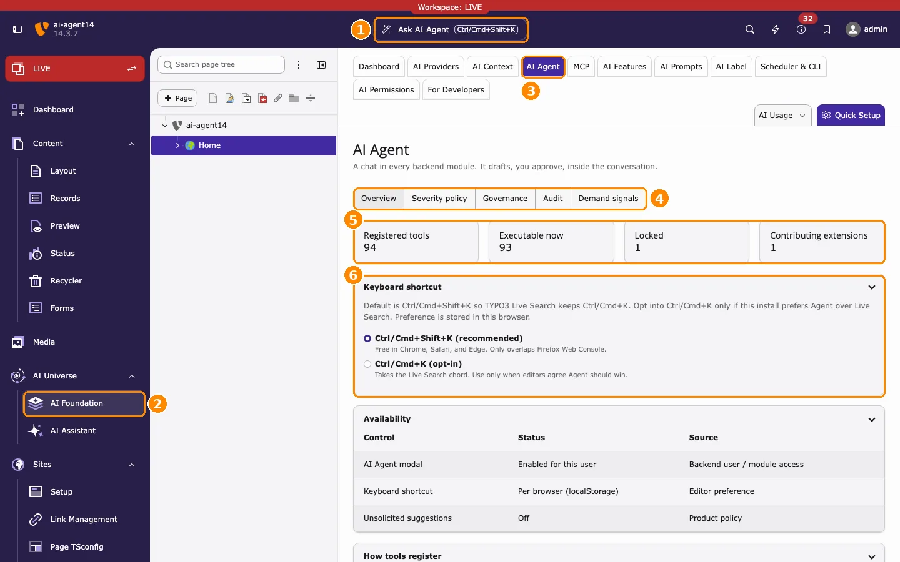
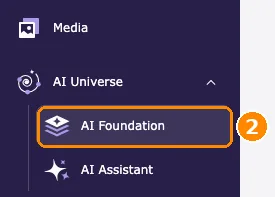
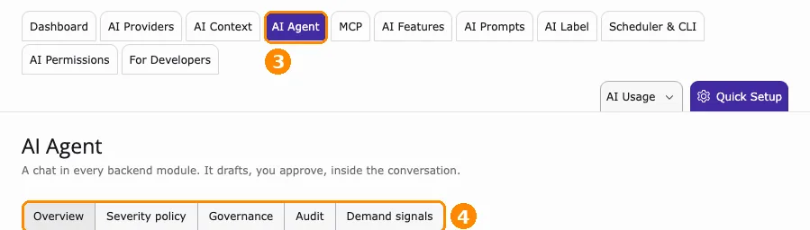
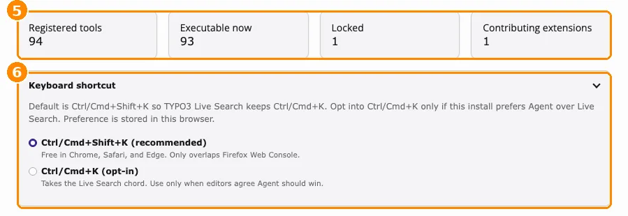
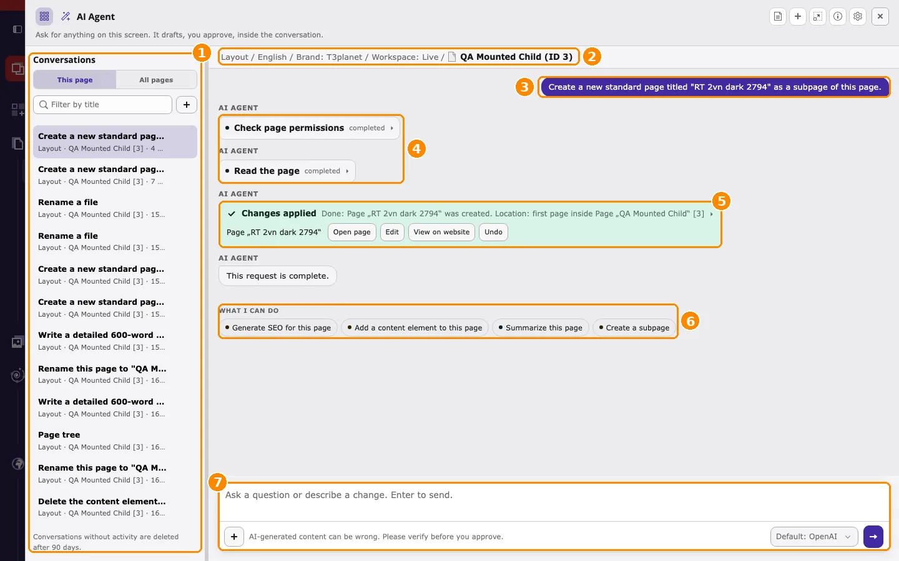
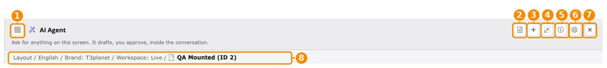
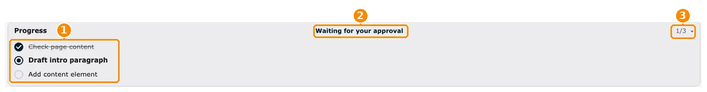
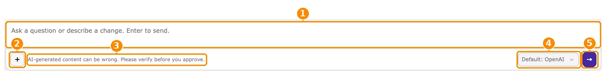

The AI agent opens on the page you are editing. This page shows where to find it in the TYPO3 backend, what each part of the window does, and where you manage it.

## Where to find it in the backend

Select a tab to see each place in the TYPO3 backend. The numbers match the orange markers in the screenshots.

<Tabs>
  <Tab title="1. Full backend view">
    

    ***AI Foundation > AI Agent > Overview** with all entry points marked (1–6).*

    1. **Ask AI Agent** in the top bar.
    2. **AI Universe > AI Foundation** in the module menu.
    3. The **AI Agent** module tab.
    4. Its five tabs.
    5. Tool counters.
    6. **Keyboard shortcut**.
  </Tab>
  <Tab title="2. Ask AI Agent">
    

    *Marker 1: **Ask AI Agent** in the backend top bar.*

    - Opens the AI agent for the page you are editing.
    - The button shows the active keyboard shortcut, by default <kbd>Ctrl/Cmd+Shift+K</kbd>.
    - The red bar above it shows the current workspace. An applied change is saved in the **selected workspace**: in **Workspace: LIVE** it is public immediately; in a draft workspace it stays in that workspace until it is published.
  </Tab>
  <Tab title="3. AI Foundation module">
    

    *Marker 2: **AI Universe > AI Foundation** in the module menu.*

    Open this module to manage AI Foundation: providers, permissions, and the AI agent.
  </Tab>
  <Tab title="4. AI Agent module tab">
    

    *Marker 3: the **AI Agent** module tab. Marker 4: its five tabs.*

    - **Overview** — status, tools, and keyboard shortcut.
    - **Severity policy**, **Governance**, **Audit**, **Demand signals** — see [AI Agent module tabs](/en/latest/ExtNsT3AF/AskAiAgent/AiAgentModule/Index).
  </Tab>
  <Tab title="5. Status and shortcut">
    

    *Marker 5: tool counters. Marker 6: **Keyboard shortcut**.*

    - **Tool counters** show how many tools are registered, how many you can run now, and how many are locked.
    - **Keyboard shortcut** sets how the AI agent opens in this browser. <kbd>Ctrl/Cmd+Shift+K</kbd> is recommended because it keeps <kbd>Ctrl/Cmd+K</kbd> for TYPO3 Live Search.
  </Tab>
</Tabs>

## Overview

This page shows **where you open the AI agent** in the TYPO3 backend, **what each part of the AI agent window does**, and **where you manage it**. After reading it, you know:

- how to open the AI agent on the page you are editing,
- what the icons, the context line, the progress list, and the message field of the window do,
- where to choose the AI provider for a conversation,
- where its settings and status are: **AI Foundation > AI Agent**.

The AI agent is an assistant for **the page you are working on**. You open it while you edit a page; it opens as a window on top of the page, so you never leave your work. The page, its site, language, and workspace are shown in the **context line** of the window. The AI agent uses this page as its context, and every change it prepares applies to this page.

<Note>
The AI agent is not a general chat for every backend module. Select the page first, then open the AI agent.
</Note>

<Info>
- **Select the page first:** open the page in the page tree, for example in **Content > Layout**.
- **Open the AI agent:** click **Ask AI Agent** in the backend top bar, or press <kbd>Ctrl+Shift+K</kbd> (Windows, Linux) / <kbd>Cmd+Shift+K</kbd> (macOS).
- **Check the context line:** it must show the page you want to change.
- **Choose the AI provider:** use the provider dropdown below the message field, for example **Default: mistral**, **before you send the first message**.
- **Nothing is saved until you click** **Apply**.
- **Settings and status:** **AI Foundation > AI Agent**.
</Info>

## Open the AI agent in three steps

1. Open the page you want to work on: go to **Content > Layout** and select the page in the page tree.
2. Click **Ask AI Agent** in the top bar, or press <kbd>Ctrl/Cmd+Shift+K</kbd>.
3. The AI agent window opens on top of the page. Check that the context line shows the right page, then type your request in the message field at the bottom and press <kbd>Enter</kbd>.

To see the settings and status of the AI agent, open **AI Universe > AI Foundation** in the module menu and select the **AI Agent** module tab.

## The AI agent window, part by part

The screenshots in this section are taken from a TYPO3 v14 backend with AI Foundation installed. The **orange numbers** in each screenshot match the numbered list below it.

### The whole window

*The AI agent window on the page "QA Mounted Child", after a request was applied.*

1. **Conversations** — your earlier conversations. **This page** lists the conversations about the current page, **All pages** lists all of them. Use **Filter by title** to find one, and **+** to start a new one.
2. **Context line** — the page the AI agent works on (see [Context line](#ask-ai-agent-where-context)).
3. **Your request** — the message you sent, shown on the right.
4. **Steps** — what the AI agent did to answer, for example **Read the page**. Click a step to see its details.
5. **Result card** — the outcome. After a change is applied, it shows **Changes applied** with the buttons **Open page**, **Edit**, **View on website**, and **Undo**.
6. **What I can do** — suggested next requests for this page, for example **Summarize this page** or **Create a subpage**. Click a suggestion to send it.
7. **Message field** — type your next request (see [Message field, AI provider, and send](#ask-ai-agent-where-composer)).

### Header icons

*The header of the AI agent window and the context line below it.*

1. **Show conversations** — shows or hides the list of conversations on the left.
2. **Summarize conversation** — writes a short summary of a long conversation, so you can continue with less history. The icon appears after a few messages.
3. **New conversation** — starts an empty conversation. Use it for a new task, or to change the AI provider.
4. **Full screen** — enlarges the window to the full backend area. Click again to return.
5. **How the AI Agent works** — opens a short help panel with the rules of the AI agent and the AI provider in use.
6. **Settings** — opens **AI Foundation > AI Agent**. Only shown to users who may open these settings.
7. **Close** — closes the window. The conversation is kept; open the AI agent again to continue.
8. **Context line** — see below.

Below the title, the line *Ask for anything on this screen. It drafts, you approve, inside the conversation.* summarizes the principle: the AI agent prepares a change, and you decide whether it is applied.

### Context line

The context line (marker 8 above) shows **what the AI agent works on**, from left to right:

- the backend module, for example **Layout**,
- the language, for example **English**,
- the brand profile from **AI Foundation > AI Context**, for example **Brand: T3planet**,
- the workspace, for example **Workspace: Live**,
- the page and its ID, for example **QA Mounted (ID 2)**.

<Warning>
Always check the context line before you send a request. The AI agent works on this page and site unless you name something else. An applied change is saved in the **selected workspace**: in **Workspace: Live** it is public immediately; in a draft workspace it stays in that workspace until it is published.
</Warning>

### Progress

*The **Progress** list above the message field.*

For a request with several steps, the AI agent shows its plan in **Progress**, directly above the message field.

1. **Steps** — the planned steps. A crossed-out step is done, the bold step is the current one, the grey steps are next.
2. **Status** — what the AI agent is doing now. **Waiting for your approval** means a change is ready; review it in the conversation and click **Apply** or **Cancel**.
3. **Step counter** — the current step and the total, for example **1/3**. Click the arrow to collapse or expand the list.

### Message field, AI provider, and send

*The message field at the bottom of the AI agent window. In this screenshot the AI provider dropdown shows **Default: OpenAI**.*

1. **Message field** — type your request, for example *Add a text element with a short introduction to this page*. Press <kbd>Enter</kbd> to send, <kbd>Shift+Enter</kbd> for a new line.
2. **Attach (+)** — **Add files or photos** attaches an image or document to your request. **Actions** lists the actions you can ask for.
3. **Hint** — *AI-generated content can be wrong. Please verify before you approve.* Always review a change before you click **Apply**.
4. **AI provider dropdown** — below the message field, next to the send button. It selects the AI provider that answers in this conversation. **Default: …** uses the default provider of the site, for example **Default: mistral** or **Default: OpenAI**. See [Change the AI provider](#ask-ai-agent-where-provider).
5. **Send** — sends the request. While the AI agent works, a **Stop** button is shown instead.

## Change the AI provider

The AI provider answers your request. You select it in the **dropdown below the message field** of the AI agent window, next to the send button.

1. Open the AI agent on your page and click **New conversation** (**+** in the header).
2. Open the dropdown next to the send button. It shows the default provider, for example **Default: mistral**.
3. Select the provider you want to use.
4. Type your request and send it.

<Note>
- **The provider is fixed per conversation.** After the first answer, the dropdown is locked. To use another provider, start a new conversation.
- The dropdown is shown only when more than one provider is available. Add providers in **AI Foundation > AI Providers**.
- Use a provider that supports **tool calling**. See [Before you start](/en/latest/ExtNsT3AF/AskAiAgent/BeforeYouStart/Index).
</Note>

## Where to find what

| What | Where |
|---|---|
| **Open the AI agent** | Select the page you are editing, then backend top bar > **Ask AI Agent**, or press <kbd>Ctrl+Shift+K</kbd> (Windows, Linux) / <kbd>Cmd+Shift+K</kbd> (macOS). |
| **Check which page is used** | AI agent window > context line below the title. |
| **Choose the AI provider** | AI agent window > dropdown below the message field, before the first message of a conversation. |
| **Start over / switch provider** | AI agent window > header > **+** (New conversation). |
| **Status and tools** | **AI Foundation > AI Agent > Overview** |
| **Settings (limits, conversations)** | **AI Foundation > AI Features** > **AI Agent** card > **Configure**. See [AI agent settings](/en/latest/ExtNsT3AF/AskAiAgent/FeatureSettings/Index). |
| **Who may use it** | Backend user group > **Access Lists > Custom module options > AI Foundation capabilities** > **AI Agent access** |
| **Restrict tools per group** | **AI Foundation > AI Permissions** > **Limits** > **AI Agent tools** |

<Note>
If **Ask AI Agent** is not shown in your top bar, your backend user group does not have **AI Agent access**. Ask your administrator.
</Note>

## Next steps

- [How it works](/en/latest/ExtNsT3AF/AskAiAgent/HowItWorks/Index) — the four steps of every request.
- [Before you start](/en/latest/ExtNsT3AF/AskAiAgent/BeforeYouStart/Index) — requirements before the first use.
- [Use the AI agent step by step](/en/latest/ExtNsT3AF/AskAiAgent/StepByStep/Index) — open the AI agent on a page, ask, and apply a change step by step.
- [Keyboard shortcuts](/en/latest/ExtNsT3AF/AskAiAgent/KeyboardShortcuts/Index) — change the keyboard shortcut.
- [AI Agent module tabs](/en/latest/ExtNsT3AF/AskAiAgent/AiAgentModule/Index) — the five tabs of the AI Agent module.
- [AI agent settings](/en/latest/ExtNsT3AF/AskAiAgent/FeatureSettings/Index) — limits, retention, and conversation settings (administrators).
