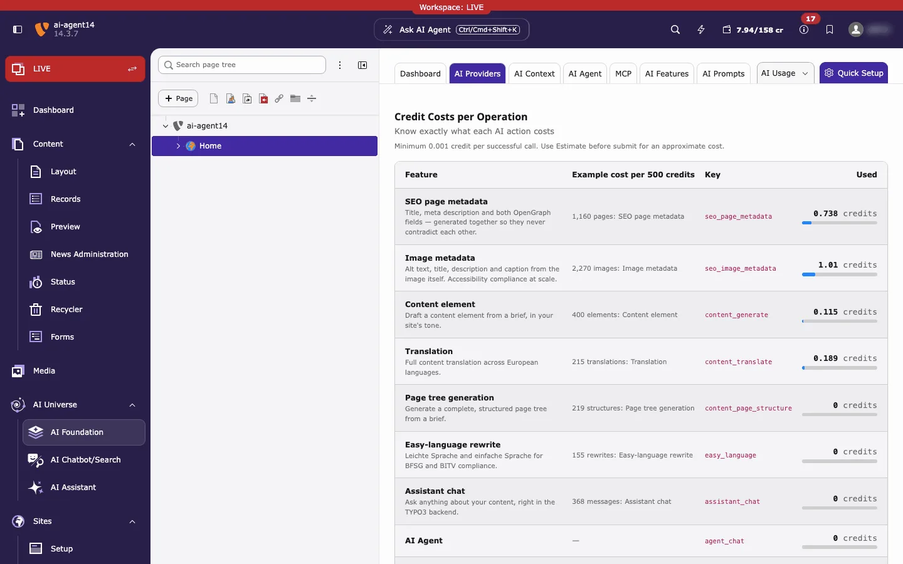
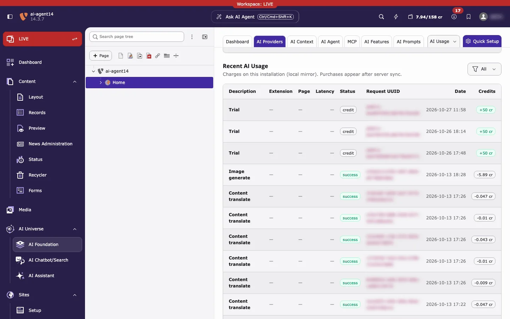

Monitor credit balance on the Dashboard and verify Credits traffic in AI Usage.

## Dashboard

**Path:** AI Foundation > Dashboard

Use the switch at the top of the Dashboard to view **Own API Keys** or **T3Planet Credits**. The credits view shows a **T3PLANET CREDITS MODE** banner with the period filter. The **Credit Balance** card has the buttons **Top up** and **Manage**. Both open **AI Foundation → AI Providers**, where you buy credits and see the details.

Credits Dashboard — remaining balance, credit burn over time, spend by
extension, and period KPIs.

### What it shows

- **Credit balance** — remaining credits from T3Planet
- **Usage charts** — credit use and requests for the selected period
- **KPI cards** — requests, tokens, credits used, success rate
- **Recent requests** — the latest AI requests from the local request log
for the current period filter (not a fixed “last hour” window). See
[AI Usage](#ai-usage) below for the full
filterable history.

<Tip>
Remaining balance comes from T3Planet. Local charts and recent requests come
from the request log. They are related, but not always identical.
</Tip>

### Period filter

Use Today, Yesterday, 7 / 14 / 30 days, or a custom range. Charts, KPIs, and
the recent-requests list follow this filter.

### Credits panel on AI Providers

**Path:** AI Foundation > AI Providers (Credits active)

This page has the most detail about your credits:

- **Credit Balance** — credits left and **Buy more credits**
- **Credits used**, **Daily average**, **Est. remaining days** — a forecast from recent use
- **AI Credit Bundles** — plans and top-ups. See [Buy credits](/en/latest/ExtNsT3AF/T3Planet-Credit-System/BuyCredits/Index)
- **Credit Costs per Operation** — what each AI action costs
- **Recent AI Usage** — charges on this site. Filter by **Entry type** (**All**, **Debit**, **Credit**). Purchases appear after the next sync with T3Planet.

*Credit Costs per Operation: each AI feature with an example of how many actions 500 credits cover, and the credits used so far.*

*Recent AI Usage. Request IDs are blurred in this screenshot.*

**What you should see in Recent AI Usage:** one row per entry with **Description**, **Extension**, **Page**, **Latency**, **Status**, **Request UUID**, **Date** and **Credits**. Credits you receive (for example the free trial) show as **credit** with a green *+50 cr*. AI calls show as **success** with a negative amount such as *-0.047 cr*.

The top bar of the TYPO3 backend also shows a credit counter (used / total, for example *7.94/158 cr*).

<Note>
**Recent AI Usage** is a copy kept on this installation. If you connect a different credits account with a claim code, the copy is cleared and refills from the new account.
</Note>

## AI Usage

**Path:** AI Foundation > AI Usage

Use AI Usage to confirm that AI calls ran through AI Credits and to
inspect individual requests.

### What to look for

For Credits traffic, the **provider** value is:

`t3planet_credits`

### Column glossary

- **Module / extension** — which product triggered the call (for example
T3 AI, AI Search, AI Chatbot)
- **Model** — model used for that request
- **Tokens** — input and output token count
- **Credits** — credits charged for a successful Credits request
- **Status** — success or error for that call
- **Provider** — `t3planet_credits` when Credits handled the request;
otherwise your own API provider id

### Filter and search

In AI Usage, narrow the log by:

- **Date range** — same period idea as the Dashboard (today, last N days,
or custom)
- **Provider** — filter to `t3planet_credits` to see only Credits traffic
- **Status** — success vs failed/error rows
- **Module / extension** — when you need traffic from one product only

Use these filters when the recent list on the Dashboard is not enough.

### How to verify Credits

1. Activate Credits.
2. Run one AI action that uses AI Foundation — for example, generate a meta
description in **T3 AI**.
3. Open AI Usage.
4. Filter by provider `t3planet_credits` (or scan the latest rows).
5. Confirm a new row for that action.

From Dashboard, open a recent request or go to AI Usage when you
need filters, older history, or failed-request details.
