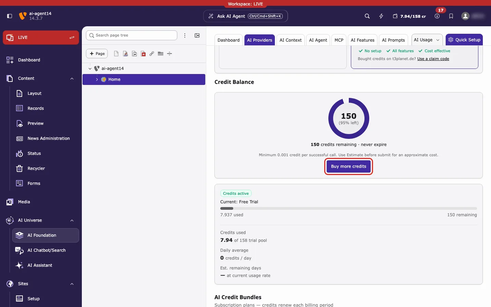
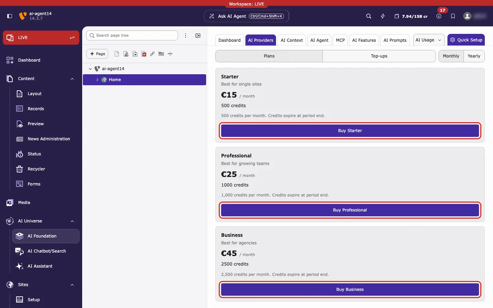
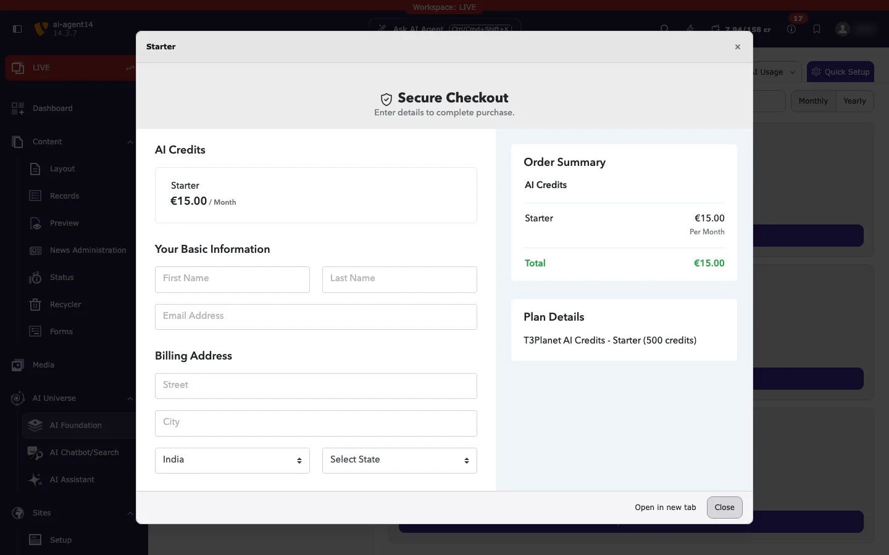
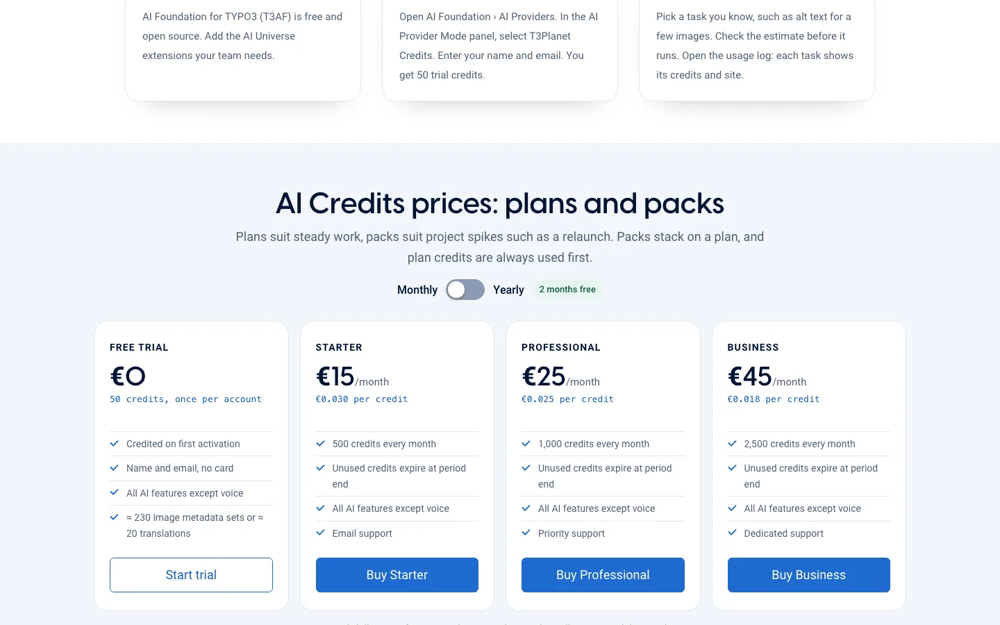

**AI Credits** are the balance that pays for AI tasks in TYPO3. Examples are translations, image descriptions and page metadata. One balance works for all AI features.

<Info>
**You can buy credits right in the TYPO3 backend.** Go to **AI Foundation → AI Providers → AI Credit Bundles** and click **Buy**.

You can also buy on [t3planet.de/ki-credits](https://t3planet.de/ki-credits).

**After every purchase, in the backend or on the website, T3Planet emails you a claim code.** Then open **AI Foundation → AI Providers**, click **Use a claim code** on the **T3Planet Credits** card and paste the code. See [Use a claim code](/en/latest/ExtNsT3AF/T3Planet-Credit-System/ClaimCode/Index).
</Info>

## Buy from the TYPO3 backend

First check that **T3Planet Credits** is **active** on the **AI Providers** page. It shows a green **Active** badge. If it does not, see [Configuration](/en/latest/ExtNsT3AF/T3Planet-Credit-System/Configuration/Index).

<Steps>
  <Step title="Click Buy more credits">
    Open **AI Foundation → AI Providers**. Find the **Credit Balance** box and click **Buy more credits**. The page scrolls down to the bundles.

    
  </Step>
  <Step title="Choose a bundle">
    In **AI Credit Bundles**, choose a tab. **Plans** renew every month or year. **Top-ups** are one-time packs. Click **Buy** on the bundle you want.

    
  </Step>
  <Step title="Pay in the checkout window">
    A **Secure Checkout** window opens inside the backend. Enter your name, email and billing address, then pay. Click **Close** to leave without buying.

    
  </Step>
  <Step title="Use your claim code">
    After the payment, check your email. T3Planet sends you a **claim code**. Click **Use a claim code** on the **T3Planet Credits** card, paste the code and click **Connect this site**. Your credits then show in **Credit Balance**. If the backend already shows *Credits purchase applied*, your balance also updates by itself. Keep the email as a backup. Full steps: [Use a claim code](/en/latest/ExtNsT3AF/T3Planet-Credit-System/ClaimCode/Index).
  </Step>
</Steps>

## Plans and prices

| Bundle | Credits | Price |
| --- | --- | --- |
| Starter (plan) | 500 per month | €15 per month |
| Professional (plan) | 1,000 per month | €25 per month |
| Business (plan) | 2,500 per month | €45 per month |
| Top-up pack | 1,000 / 5,000 / 10,000 | €29 / €119 / €199 |

Yearly plans cost €150, €250 and €450. Plan credits expire at the end of each period. Top-up credits expire on 31 December of the third year after you buy them.

<Note>
These are the prices shown in the backend on 27 October 2026. They may change on the website. The backend and [t3planet.de/ki-credits](https://t3planet.de/ki-credits) always show the current prices.
</Note>

## Buy on the website

1. Open [t3planet.de/ki-credits](https://t3planet.de/ki-credits). Choose a plan or a pack and buy it. Every new account also gets 50 free trial credits once.
2. Find the **claim code** in the email from T3Planet.
3. In TYPO3, click **Use a claim code** and paste it. Steps are on [Use a claim code](/en/latest/ExtNsT3AF/T3Planet-Credit-System/ClaimCode/Index).

*The price cards on [t3planet.de/ki-credits](https://t3planet.de/ki-credits) (English page: [t3planet.de/en/ai-credits](https://t3planet.de/en/ai-credits)). Free Trial, Starter, Professional and Business, with the Monthly / Yearly switch.*

<Accordion title="Messages after checkout">
The backend shows a short message at the top of the page:

- *Credits purchase applied. Your balance will update shortly.* The payment worked.
- *Payment pending — credits will be added once your bank transfer clears.* Credits arrive when T3Planet receives the money.
- *Credits purchase could not be completed. Please try again or contact support.* Nothing was bought. Try again or contact [Support](/en/latest/ExtNsT3AF/Support/Index).
</Accordion>

## When credits run out

AI tasks stop when the balance is zero. Backend users see *Your T3Planet AI credits have been exhausted. Please purchase additional credits to continue using AI features.* Website visitors only see that AI features are temporarily unavailable. Buy more credits, or switch back to **Your Own API Keys**. Your saved providers are still there.

## Refunds

T3Planet's refund rules are on [t3planet.de/ki-credits](https://t3planet.de/ki-credits). In October 2026 the page offered a full refund within 30 days if none of the credits were used.
