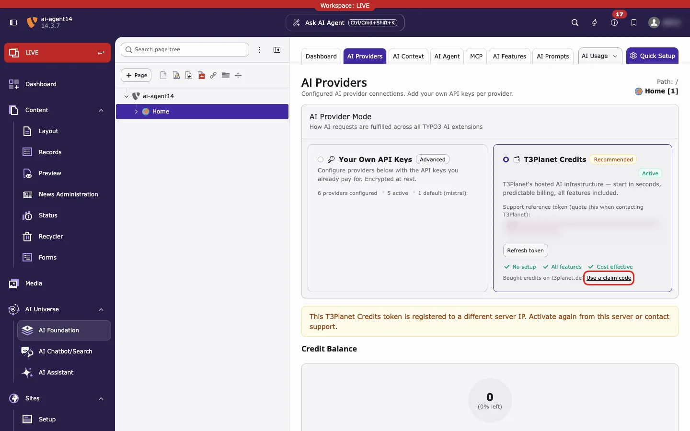
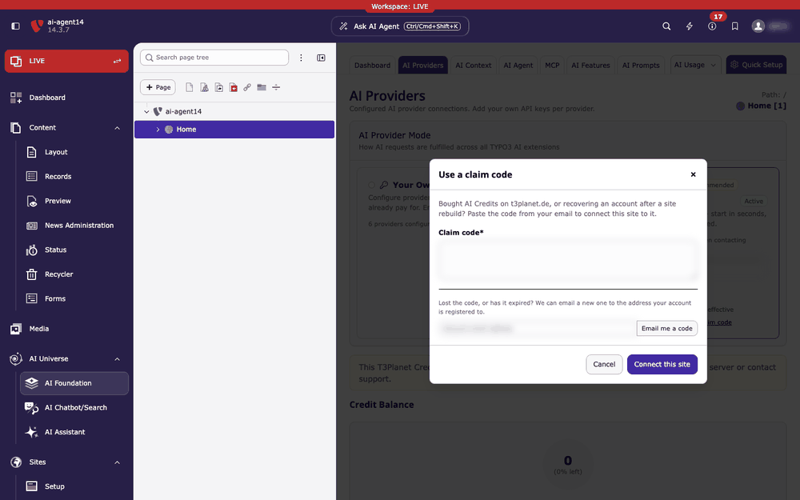

The claim link is on **AI Foundation → AI Providers**: on the **T3Planet Credits** card, click **Use a claim code** (red box).

*AI Foundation → AI Providers, T3Planet Credits card, link Use a claim code (red box). Here the yellow notice says that this site's token is not accepted, which is one reason to use a claim code.*

A **claim code** connects a TYPO3 site to a T3Planet credits account that already exists. T3Planet emails the code. You paste it once, and the site then uses your balance.

## When you need one

- You **bought credits**, in the TYPO3 backend or on t3planet.de, and want the site to use them.
- You are **recovering an account** after a site rebuild, a server move or a changed server IP.
- TYPO3 reports that **this server IP already belongs to a paying account** and asks for a claim code.

You do not need a claim code for the free trial. Use **Activate** instead. See [Configuration](/en/latest/ExtNsT3AF/T3Planet-Credit-System/Configuration/Index).

## Where the code comes from

- After **every purchase**, T3Planet emails the code to the address you used. This is the same if you bought in the TYPO3 backend (**AI Credit Bundles**) or on [t3planet.de/ki-credits](https://t3planet.de/ki-credits).
- Lost or expired? Request a new one in TYPO3 (see [Lost the code or it expired](#lost-the-code-or-it-expired)).

<Warning>
Treat the code like a password. Anyone holding it can connect a site to your credits. Do not post it in tickets, chats or screenshots.
</Warning>

## Enter the code

<Steps>
  <Step title="Open the dialog">
    Open **AI Foundation → AI Providers**. On the **T3Planet Credits** card, click **Use a claim code** (see the red box above).
  </Step>
  <Step title="Paste the code">
    Paste it into **Claim code**. Spaces and line breaks are removed for you.
  </Step>
  <Step title="Connect">
    Click **Connect this site**.
  </Step>
  <Step title="Wait for the reload">
    A green message appears in the bottom right corner. Then the page reloads.
  </Step>
</Steps>

*Steps 1 to 4 on a test site. The code and email are blurred.*

## What happens next

- TYPO3 sends the code to T3Planet. The code is not stored in TYPO3.
- TYPO3 saves the access token it gets back in encrypted form and switches Credits on. You do not need to click **Activate**.
- After the reload, the **T3Planet Credits** card shows the green **Active** badge. **Credit Balance** shows your credits. See [Dashboard & AI Usage](/en/latest/ExtNsT3AF/T3Planet-Credit-System/AIUsage/Index).

The green message depends on your site:

- *Your purchase was added to this site's existing credits account. Loading your dashboard…* The site already had a credits account, for example from the free trial. Your purchase is added to it. The balance can still say **Current: Free Trial**.
- *Credits account connected. Loading your dashboard…* The site had no credits account yet.

The **Use a claim code** link stays on the card after Credits is active. If the code belongs to a different account than before, the **Recent AI Usage** list is cleared. It then shows only the connected account.

## Lost the code or it expired

In the same dialog, use **Email me a code**.

1. Enter the email address of your T3Planet credits account.
2. Click **Email me a code**.
3. Paste the new code from the email.

T3Planet always answers *If that address has an AI Credits account, a claim code is on its way to it.* It never says whether the address is registered. The code goes only to the address stored on the account.

Code not accepted or something else does not work? See [Troubleshooting: Claim code not accepted](/en/latest/ExtNsT3AF/T3Planet-Credit-System/Troubleshooting/Index#claim-code-not-accepted).
