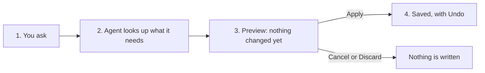
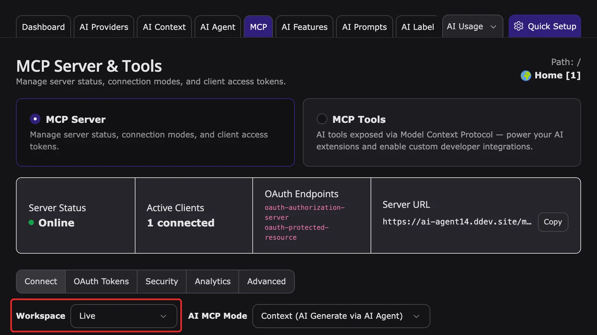

## The page is the context

The AI agent works on what you have open. The context line at the top of the window shows the module, language, workspace, and page. *This page* and *here* in your request mean that page, unless you name another one, for example *"Translate page Contact into German"* or `@pages:12`.

## The four steps of every request

1. **You ask** in your own words, in any language. Click a suggestion or pick an action with `/`.
2. **The agent looks up what it needs**, for example the site languages, the glossary, or the page content. These read steps run automatically and appear as steps marked **completed**.
3. **For a change, it shows a preview** marked **Preview — nothing changed yet**. The preview lists exactly what will be written: the page, the languages, the glossary term, or each SEO field with its current and new value.
4. **You decide.** Click **Apply** to write the change, or **Cancel** to discard it. After **Apply**, the result card links to **Open page**, **Edit**, **View on website**, and **Undo**.

The agent never skips step 3 for a change. If it is unsure, it asks a follow-up question instead of guessing.

## Three kinds of actions

Every T3AI tool declares what it does. The `/` picker and the suggestions show this label.

| Label | What happens | T3AI examples |
|---|---|---|
| **Only reads** | Runs immediately. You see a step and an answer. | Show the translation glossary, Show the SEO queue, Show the translation queue |
| **Asks before changing** | Shows a preview. Writes only after **Apply**. | Write all SEO texts, Translate the whole page, Create a page, Save a glossary term, Add pages to the SEO queue |
| **Asks before deleting** | Red preview. Needs two clicks: **Confirm (1 of 2)**, then **Apply (2 of 2)**. Cannot be undone. | Remove a glossary term |

## Live or draft workspace

- In **Live**, an applied change is public immediately. The preview says *On confirm this goes live on the website.*
- In a draft workspace, the change stays in that workspace until it is published. The preview names the workspace.

The context line of the agent window shows the workspace that is used, for example **Workspace: Live**. It is decided in this order:

1. **Your backend workspace**: if you switched to a draft workspace in the TYPO3 backend, the agent saves there.
2. **AI Foundation > MCP > MCP Server**, tab **Connect**, field **Workspace**: if you work in Live, the agent saves to the workspace selected here. Select a draft workspace to keep agent changes as drafts while you stay in Live, or **Live** to publish directly. The selection is stored per backend user and also applies to new MCP tokens and CLI commands.

If no draft workspace exists yet, the MCP Server tab offers **Generate MCP workspace**. Creating it needs access to the Workspaces module. Workspaces require the TYPO3 system extension `workspaces`.

To make drafts mandatory for an editor group, enable **Workspace enforcement** in **AI Foundation > AI Permissions**, step **Governance & limits** of the group. Members of that group then cannot apply agent changes in Live; the agent shows *Your group policy requires workspace-only edits. Switch to a draft workspace before applying changes.* See [AI Permissions](/en/latest/ExtNsT3AF/Configuration/AIPermissions/Index#guided-wizard).

<Note>
The Mass SEO and Mass Translation queues are shared by the whole site. The agent changes them only in Live.
</Note>

## Large jobs go to the Scheduler

The agent works on one page or a few pages per request. For many pages, ask it to queue them, for example *"Queue all subpages of Products for Mass SEO"*. The [Mass SEO](/en/latest/ExtNsT3AI/MassSEO/Index) and [Mass Translation](/en/latest/ExtNsT3AI/Translation/MassTranslation/Index) Scheduler tasks then process the queue. A single turn warns at 20 tool calls and stops at 40.

## Where the AI text comes from

T3AI tools generate SEO texts, translations, pages, and images with the AI provider configured in AI Foundation. **AI Foundation > MCP > AI MCP Mode** decides where the text is generated:

- **Context**: the AI agent's own model writes the text, and the T3AI tool saves it.
- **Native**: T3AI generates the text inside TYPO3.

Each AI call uses credits. Regenerating a preview uses credits again.

## Data protection

Your messages and the content the agent reads are sent to the AI provider shown in the message field. Your backend permissions and the AI Permissions of your user group always apply. See [DPA & GDPR](/en/latest/ExtNsT3AI/DPAandGDPR/Index).

## Before you start

| Requirement | Where |
|---|---|
| TYPO3 13.4 LTS or 14.x for the AI agent. On TYPO3 v12, all other T3AI features work as usual, only without the AI agent. | Your TYPO3 installation |
| AI Foundation and T3AI installed and active | [Installation](/en/latest/ExtNsT3AI/Installation/Index) |
| An AI provider with a model that supports tool calling | [AI Providers](/en/latest/ExtNsT3AF/Configuration/AIProviders/Index) |
| AI agent access for your backend user group (administrators always have access) | [AI Permissions](/en/latest/ExtNsT3AF/Configuration/AIPermissions/Index) |
| Normal TYPO3 permissions for the pages and records you want to change | Backend user groups |
| Site languages configured (translation) | Site configuration |
| Scheduler tasks for queued work (Mass SEO, Mass Translation) | [Mass SEO](/en/latest/ExtNsT3AI/MassSEO/Index), [Mass Translation](/en/latest/ExtNsT3AI/Translation/MassTranslation/Index) |

Next: [Your first T3AI request](/en/latest/ExtNsT3AI/AskAiAgent/StepByStep/Index)
