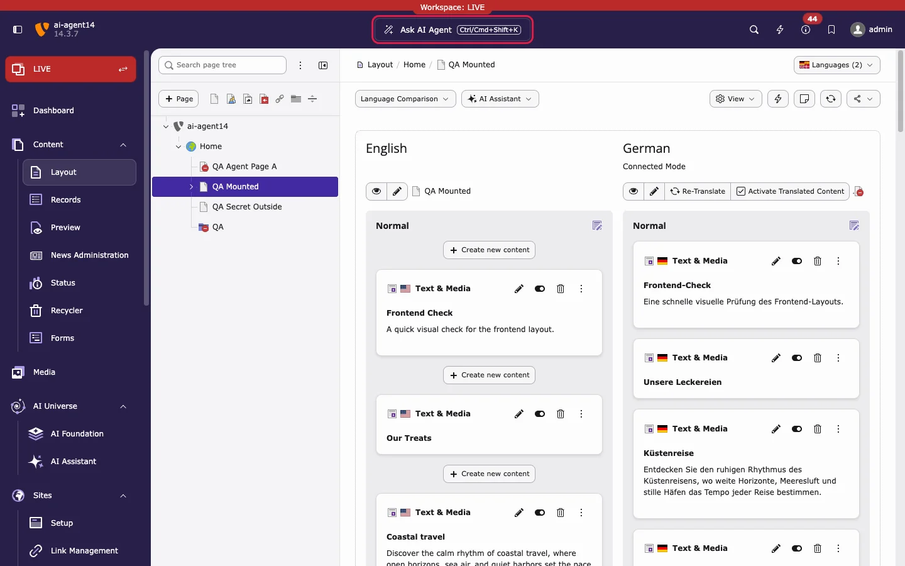

The **AI agent** is a chat window inside the TYPO3 backend. You describe a task in plain language, for example *"Generate SEO for this page"* or *"Translate this page into German"*. The AI agent reads the page you are working on, picks the right T3AI feature, and prepares the change. You review the change and decide whether it is saved.

The AI agent ships with **AI Foundation** (`ns_t3af`). When **T3AI** (`ns_t3ai`) is installed, it adds **33 T3AI tools** to the agent: SEO, translation, page, news, and blog creation, the translation glossary, the Mass SEO and Mass Translation queues, and AI images.

<Note>
The AI agent needs TYPO3 13.4 LTS or 14.x. On TYPO3 v12, all other T3AI features work as usual, only without the AI agent.
</Note>

## Get started in three steps

<Steps>
  <Step title="Select the page">
    Select the page you want to work on in the page tree, for example in **Content > Layout**. The AI agent uses this page as its context.
  </Step>
  <Step title="Click Ask AI Agent">
    Click **Ask AI Agent** in the center of the backend top bar, or press `Ctrl/Cmd+Shift+K`. The AI agent window opens on top of the page.
  </Step>
  <Step title="Ask, review, apply">
    Type your request, for example *"Generate SEO for this page"*, and press Enter. Review the preview card, then click **Apply** to save it or **Cancel** to discard it.
  </Step>
</Steps>

<Warning>
- Nothing is saved until you click **Apply**. **Cancel** or **Discard** writes nothing.
- An applied change is saved in the **selected workspace**. In **Live**, it is public immediately. To save agent changes as drafts, set **AI Foundation > MCP > MCP Server > Connect > Workspace** to a draft workspace. See [Live or draft workspace](/en/latest/ExtNsT3AI/AskAiAgent/HowItWorks/Index#live-or-draft-workspace).
- The AI agent has **your** backend permissions, never more.
</Warning>

## Read the pages in this order

| Page | What you learn |
|---|---|
| [Where the AI agent opens](/en/latest/ExtNsT3AI/AskAiAgent/WhereOpens/Index) | Where to find the AI agent, and what each part of its window does. |
| [How it works](/en/latest/ExtNsT3AI/AskAiAgent/HowItWorks/Index) | How a request runs, the three kinds of actions, and what you need before you start. |
| [Your first T3AI request](/en/latest/ExtNsT3AI/AskAiAgent/StepByStep/Index) | Step by step: generate SEO, translate a page, and handle a delete safely. |
| [T3AI tools](/en/latest/ExtNsT3AI/AskAiAgent/Tools/Index) | All 33 T3AI tools, their names in the agent, and the matching feature pages. |
| [Example requests](/en/latest/ExtNsT3AI/AskAiAgent/ExampleRequests/Index) | Ready-to-use requests for every T3AI area. |
| [Troubleshooting](/en/latest/ExtNsT3AI/AskAiAgent/Troubleshooting/Index) | Common messages and how to solve them. |

## Related

- [AI Foundation: Ask AI agent](https://docs.typo3.org/p/nitsan/ns-t3af/main/en-us/AskAiAgent/Index.html): the AI Foundation manual for the agent, its settings, and the AI Agent module tabs.
- [AI Foundation MCP Server](/en/latest/ExtNsT3AF/Integrations/MCPServer/Index): use the same T3AI tools from Cursor, Claude Desktop, or other MCP clients.
