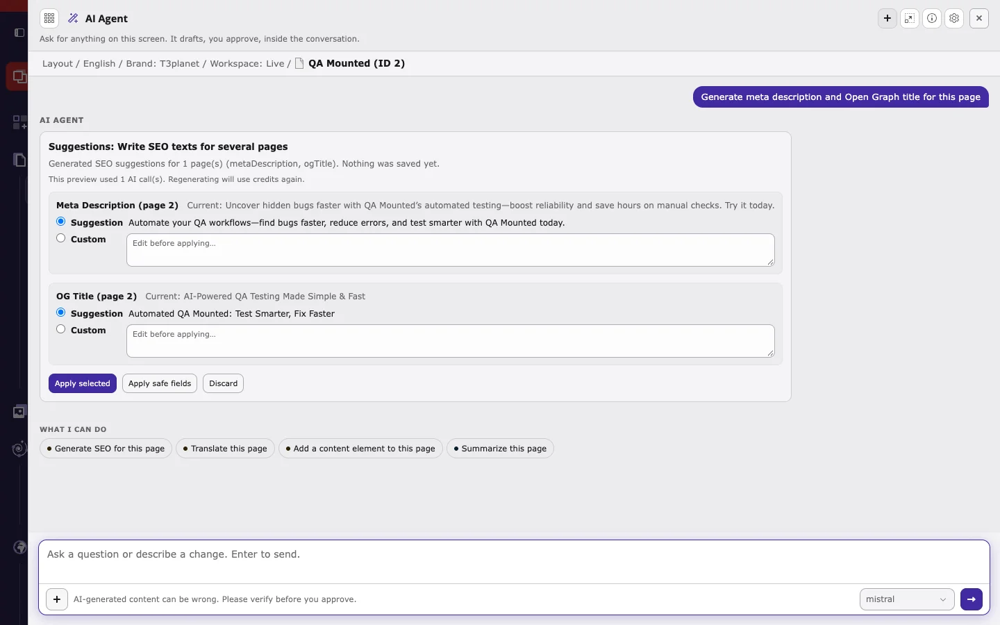
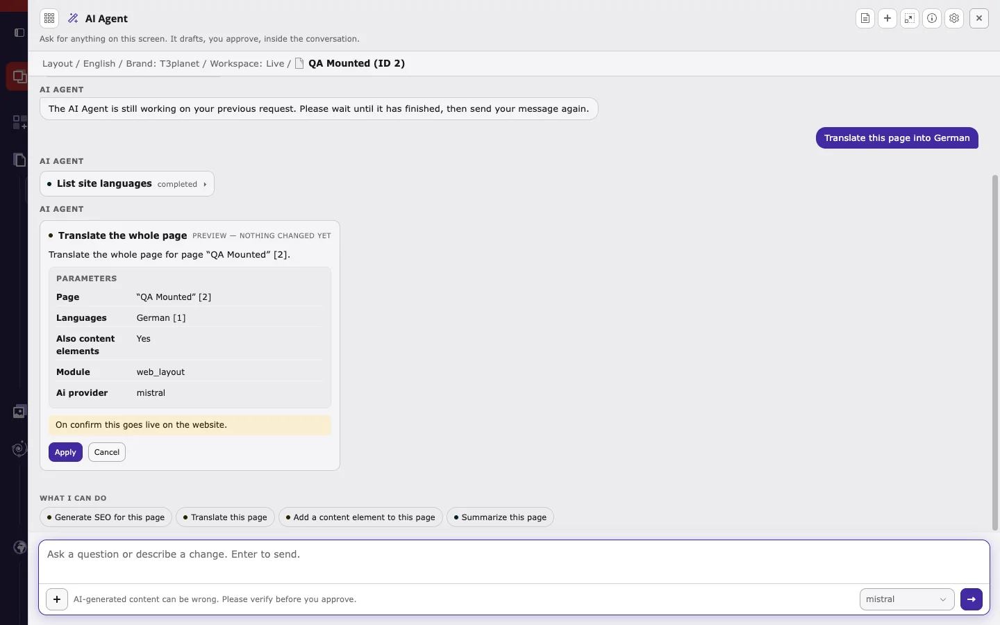
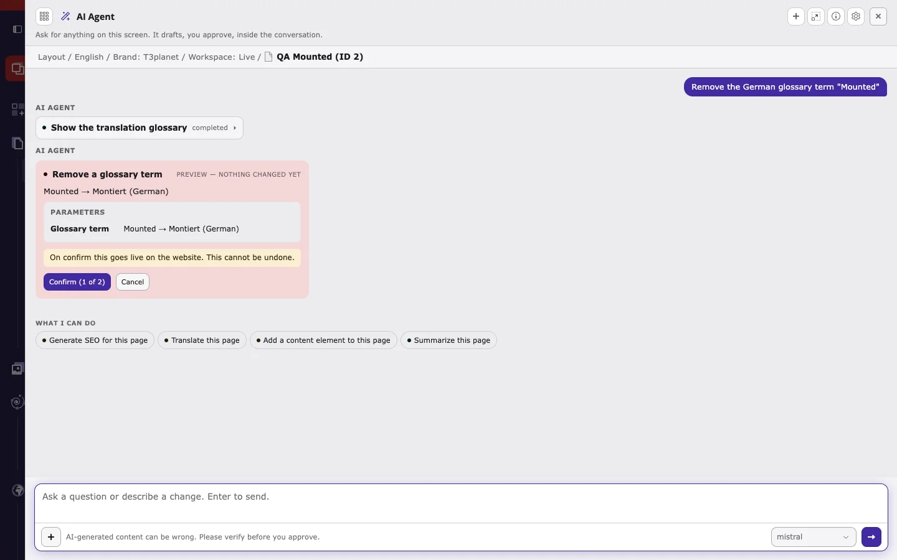

This walkthrough uses one page and four requests, from safe to more powerful. Use a test page, or a draft workspace, for your first try.

## Step 1: Open the AI agent on your page

1. Select the page in the page tree, for example in **Content > Layout**.
2. Click **Ask AI Agent** in the top bar, or press `Ctrl/Cmd+Shift+K`.
3. On first use, read the AI notice and confirm it.
4. Check the context line below the title. It must show the page you want to work on.

<Tip>
If the context line shows the wrong page, close the agent, select the right page, and open it again.
</Tip>

## Step 2: Start with a request that only reads

Type a request that does not change anything:

```text
Show the Mass Translation queue
```

The agent runs the T3AI step **Show the translation queue** (marked **completed**) and answers with the queued pages, their status, and the number of attempts. Nothing is written. This is the safest way to see how the agent works.

## Step 3: Generate SEO and apply it

```text
Generate meta description and Open Graph title for this page
```



1. The card is marked **Preview — nothing changed yet** and shows how many AI calls the preview used, for example *This preview used 1 AI call(s). Regenerating will use credits again.*
2. For each field, compare **Current** with the **Suggestion**.
3. Keep the **Suggestion**, or choose **Custom** and type your own value.
4. Click **Apply selected** to save the chosen values, or **Discard** to write nothing.

## Step 4: Translate the page

```text
Translate this page into German
```



1. The agent first runs **List site languages**, then prepares **Translate the whole page**.
2. Check the **Parameters**: the page, the target languages, and whether content elements are included.
3. Read the hint at the bottom. In **Live**, it says *On confirm this goes live on the website.*
4. Click **Apply** to translate, or **Cancel** to discard. After **Cancel**, the agent confirms *Nothing was written* and may ask what to do instead.

After **Apply**, the card shows **Changes applied** with **Open page**, **Edit**, **View on website**, and **Undo**.

## Step 5: Deleting needs two clicks

```text
Remove the German glossary term "Mounted"
```



- The card is red and says *This cannot be undone.*
- **Confirm (1 of 2)** only arms the action. The second click, **Apply (2 of 2)**, runs it.
- **Undo** restores changed values, but it cannot bring back deleted items.

## Next steps

- Browse all T3AI actions in [T3AI tools](/en/latest/ExtNsT3AI/AskAiAgent/Tools/Index).
- Copy requests from [Example requests](/en/latest/ExtNsT3AI/AskAiAgent/ExampleRequests/Index).
- If something does not work, see [Troubleshooting](/en/latest/ExtNsT3AI/AskAiAgent/Troubleshooting/Index).
