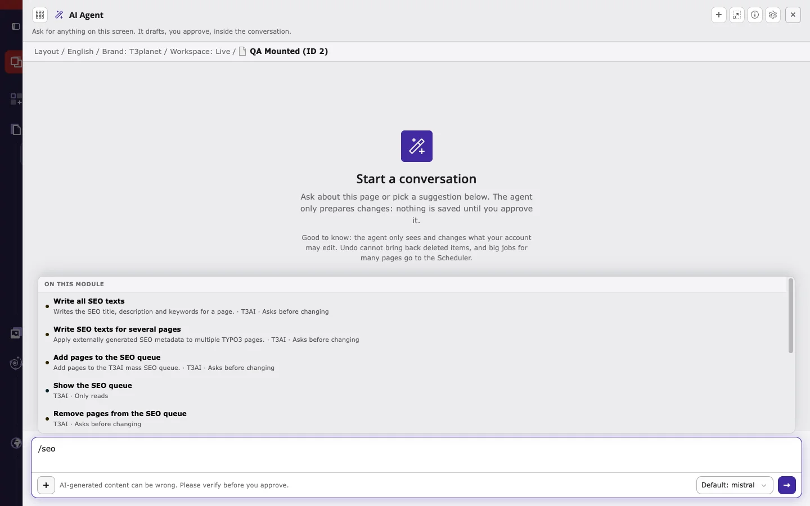

T3AI adds 33 tools to the AI agent. You do not have to name a tool: the agent picks it from your request. The tables below show:

- **In the agent**: the name you see in the `/` picker, in steps, and on preview cards. You can also describe the task in your own words; the agent then picks the tool itself.
- **Tool**: the technical name, shown when you expand a step, in **AI Foundation > AI Agent > Audit**, and in external MCP clients.
- **Kind**: **Only reads**, **Asks before changing**, or **Asks before deleting**. See [Three kinds of actions](/en/latest/ExtNsT3AI/AskAiAgent/HowItWorks/Index#three-kinds-of-actions).

## Pages, news, and blogs

| In the agent | Tool | What it does | Kind | Feature |
|---|---|---|---|---|
| Create a page | `t3ai_create_page_simple` | Creates a page with up to 5 content elements from a short description. | Asks before changing | [Page (Simple)](/en/latest/ExtNsT3AI/Pages/Index#page-simple) |
| Create a page (detailed) | `t3ai_create_page_advanced` | Creates a page from a full outline, with no limit on content elements. | Asks before changing | [Page (Advanced)](/en/latest/ExtNsT3AI/Pages/Index#page-advanced) |
| Create a page structure | `t3ai_create_page_structure` | Creates a page tree. | Asks before changing | [Page Tree](/en/latest/ExtNsT3AI/Pages/Index#page-tree) |
| Write a content element | `t3ai_create_content_element` | Creates or updates a header or text content element on an existing page. | Asks before changing | [Content](/en/latest/ExtNsT3AI/Content/Index) |
| Write a news article | `t3ai_create_news_simple` | Creates an EXT:news record. | Asks before changing | [News (Simple)](/en/latest/ExtNsT3AI/Pages/Index#news-simple) |
| Write a news article (detailed) | `t3ai_create_news_advanced` | Creates an EXT:news record with related content elements. | Asks before changing | [News (Advanced)](/en/latest/ExtNsT3AI/Pages/Index#news-advanced) |
| Write a blog post | `t3ai_create_blog_simple` | Creates a blog page (doktype 137) with content elements. | Asks before changing | [Blog (Simple)](/en/latest/ExtNsT3AI/Pages/Index#blog-simple) |
| Write a blog post (detailed) | `t3ai_create_blog_advanced` | Creates a blog page (doktype 137) from a full outline. | Asks before changing | [Blog (Advanced)](/en/latest/ExtNsT3AI/Pages/Index#blog-advanced) |

## SEO

| In the agent | Tool | What it does | Kind | Feature |
|---|---|---|---|---|
| Write all SEO texts | `t3ai_generate_all_seo` | Writes the SEO title, description, and keywords for a page. | Asks before changing | [T3AI SEO](/en/latest/ExtNsT3AI/SEO/Index) |
| Write the meta description | `t3ai_generate_meta_description` | Sets the meta description of a page. | Asks before changing | [Optimized Meta](/en/latest/ExtNsT3AI/SEO/Index#optimized-meta) |
| Suggest keywords | `t3ai_generate_keywords` | Sets the SEO keywords of a page. | Asks before changing | [Optimized Meta](/en/latest/ExtNsT3AI/SEO/Index#optimized-meta) |
| Write the social media title | `t3ai_generate_og_title` | Sets the Open Graph title of a page. | Asks before changing | [Social Meta](/en/latest/ExtNsT3AI/SEO/Index#social-meta) |
| Write the social media description | `t3ai_generate_og_description` | Sets the Open Graph description of a page. | Asks before changing | [Social Meta](/en/latest/ExtNsT3AI/SEO/Index#social-meta) |
| Write SEO texts for several pages | `t3ai_generate_seo_batch` | Sets SEO metadata on several pages in one request. | Asks before changing | [Mass SEO](/en/latest/ExtNsT3AI/MassSEO/Index) |
| Analyze content | `t3ai_analyze_content` | Analyses the text of a page (readability, structure, SEO) and shows a report. Changes nothing. | Only reads | [Content Analysis](/en/latest/ExtNsT3AI/SEO/Index#content-analysis) |
| Add structured data | `t3ai_apply_schema_markup` | Applies JSON-LD schema markup to a page or news record. | Asks before changing | [Schema Markup](/en/latest/ExtNsT3AI/SEO/Index#schema-markup) |
| Analyze and improve content | `t3ai_apply_content_analysis` | Stores a content analysis report and can apply the recommended text changes to content elements. | Asks before changing | [Content Analysis](/en/latest/ExtNsT3AI/SEO/Index#content-analysis) |

SEO tools show one row per field with the current value, the AI suggestion, and a **Custom** input. **Apply selected** saves the chosen values, and **Discard** writes nothing. Each preview uses AI credits, and regenerating uses them again.

## Translation

| In the agent | Tool | What it does | Kind | Feature |
|---|---|---|---|---|
| Translate the whole page | `t3ai_translate_page` | Translates a page and all of its default-language content elements into the selected site languages (connected localization). | Asks before changing | [One-Click Page Translations](/en/latest/ExtNsT3AI/Translation/OneClickPageTranslations/Index) |
| Translate content | `t3ai_translate_content` | Creates translated localizations of content elements. | Asks before changing | [Translate Content Elements](/en/latest/ExtNsT3AI/Translation/TranslateContentElements/Index) |
| Translate a news article | `t3ai_translate_news` | Creates or updates a connected translation of an EXT:news record. | Asks before changing | [News Translation](/en/latest/ExtNsT3AI/Translation/NewsTranslation/Index) |
| Translate a record | `t3ai_record_translate` | Creates or updates a connected translation of any language-aware record. | Asks before changing | [Records Translation](/en/latest/ExtNsT3AI/Translation/RecordsTranslation/Index) |

## Glossary

| In the agent | Tool | What it does | Kind | Feature |
|---|---|---|---|---|
| Show the translation glossary | `t3ai_glossary_list` | Lists glossary terms (source term, target term, language, term ID). | Only reads | [Language Glossary](/en/latest/ExtNsT3AI/Translation/LanguageGlossary/Index) |
| Save a glossary term | `t3ai_glossary_save` | Adds or updates a glossary term for one language. | Asks before changing | [Language Glossary](/en/latest/ExtNsT3AI/Translation/LanguageGlossary/Index) |
| Remove a glossary term | `t3ai_glossary_delete` | Removes one glossary term for one language. | Asks before deleting | [Language Glossary](/en/latest/ExtNsT3AI/Translation/LanguageGlossary/Index) |

## Mass SEO queue

| In the agent | Tool | What it does | Kind | Feature |
|---|---|---|---|---|
| Show the SEO queue | `t3ai_mass_seo_queue_list` | Lists pages in the Mass SEO queue. | Only reads | [Mass SEO](/en/latest/ExtNsT3AI/MassSEO/Index) |
| Add pages to the SEO queue | `t3ai_mass_seo_queue_add` | Adds pages to the Mass SEO queue. | Asks before changing | [Mass SEO](/en/latest/ExtNsT3AI/MassSEO/Index) |
| Remove pages from the SEO queue | `t3ai_mass_seo_queue_remove` | Removes pages from the Mass SEO queue. | Asks before changing | [Mass SEO](/en/latest/ExtNsT3AI/MassSEO/Index) |

## Mass Translation queue

| In the agent | Tool | What it does | Kind | Feature |
|---|---|---|---|---|
| Show the translation queue | `t3ai_mass_translation_queue_list` | Lists pages in the Mass Translation queue, with status and attempts. | Only reads | [Mass Translation](/en/latest/ExtNsT3AI/Translation/MassTranslation/Index) |
| Add to the translation queue | `t3ai_mass_translation_queue_add` | Adds a page to the Mass Translation queue. | Asks before changing | [Mass Translation](/en/latest/ExtNsT3AI/Translation/MassTranslation/Index) |
| Remove pages from the translation queue | `t3ai_mass_translation_queue_remove` | Removes pages from the Mass Translation queue. | Asks before changing | [Mass Translation](/en/latest/ExtNsT3AI/Translation/MassTranslation/Index) |
| Retry translations | `t3ai_mass_translation_queue_requeue` | Sets entries back to pending so the Scheduler runs them again. | Asks before changing | [Mass Translation](/en/latest/ExtNsT3AI/Translation/MassTranslation/Index) |
| Clear finished translations from the queue | `t3ai_mass_translation_queue_clear_completed` | Deletes all completed entries from the queue. | Asks before changing | [Mass Translation](/en/latest/ExtNsT3AI/Translation/MassTranslation/Index) |

Queue tools only manage the queue. The Scheduler task processes the queued pages.

## Media

| In the agent | Tool | What it does | Kind | Feature |
|---|---|---|---|---|
| Generate an image | `t3ai_generate_image` | Generates AI images from a text description, or takes free stock photos from Unsplash, Pexels, Pixabay, or Openverse, and saves them in fileadmin. | Asks before changing | [Media](/en/latest/ExtNsT3AI/Media/Index) |

## Related

- [AI Foundation MCP Tools](/en/latest/ExtNsT3AF/Integrations/MCPTools/Index): the AI Foundation core tools that the agent combines with T3AI tools, such as site languages, page search, workspaces, and cache.
- [AI Foundation MCP Server](/en/latest/ExtNsT3AF/Integrations/MCPServer/Index): use the same T3AI tools from Cursor, Claude Desktop, or other MCP clients.
