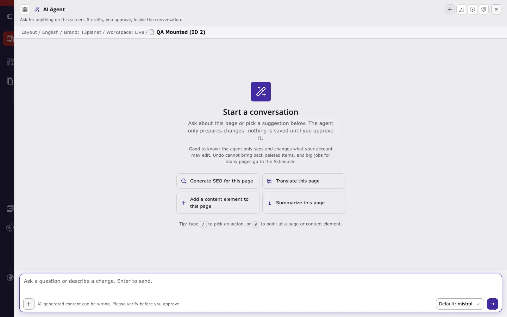
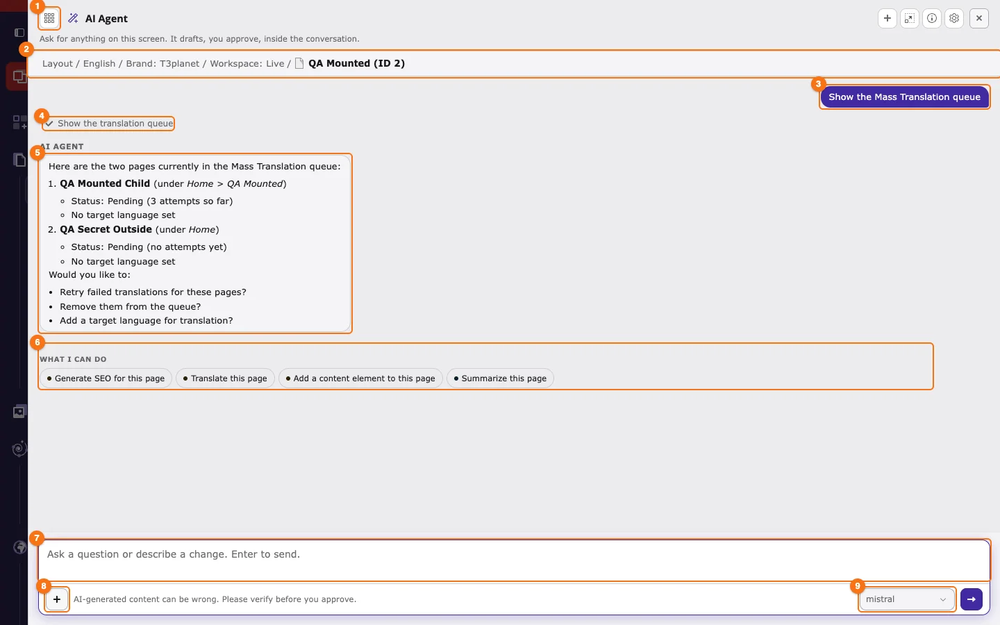
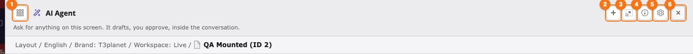
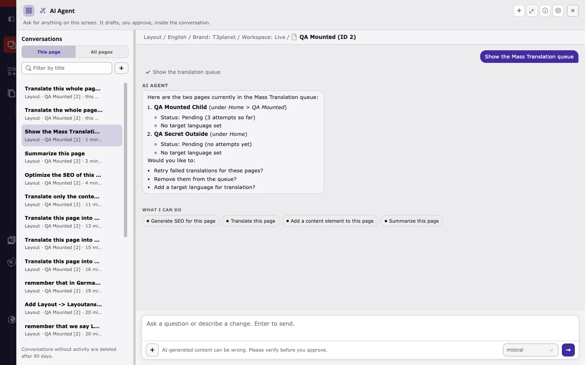

## The Ask AI Agent button

- **Ask AI Agent** sits in the center of the backend top bar and is available in every backend module.
- The button shows the keyboard shortcut. The default is `Ctrl+Shift+K` (Windows, Linux) or `Cmd+Shift+K` (macOS), which keeps `Ctrl/Cmd+K` free for TYPO3 Live Search.
- The bar above the button shows the current workspace, for example **Workspace: LIVE**. Applied changes are saved in that workspace. In Live, the **Workspace** selected in **AI Foundation > MCP** can send them to a draft workspace instead; see [Live or draft workspace](/en/latest/ExtNsT3AI/AskAiAgent/HowItWorks/Index#live-or-draft-workspace).

## Open the AI agent in three steps

1. Select the page you want to work on in the page tree, for example in **Content > Layout**.
2. Click **Ask AI Agent**, or press `Ctrl/Cmd+Shift+K`.
3. The AI agent window opens on top of the page. Check that the context line shows the right page, then type your request.

Opening the agent on a page continues the latest conversation for that page. Press `Esc` or click **Close** to close the window. Your work in the backend stays open behind it.

A new conversation starts with **Start a conversation** and suggestions for the current screen. In the Layout module, three of the four suggestions run T3AI features: **Generate SEO for this page**, **Translate this page**, and **Add a content element to this page**.

## The window, part by part

The screenshot shows a T3AI request (*Show the Mass Translation queue*) after it ran.

1. **Conversations**: opens the list of earlier conversations. See [Conversations](#conversations).
2. **Context line**: the module, language, brand, workspace, and page the agent works on. *This page* in your request always means this page.
3. **Your request**, shown on the right.
4. **Step**: each tool the agent runs, here the T3AI tool **Show the translation queue**. Click a step to see the tool name and its details.
5. **Answer** from the agent.
6. **What I can do**: suggested next requests for this screen. Click one to send it.
7. **Message field**: type your request and press Enter.
8. **Attach (+)**: add files to the request.
9. **AI model**: the provider that answers, for example **Default: mistral**. Choose it before the first message. After the first answer, it is fixed for the conversation.

### Header icons

1. **Show conversations**: opens or hides the conversation list.
2. **New conversation**: starts an empty conversation on the current page.
3. **Full screen**: enlarges the window.
4. **How the AI Agent works**: a short built-in guide with your current context (module, page, language, workspace) and the active AI model.
5. **Settings**: opens **AI Foundation > AI Agent**.
6. **Close**: closes the window.

In longer conversations, a **Summarize conversation** icon appears in the header as well.

## Pick a T3AI action with `/`

Type `/` in the message field to open the action picker. It lists **On this module** actions first, then **All actions**. Each entry shows its owner (**T3AI** or **AI Foundation**) and what it does: **Only reads**, **Asks before changing**, or **Asks before deleting**. Keep typing to filter, for example `/seo` or `/translat`.

- Type `@` to point at a page or content element, for example `@pages:12`.
- Use **+** to attach files.

You do not have to use `/`. Plain language works too. The agent picks the T3AI tool from your request.

## Conversations

- **This page** lists the conversations about the current page. **All pages** lists all of your conversations.
- Use **Filter by title** to find a conversation, and **+** to start a new one.
- Use **Rename** or **Delete** on a conversation to manage the list.
- Each page has its own conversations. Conversations without activity are deleted after 90 days.

## Where administrators manage the agent

| What | Where |
|---|---|
| Status, tool counters, keyboard shortcut | **AI Foundation > AI Agent > Overview** |
| Which T3AI tools only read, ask before changing, or ask before deleting | **AI Foundation > AI Agent > Severity policy** |
| Credit caps, daily limits, providers, PII masking per user group | [AI Permissions](/en/latest/ExtNsT3AF/Configuration/AIPermissions/Index) |
| Full list of T3AI tools and the downloadable AI Skill (`/t3ai`) | **AI Foundation > MCP > MCP Tools > AI Assistant** |
| AI providers and models | [AI Providers](/en/latest/ExtNsT3AF/Configuration/AIProviders/Index) |

Next: [How it works](/en/latest/ExtNsT3AI/AskAiAgent/HowItWorks/Index)
