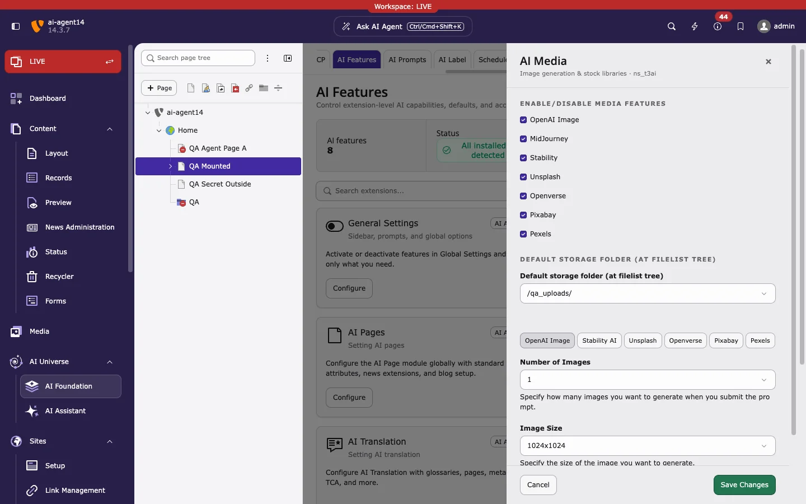

T3AI feature settings are in **AI Universe > AI Foundation > AI Features**, not under **Admin Tools > Settings > Configure extensions**.

<iframe src="https://app.supademo.com/embed/cmrabnhz30bh0qmhx012m66o5?utm_source=link" loading="lazy" title="T3AI Features" allow="clipboard-write; fullscreen" frameBorder="0" webkitallowfullscreen="true" mozallowfullscreen="true" allowfullscreen></iframe>

1. Open **AI Foundation > AI Features**.
2. Select **AI Assistant** in the **Extension** filter to list the six T3AI cards.
3. Click **Configure** on a card. Its settings open in a panel on the right.
4. Change the settings and click **Save Changes**.

Each card, except General Settings, has a **Default AI provider**. **Default** inherits the default provider from [AI Providers](/en/latest/ExtNsT3AI/Configuration/AIProviders/Index). The **Brand Context Profile** on the SEO, Pages, and Content cards uses the site default from **AI Context** unless you select a profile.

## General Settings

- Optimize AI-SEO, Create AI-Page, TCA Records - Generate AI Fields
- Exception Handling by OpenAI and **Enable System Log Solution** (see [System Log Solution](/en/latest/ExtNsT3AI/AISettings/Index#system-log-solution))
- Maximum Count for RTE History

## AI SEO

- Feature toggles: Optimize SEO, New SEO, SEO Meta Data, Social Media Meta, SERP Snippet, Content Analysis, SEO Page Score
- **With Page Content?** default, default SERP snippet view (Desktop or Mobile), and the default content type for Content Analysis (CurrentPage or Manual)
- Number of results for topic, page title, page description, keywords, OG title, and OG description
- **Enable Schema** and **Schema news detail id** (the page that holds the news detail plugin)
- Automatic SEO title, description, keywords, and OG/Twitter title, description, and image for new AI pages

Used by: [SEO](/en/latest/ExtNsT3AI/SEO/Index)

## AI Pages

- Feature toggles: Page (Simple), Page (Advanced), Page Tree, News (Simple), News (Advanced)
- Default prompts for General Page, Blog, Product Page, Service Page, and News
- Default content element type (textpic, header, text, textmedia)
- Number of AI results per page type

Used by: [Pages](/en/latest/ExtNsT3AI/Pages/Index)

## AI Content

- Feature toggles: Content Rewriter, News Content Rewriter, Blog Content Rewriter, Content Elements (Create)
- Rewriter type (Internal, External, Text) and writing style (Casual, Approachable, Easy Readability) for pages, news, and blog
- Default text fields for new content elements, default word counts, and type of content

Used by: [Content](/en/latest/ExtNsT3AI/Content/Index)

## AI Translation

- **Language Translation** toggle and **Auto Page Translate**
- Default AI model for Auto-, Re-, and Mass-Translate (OpenAI, DeepL, Gemini, Google, Claude, Mistral)
- FlexForm field keys to skip from AI translation (comma-separated), see [Notes](/en/latest/ExtNsT3AI/Translation/Notes/Index)
- **Use DeepL Official Glossary**, see [DeepL Official Glossary](/en/latest/ExtNsT3AI/Translation/DeepLOfficialGlossary/Index)

The card's **Default AI provider** applies only to LLM-based translation. DeepL and Google Translate use their own providers.

Used by: [Translation](/en/latest/ExtNsT3AI/Translation/Index)

## AI Media

- Feature toggles: OpenAI Image, MidJourney, Stability, Unsplash, Openverse, Pixabay, Pexels
- **Default storage folder** for generated and imported images
- One tab per source:

| Tab | Settings |
|---|---|
| OpenAI Image | Number of Images (1, 3, 5, 10), Image Size (1024x1024, 1024x1792, 1792x1024), default image style |
| Stability AI | Generate mode (Primary, Ultra, Diffusion) and image format (jpeg, png, webp) |
| Unsplash | Items per page, Unsplash Access Key |
| Openverse | Openverse Client ID, Openverse Client Secret, default image style (Small, Medium, Large) |
| Pixabay | Pixabay Access Key |
| Pexels | Pexels Access Key |

This card holds only the stock library keys (Unsplash, Openverse, Pixabay, Pexels). The API keys for OpenAI Image, Stability AI, and MidJourney are added as providers in [AI Providers](/en/latest/ExtNsT3AI/Configuration/AIProviders/Index). Saved stock library keys show **Configured**; leave the field blank to keep the key.

Used by: [Media](/en/latest/ExtNsT3AI/Media/Index)

## Access & Notifications

This AI Foundation card also affects T3AI:

- **Enable Basic Authentication Support** with **Basic Auth Username** and **Basic Auth Password**, for sites protected by HTTP Basic Authentication (`.htaccess`)
- Email notification on API quota or authentication errors, with the recipient address

**Related:** [AI provider & API keys](/en/latest/ExtNsT3AI/Configuration/AIProviders/Index) · [Permissions](/en/latest/ExtNsT3AI/Configuration/Permissions/Index) · [AI Features in AI Foundation](/en/latest/ExtNsT3AF/Configuration/AIFeatures/Index)
