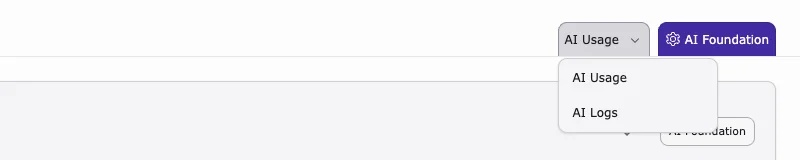
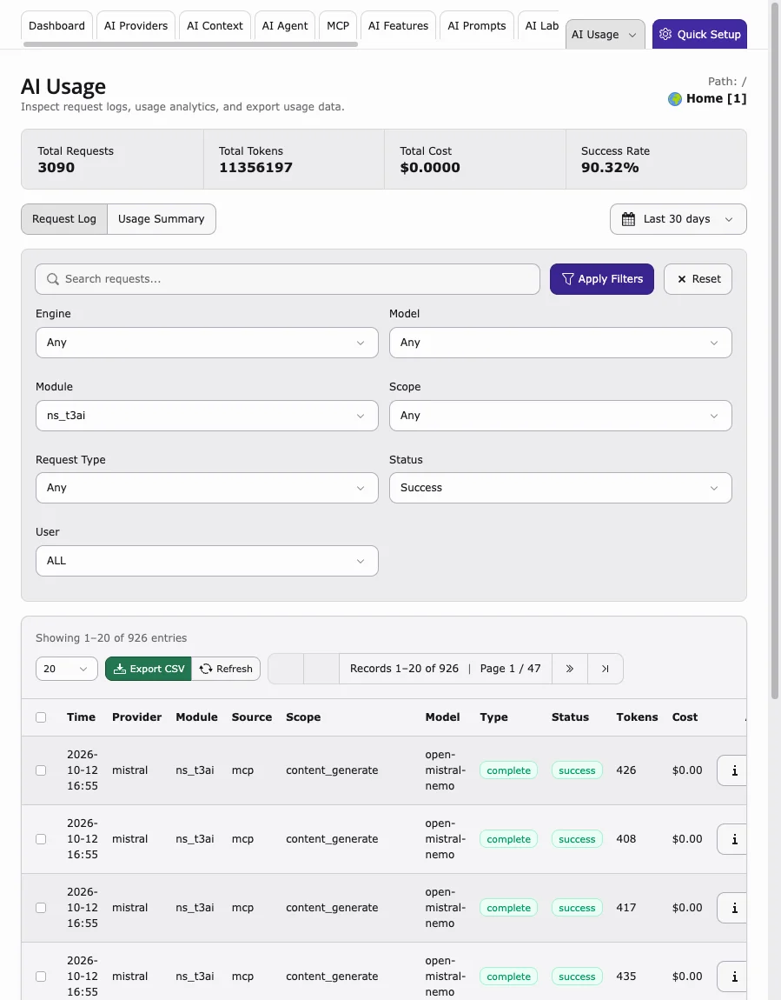
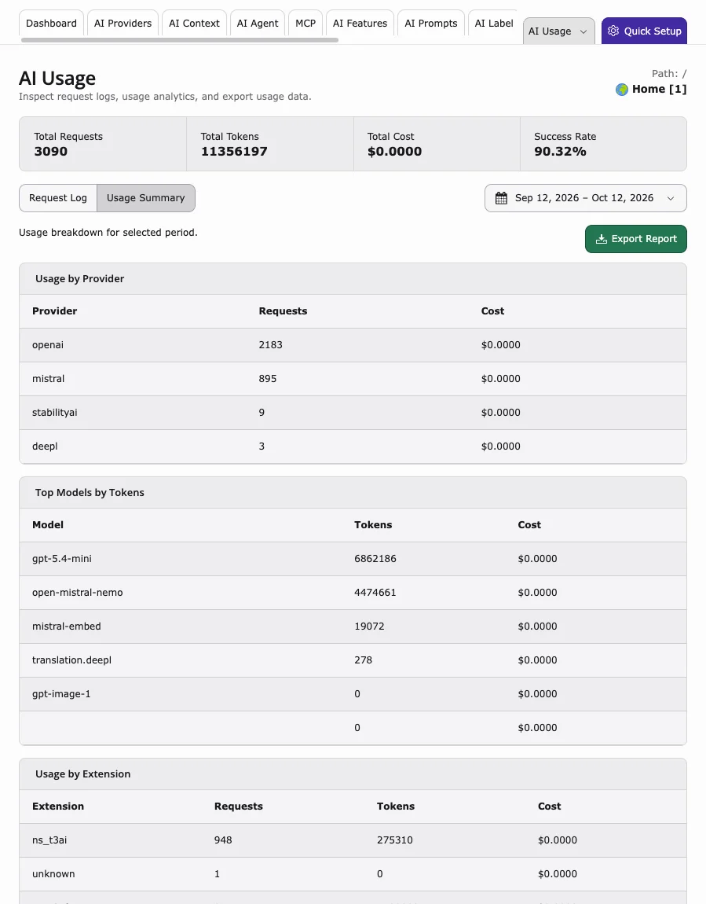

T3AI writes its requests and errors to AI Foundation. Open them from the **AI Usage** menu at the top right of the **AI Assistant** module, or directly in **AI Foundation > AI Usage** and **AI Foundation > AI Logs**.

## AI Logs

<iframe src="https://app.supademo.com/embed/cmrbpsdl20frlqmo521y5if8m?utm_source=link" loading="lazy" title="T3AI AI Logs Demo" allow="clipboard-write; fullscreen" frameBorder="0" webkitallowfullscreen="true" mozallowfullscreen="true" allowfullscreen></iframe>

Events and errors, for example a provider without a required capability.

1. Filter by **Channel**: **AI Assistant Content**, **AI Assistant SEO**, **AI Assistant Translation**, **AI Assistant Media**, **AI Assistant Prompts**, **AI Assistant Bulk Ops**, or **AI Assistant Forms**.
2. Filter by **Level**: **Error**, **Warning**, or **Info**.
3. Open an entry to read the details.
4. Use **Export CSV** to share entries, and **Reset** to clear the filters.

## AI Usage

Request counts, tokens, costs, and the success rate.

- Filter the **Request Log** by **Module** `ns_t3ai` to list T3AI requests only.
- Narrow down by **Engine**, **Model**, **Scope** (for example `seo.meta_description`, `content_translate`, `image_generate`), **Request Type**, **Status**, and **User**. **User** shows the source, for example `backend_module`, `agent`, `mcp`, or `cli`.

- Switch to **Usage Summary** for totals by provider, model, and extension. **Export Report** downloads the summary.

More: [AI Usage & Logs in AI Foundation](/en/latest/ExtNsT3AF/Configuration/AIUsageAndLogs/Index)

**Related:** [AI provider & API keys](/en/latest/ExtNsT3AI/Configuration/AIProviders/Index) · [Scheduler & CLI](/en/latest/ExtNsT3AI/Configuration/SchedulerAndCLI/Index) · [Known Problems](/en/latest/ExtNsT3AI/KnownProblems/Index)
