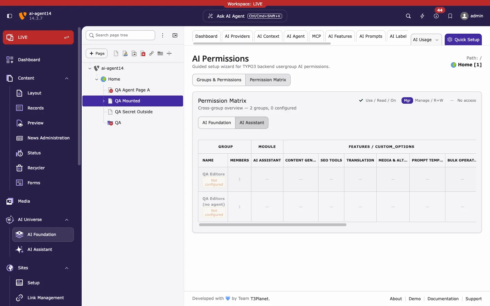

Decide which backend user groups may use T3AI. Administrators always have full access.

1. Go to **AI Universe > AI Foundation > AI Permissions**.
2. On **Groups & Permissions**, select a group (or click **Add Backend Usergroup**) and click **Start Setup Wizard**.
3. Grant the module, the features, and the record tables the group needs, then save.
4. Check the result on **Permission Matrix > AI Assistant**.

## T3AI permissions

| Permission | Type | Gives access to |
|---|---|---|
| AI Assistant | Module | The **AI Assistant** module |
| Content Generation | Feature | [Content](/en/latest/ExtNsT3AI/Content/Index): rewrite, summarise, and generate text |
| SEO Tools | Feature | [SEO](/en/latest/ExtNsT3AI/SEO/Index): meta data, OG tags, and SEO audits |
| Translation | Feature | [Translation](/en/latest/ExtNsT3AI/Translation/Index) |
| Media & Alt Texts | Feature | [Media](/en/latest/ExtNsT3AI/Media/Index): AI images, alt texts, and captions |
| Prompt Templates | Feature | [Prompts](/en/latest/ExtNsT3AI/Prompts/Index): use or manage prompt templates |
| Bulk Operations | Feature | Mass actions across many pages: [Mass Translation](/en/latest/ExtNsT3AI/Translation/MassTranslation/Index) and [Mass SEO](/en/latest/ExtNsT3AI/MassSEO/Index) |
| Page Content Elements | Record table | View, or edit and translate, `tt_content` (required for Re-translate in the Page module) |
| Translation Glossary | Record table | View or manage the [Language Glossary](/en/latest/ExtNsT3AI/Translation/LanguageGlossary/Index) |
| RTE AI Commands | Record table | Use, or manage, the RTE command groups |
| Bulk Translation Jobs | Record table | View or manage the Mass Translation queue |
| Bulk SEO Jobs | Record table | View or manage the Mass SEO queue |
| Schema Markup Records | Record table | View or manage [Schema Markup](/en/latest/ExtNsT3AI/SEO/Index#schema-markup) |

The bulk job tables need **Bulk Operations** as well as the Translation or SEO feature.

<Note>
To stop editors from adding, editing, or deleting prompts, grant **Prompt Templates** as use only, without manage rights.
</Note>

## Groups from older versions

Before AI Permissions, T3AI access was set per backend user group in **Backend Users > edit group > Access Rights**, with the module and the T3AI feature options.

Review these groups in AI Permissions after an upgrade. See [Reinstall After Upgrading to Extension v14.x.x](/en/latest/ExtNsT3AI/ReInstallEverything/Index).

**Related:** [AI Permissions in AI Foundation](/en/latest/ExtNsT3AF/Configuration/AIPermissions/Index) · [AI Features cards](/en/latest/ExtNsT3AI/Configuration/AIFeatures/Index) · [Ask AI agent](/en/latest/ExtNsT3AI/AskAiAgent/Index)
