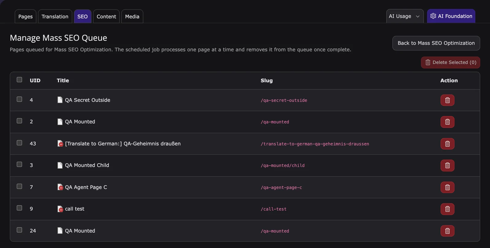

Mass SEO writes SEO data for many pages in one run: meta title, meta description, keywords, Open Graph title, and Open Graph description. You optimize pages right away in the browser, or add them to a queue that a Scheduler task processes in the background.

For one page at a time, use the tools on the [SEO](/en/latest/ExtNsT3AI/SEO/Index) page. Settings, permissions, AI agent tools, and logs for this feature are listed in [Settings, access and logs](#settings-access-and-logs).

## Before you start

- An AI provider is connected. See [AI provider & API keys](/en/latest/ExtNsT3AI/Configuration/AIProviders/Index).
- Editors need **SEO Tools**, **Bulk Operations**, and **Bulk SEO Jobs**. See [Permissions](/en/latest/ExtNsT3AI/Configuration/Permissions/Index).
- For the queue: a Scheduler task and a cron job that runs the Scheduler. See [Scheduler](#scheduler).

## Which way do I need?

| You want to | Use |
|---|---|
| Pick pages from a filtered list and optimize them now | [Mass Optimize SEO](#mass-optimize-seo), **Optimize** or **Start Optimization** |
| Optimize many pages in the background | [Mass Optimize SEO](#mass-optimize-seo), **Add to Queue**, plus the [Scheduler](#scheduler) |
| Queue one page from the page tree | [Page wise Mass SEO](#page-wise-mass-seo) |
| Queue a page with all its subpages | [Recursive Mass SEO](#recursive-mass-seo) |
| Optimize the pages of one language | [Language-wise SEO optimization](#language-wise-seo-optimization) |
| See or clean up the queue | [Manage the queue](#manage-the-queue) |

## Mass Optimize SEO

<iframe src="https://app.supademo.com/embed/cmranl2rf12m9qmhxqwmx41z4?utm_source=link" loading="lazy" title="T3AI Mass SEO Demo" allow="clipboard-write; fullscreen" frameBorder="0" webkitallowfullscreen="true" mozallowfullscreen="true" allowfullscreen></iframe>

**Mass Optimize SEO** fills SEO data for many pages in one place. Open it with **AI Assistant > SEO > Mass Optimize SEO**.

### Step 1: AI Configuration

- **AI Provider**: the provider used for all pages.
- **Number Of Suggestions**: how many options the AI writes per field.
- **Fields To Generate**: Meta Title, Meta Description, Keywords, OG Title, OG Description. Each field can use its own prompt.

### Step 2: Filters

Narrow down the page list by **Page Title**, **SEO** status (All SEO, Missing, Partial, Good), page type (Standard, Folder, External, Shortcut, Spacer), **Language**, and **Page visible**. Click **Search**, or **Reset** to clear the filters.

### Step 3: Select pages and run

Each row shows the page type, SEO **Score**, last modification, and whether it is in the queue. Then choose how to run it:

- **Optimize** in a row, or tick several pages and click **Start Optimization (n)**: T3AI generates now, in the browser. Click **View result** to check the output.
- **Add to Queue** in a row, or **Add to Queue (n)** for the ticked pages: a Scheduler task processes the pages later, one at a time.

**Result:** The generated texts are written to the page properties (tabs **SEO** and **Social Media**).

## Manage the queue

Click **Manage Queue (n)** in Mass Optimize SEO to open **Manage Mass SEO Queue**. It lists the queued pages. Tick pages and click **Delete Selected (n)** to remove them from the queue, or use the delete icon in a row.

The Scheduler task processes one page at a time and removes it from the queue when it is done.

## Scheduler

<iframe src="https://app.supademo.com/embed/cmq7sizd80nqcqml6hobhev7r?utm_source=embed" loading="lazy" title="T3AI Mass SEO Scheduler Demo" allow="clipboard-write; fullscreen" frameBorder="0" webkitallowfullscreen="true" mozallowfullscreen="true" allowfullscreen></iframe>

The queue is only processed by the Scheduler:

1. In the **Scheduler** module, create the task **T3AF: Mass SEO Optimization (queue)**. On TYPO3 v13, create an **Execute console commands** task with the command `t3af:bulk:seo-optimize`.
2. Choose the **SEO fields to generate**, the limit per run, and optionally the provider. **Dry run** generates without saving.
3. Make sure a cron job runs the TYPO3 Scheduler on the server.

The command options are `--fields`, `--limit`, `--page`, `--provider`, `--model`, and `--dry-run`. Composer and non-Composer examples: [Scheduler & CLI](/en/latest/ExtNsT3AI/Configuration/SchedulerAndCLI/Index).

## Page wise Mass SEO

<iframe src="https://app.supademo.com/embed/cmrc2khs118r3qmo5stu972a6?utm_source=link" loading="lazy" title="T3AI Page Wise Mass SEO Demo" allow="clipboard-write; fullscreen" frameBorder="0" webkitallowfullscreen="true" mozallowfullscreen="true" allowfullscreen></iframe>

1. Edit the page properties, open the **AI Assistant** tab, enable **Allow Mass SEO Optimization?**, and save.
2. Right-click the page in the page tree and choose **Mass SEO > Add Page to Mass SEO Queue**.

The **Mass SEO** entry only appears in the context menu for pages with this option enabled.

## Recursive Mass SEO

<iframe src="https://app.supademo.com/embed/cmrc2s2uw19cnqmo5qdlz7g7h?utm_source=link" loading="lazy" title="T3AI Recursive Mass SEO Demo" allow="clipboard-write; fullscreen" frameBorder="0" webkitallowfullscreen="true" mozallowfullscreen="true" allowfullscreen></iframe>

1. In the page properties of the parent page, tab **AI Assistant**, enable **Allow Mass SEO Optimization?** and **Allow Recursive Mass SEO Optimization?**.
2. Enable **Allow Mass SEO Optimization?** on every subpage that should be optimized.
3. Right-click the parent page and choose **Mass SEO > Add Pages Recursively to Mass SEO Queue**.

T3AI queues the page and its subpages. Subpages without **Allow Mass SEO Optimization?** are skipped. Pages you add in the Mass Optimize SEO module are queued without this check.

## Language-wise SEO optimization

In **Mass Optimize SEO**, use the **Language** filter to list and optimize the pages of one language. T3AI writes the SEO texts for the translated pages in that language.

## Settings, access and logs

| Topic | Where |
|---|---|
| Opens in | **AI Assistant > SEO > Mass Optimize SEO**; page tree context menu **Mass SEO** |
| Settings | [AI SEO card](/en/latest/ExtNsT3AI/Configuration/AIFeatures/Index#ai-seo); page properties, tab **AI Assistant**: **Allow Mass SEO Optimization?**, **Allow Recursive Mass SEO Optimization?** |
| Permissions | **SEO Tools**, **Bulk Operations**, **Bulk SEO Jobs**. See [Permissions](/en/latest/ExtNsT3AI/Configuration/Permissions/Index) |
| Ask AI agent | Write SEO texts for several pages, Show the SEO queue, Add pages to the SEO queue, Remove pages from the SEO queue. See [T3AI tools](/en/latest/ExtNsT3AI/AskAiAgent/Tools/Index#mass-seo-queue) |
| Scheduler & CLI | **T3AF: Mass SEO Optimization (queue)**, `t3af:bulk:seo-optimize`. See [Scheduler & CLI](/en/latest/ExtNsT3AI/Configuration/SchedulerAndCLI/Index) |
| Logs | AI Logs channel **AI Assistant SEO**; AI Usage scopes `seo.*`. See [AI Usage & AI Logs](/en/latest/ExtNsT3AI/Configuration/AIUsageAndLogs/Index) |

**Related:** [SEO](/en/latest/ExtNsT3AI/SEO/Index) · [Prompts](/en/latest/ExtNsT3AI/Prompts/Index) · [Configuration](/en/latest/ExtNsT3AI/Configuration/Index)
