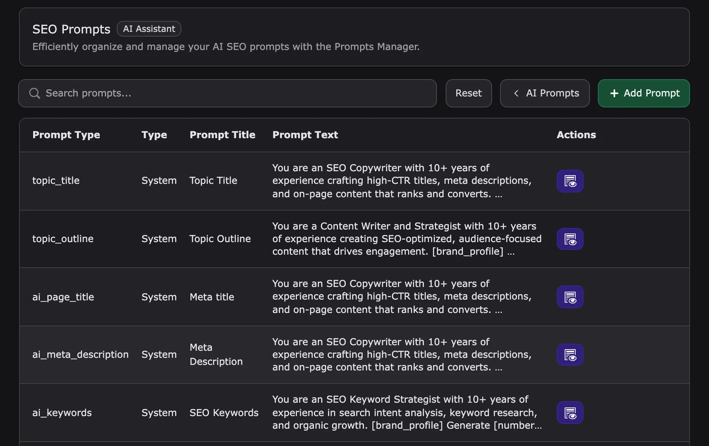

A prompt is the instruction T3AI sends to the AI provider, for example "Generate [number] meta descriptions for [Content]". T3AI ships a tested default prompt for every task. You can pick another prompt in a T3AI window, adjust it for one run, or save your own reusable prompts for the whole team.

T3AI has no prompt manager of its own. All T3AI prompts are managed in **AI Universe > AI Foundation > AI Prompts**.

Settings, permissions, and logs for this feature are listed in [Settings, access and logs](#settings-access-and-logs).

## Prompt categories

With **Extension** set to **AI Assistant**, AI Prompts lists six T3AI categories:

| Category | Prompt types | Used by |
|---|---|---|
| SEO Prompts | Meta title, Meta Description, SEO Keywords, Open Graph Title, Open Graph Description, Topic Title, Topic Outline, Content Analysis, Page Score, Slug Suggestions, AI Schema | [SEO](/en/latest/ExtNsT3AI/SEO/Index), [Mass SEO](/en/latest/ExtNsT3AI/MassSEO/Index) |
| Pages Prompts | Titles, outlines, and content for default, blog, product, and service pages; news; AI page tree | [Pages](/en/latest/ExtNsT3AI/Pages/Index) |
| Content Prompts | AI Content Elements, Rewrite Using Page Content, Rewrite Using External Links, Rewrite Using Text, Regenerate Title, Regenerate Content | [Content](/en/latest/ExtNsT3AI/Content/Index) |
| Translation Prompts | AI Translate Pages, Language Glossary Manager | [Translation](/en/latest/ExtNsT3AI/Translation/Index) |
| Media Prompts | AI image generation, image Metadata (alt text) | [Media](/en/latest/ExtNsT3AI/Media/Index) |
| RTE AI Prompts | Optimize Content, Adjust Content, Tone of Content, Content translate | [RTE AI Copilot](/en/latest/ExtNsT3AI/Content/Index#rte-ai-copilot) |

## Use a prompt in a T3AI window

T3AI windows that generate text, for example in SEO and Pages, have a **Prompt** dropdown:

1. Keep the default entry to run the built-in prompt, or select one of your custom prompts for this task.
2. Click the icon next to the dropdown to open **Edit Your Prompt**. **Original Prompt** shows the built-in text for reference.
3. Change the text and click **Save Changes** to use it for this run.
4. To reuse it, click **Save Prompt**, enter a **Prompt Title**, and save. The prompt is stored in AI Prompts and appears in the dropdown next time.

## Manage prompts in AI Prompts

<iframe src="https://app.supademo.com/embed/cmraru3lk1h13qmhxc5zr98ut?utm_source=link" loading="lazy" title="Manage T3AI prompts" allow="clipboard-write; fullscreen" frameBorder="0" webkitallowfullscreen="true" mozallowfullscreen="true" allowfullscreen></iframe>

1. Open **AI Foundation > AI Prompts** and set the extension filter (**All Extensions**) to **AI Assistant**.
2. Click **Manage Prompts** on a category. The table shows **Prompt Type**, **Type** (System or Custom), **Prompt Title**, and **Prompt Text**.
3. Click **Edit** to change a custom prompt, or **Add Prompt** to create one.
4. In the **New Prompt** panel, enter the **Prompt Title** and choose the **Category**, **Scope**, and **Prompt Type**.
5. Write the **Prompt Text**. Include every variable listed under **Required variables** in square brackets, for example `[Content]`. T3AI fills them in when the prompt runs.
6. Click **Save Prompt**.

<Note>
**Built-in default prompt** shows the system prompt for reference. Your custom prompt replaces it only where you select it. System prompts are delivered with the extensions, so an update brings new and updated system prompts automatically.
</Note>

For SEO, Pages, and Content prompts, the brand details from your [AI Context](/en/latest/ExtNsT3AF/Configuration/AIContext/Index) profile are inserted automatically. You do not need to repeat company name or tone in every prompt.

Custom RTE AI prompts are added to the **T3AI Prompts** and **T3AI Translator** menus in the rich text editor.

## Tips for good prompts

- Change one prompt at a time and test it on one page before you use it in bulk.
- Keep instructions short and specific: length, tone, audience, and what to avoid.
- Give custom prompts clear titles, so editors find them in the **Prompt** dropdown.

## Settings, access and logs

| Topic | Where |
|---|---|
| Manage prompts | **AI Foundation > AI Prompts**. See [AI Prompts](/en/latest/ExtNsT3AF/Configuration/AIPrompts/Index) |
| Permissions | **Prompt Templates** (use or manage), **RTE AI Commands**. See [Permissions](/en/latest/ExtNsT3AI/Configuration/Permissions/Index) |
| Logs | AI Logs channel **AI Assistant Prompts**. See [AI Usage & AI Logs](/en/latest/ExtNsT3AI/Configuration/AIUsageAndLogs/Index) |

**Related:** [Content](/en/latest/ExtNsT3AI/Content/Index) · [Configuration](/en/latest/ExtNsT3AI/Configuration/Index)
