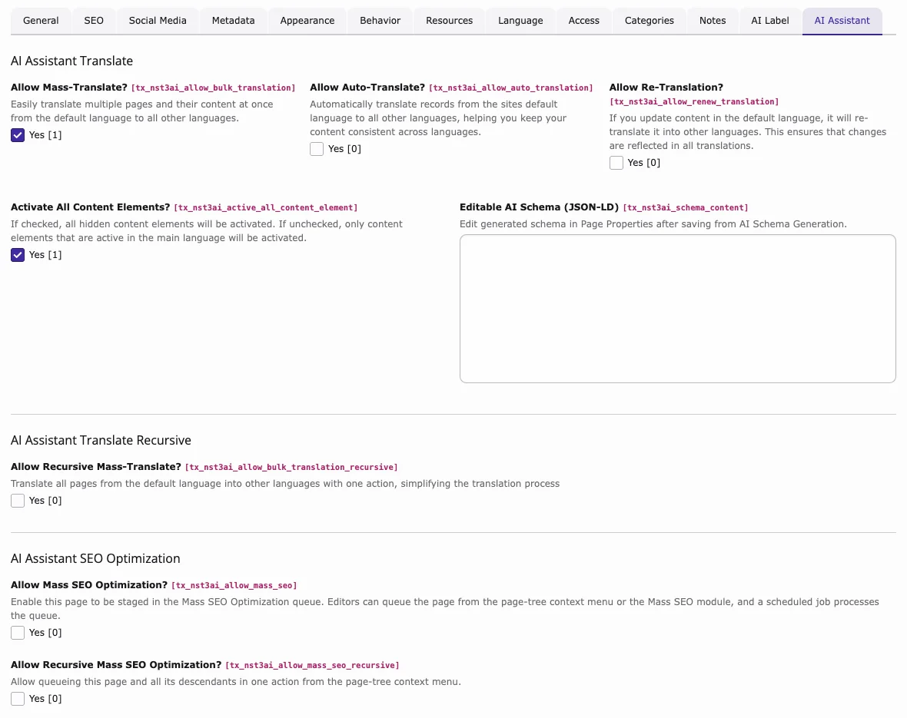

T3AI creates translated content elements as **hidden**, so you can review them first. When the translation is fine, you activate all of them in one click.

<div className="t3-embed"><iframe src="https://app.supademo.com/embed/cmran84i811r1qmhxkpvvp2rw?embed_v=2&utm_source=embed" loading="lazy" title="Activate Translated Content" allow="clipboard-write; fullscreen" frameBorder="0" webkitallowfullscreen="true" mozallowfullscreen="true" allowfullscreen></iframe></div>

## Activate translated content

1. Open the **Page** module, select the page, and set the display mode to **Languages** (TYPO3 v14: **Language Comparison**).
2. In the column of the language, click **Activate Translated Content**.

**Result:** The hidden translated content elements of this page and language become visible.

### Auto Activate All Content Elements

The page option **Activate All Content Elements?** decides which elements the button activates:

- **Enabled** (default): all hidden translated elements.
- **Disabled**: only elements whose original in the default language is visible. Elements that are hidden in the default language stay hidden.

### How to Enable

1. Edit the page properties and open the **AI Assistant** tab.
2. Enable or disable **Activate All Content Elements?** and save.



## Preview tagging for translated pages

For every AI translation, T3AI sets two page fields:

- `tx_nst3ai_content_not_checked`: **AI Assistant Translated Content has not been checked.**
- `tx_nst3ai_translated_time`: **Last AI Assistant Translated Date**

When an editor previews a hidden page translated by T3AI, a T3AI badge appears next to the **Preview** badge in the frontend.


Integrators can show the same hint in the frontend. Both fields are available as `data` in the page Fluid template:

```html
<f:if condition="{data.tx_nst3ai_content_not_checked}" >
    <div style="background: #006494; border: #0000cc 1px solid; color: #fff; padding: 10px; text-align: center">
        <f:translate key="LLL:EXT:ns_t3ai/Resources/Private/Language/locallang_be:preview.flag" extensionName="ns_t3ai" />
        <f:if condition="{data.tx_nst3ai_translated_time} > 0" >
            <f:format.date format="{dateFormat}">{data.tx_nst3ai_translated_time}</f:format.date>
        </f:if>
    </div>
</f:if>
```

### Earlier walkthrough

<div className="t3-embed"><iframe src="https://app.supademo.com/embed/cmfpid1c3048o130uzzi54lbw?embed_v=2&utm_source=embed" loading="lazy" title="Activate Translated Content" allow="clipboard-write; fullscreen" frameBorder="0" webkitallowfullscreen="true" mozallowfullscreen="true" allowfullscreen></iframe></div>

**Related:** [AI Translation card](/en/latest/ExtNsT3AI/Configuration/AIFeatures/Index#ai-translation) · [Permissions](/en/latest/ExtNsT3AI/Configuration/Permissions/Index)
