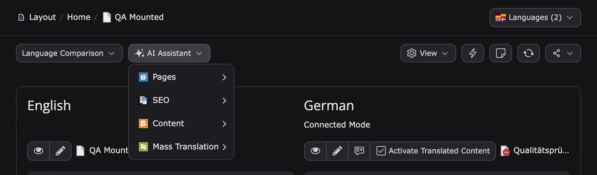
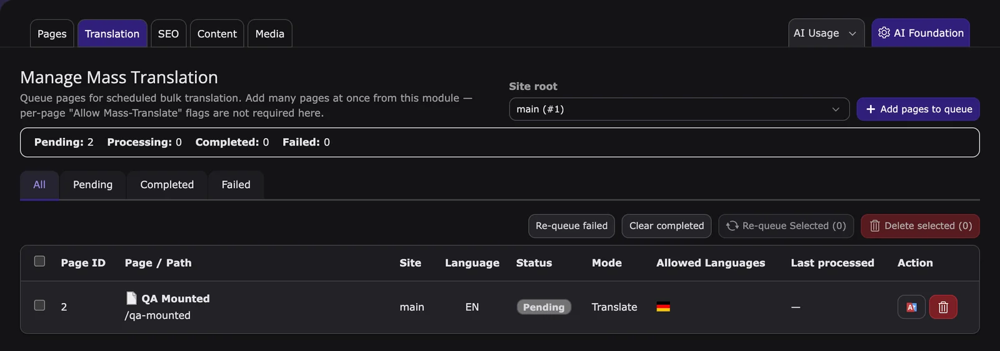

T3AI translates your TYPO3 content from the default language into the other languages of your site. You can translate one page with a click, translate many pages in the background, or let T3AI update translations whenever editors save. This page walks through every translation tool; each section links to its detail page.

Settings, permissions, AI agent tools, and logs for this feature are listed in [Settings, access and logs](#settings-access-and-logs).

## Before you start

- The target languages are configured in the site configuration.
- A translation provider is connected, for example DeepL, Google Translate, or an AI provider. See [AI provider & API keys](/en/latest/ExtNsT3AI/Configuration/AIProviders/Index).
- The translation options are set in the [AI Translation card](/en/latest/ExtNsT3AI/Configuration/AIFeatures/Index#ai-translation): **Language Translation**, **Auto Page Translate**, the default model, FlexForm fields to skip, and **Use DeepL Official Glossary**.
- Editors have the **Translation** permission. See [Permissions](/en/latest/ExtNsT3AI/Configuration/Permissions/Index).

## Where the translation tools are

Most translation tools are where you already work, not in the AI Assistant module:

| Where | What you find there |
|---|---|
| **Page** module, document header | **Translate with T3AI** for the selected page, while it has untranslated site languages |
| **Page** module, **AI Assistant** menu | **Pages**, **SEO**, **Content**, and **Mass Translation** submenus |
| **Page** module, display mode **Languages** (TYPO3 v14: **Language Comparison**) | **Re-Translate** and **Activate Translated Content** in each language column |
| Form of a content element or translated record | **Translate with T3AI** with the available providers |
| Page tree context menu | **Mass Translation** submenu to queue pages |
| Page properties, tab **AI Assistant** | **Allow Mass-Translate?**, **Allow Auto-Translate?**, **Allow Re-Translation?**, **Activate All Content Elements?**, **Allow Recursive Mass-Translate?** |
| **AI Assistant > Translation** | **Manage Mass Translation** and **Manage Glossary** |



<Note>
On the **Translation** tab of the AI Assistant module, most card buttons open a short demo of the tool. Only **Manage Mass Translation** and **Manage Glossary** open a module.
</Note>

## Which tool do I need?

| You want to | Use |
|---|---|
| Translate one page now | [One-Click Page Translations](#one-click-page-translations) |
| Translate many pages or a whole site | [Mass Translation](#mass-translation), [Recursive Mass Translate](#recursive-mass-translate) |
| Replace an existing translation | [Re-Translate Pages](#re-translate-pages) |
| Keep translations updated while editing | [Auto Re-Translate Page](#auto-re-translate-page) |
| Translate one content element | [Translate Content Elements](#translate-content-elements) |
| Translate a news article or another record | [News Translation](#news-translation), [Records Translation](#records-translation) |
| Translate the fields of your own tables | [Extend Records Translation](#extend-records-translation) |
| Keep product names and terms consistent | [Language Glossary](#language-glossary), [DeepL Official Glossary](#deepl-official-glossary) |
| Make translated elements visible | [Activate Translated Content](#activate-translated-content) |
| Check Mask, FlexForm, and DCE support | [Notes](#notes) |

## One-Click Page Translations

<a id="translate-pages"></a>

<div className="t3-embed"><iframe src="https://app.supademo.com/embed/cmrakfkin0w8pqmhxhm36f6l4?embed_v=2&utm_source=embed" loading="lazy" title="Translate Pages" allow="clipboard-write; fullscreen" frameBorder="0" webkitallowfullscreen="true" mozallowfullscreen="true" allowfullscreen></iframe></div>

Translates a page into one or all site languages, with or without its content elements.

1. Open the **Page** module and select the page in the default language.
2. At the top, click **Translate with T3AI** and select the **AI Provider**.
3. Under **Choose Language**, select a language or **All**.
4. Click **Translate Page** (page only) or **Translate Page & Content** (page and its content elements).

**Result:** The page translation is created. Translated content elements stay hidden until you [activate them](#activate-translated-content). **Translate with T3AI** is shown only while the page has untranslated site languages.

Details: [One-Click Page Translations](/en/latest/ExtNsT3AI/Translation/OneClickPageTranslations/Index).

## Mass Translation

<a id="mass-pages-translation"></a>

<div className="t3-embed"><iframe src="https://app.supademo.com/embed/cmttyv0zu149lqmgz7dxycp3b?embed_v=2&utm_source=embed" loading="lazy" title="Manage Mass Translation Demo" allow="clipboard-write; fullscreen" frameBorder="0" webkitallowfullscreen="true" mozallowfullscreen="true" allowfullscreen></iframe></div>

Translates many pages in the background. You put pages in a queue, and a Scheduler task translates them batch by batch.

**Fill the queue in Manage Mass Translation** (**AI Assistant > Translation > Manage Mass Translation**):

1. Click **Add pages to queue**, choose the **Site root**, and click **Continue**.
2. Tick the pages, or a page with **Include all subpages**.
3. Optionally tick **Re-translate mode (re-translate queue)** to replace existing translations.
4. Select the target languages and click **Add to queue**.

**Or queue from the page tree:** enable **Allow Mass-Translate?** in the page properties (tab **AI Assistant**), then right-click the page and choose **Mass Translation > Add this page to the scheduler queue**.

**Process the queue:** create the Scheduler task **T3AF: Bulk Translate (queue)**, and **T3AF: Bulk Re-translate (queue)** for Re-translate mode. On TYPO3 v13, use an **Execute console commands** task with `t3af:bulk:translate`. A cron job must run the Scheduler.



The summary bar counts **Pending**, **Processing**, **Completed**, and **Failed** entries. Use the tabs **All**, **Pending**, **Completed**, and **Failed** to filter, **Re-queue failed** or **Re-queue Selected (n)** to run pages again, and **Clear completed** or **Delete selected (n)** to clean up the queue.

Details: [Mass Translation](/en/latest/ExtNsT3AI/Translation/MassTranslation/Index) · CLI: [Scheduler & CLI](/en/latest/ExtNsT3AI/Configuration/SchedulerAndCLI/Index).

## Recursive Mass Translate

<div className="t3-embed"><iframe src="https://app.supademo.com/embed/cmraloedr0yqmqmhxmejplhxg?embed_v=2&utm_source=embed" loading="lazy" title="Recursive Mass Translate" allow="clipboard-write; fullscreen" frameBorder="0" webkitallowfullscreen="true" mozallowfullscreen="true" allowfullscreen></iframe></div>

Queues a page and all its subpages in one action.

1. In the page properties of the parent page, tab **AI Assistant**, enable **Allow Mass-Translate?** and **Allow Recursive Mass-Translate?**, and save.
2. Right-click the parent page and choose **Mass Translation > Recursively add this page to the scheduler queue**.
3. Make sure the Scheduler task **T3AF: Bulk Translate (queue)** runs.

Subpages are queued only if they have **Allow Mass-Translate?** enabled. To queue a page tree without these options, use **Include all subpages** in Manage Mass Translation.

Details: [Recursive Mass Translate](/en/latest/ExtNsT3AI/Translation/RecursiveMassTranslate/Index).

## Re-Translate Pages

<div className="t3-embed"><iframe src="https://app.supademo.com/embed/cm1iyxwth37itououeb054igl?embed_v=2&utm_source=embed" loading="lazy" title="Re-Translate Pages" allow="clipboard-write; fullscreen" frameBorder="0" webkitallowfullscreen="true" mozallowfullscreen="true" allowfullscreen></iframe></div>

Replaces the existing translation of a page with a fresh AI translation, for example after larger changes in the default language.

1. Open the **Page** module, select the page, and set the display mode to **Languages** (TYPO3 v14: **Language Comparison**).
2. In the column of the language, click **Re-Translate**. The button appears when all elements of the page are translated.
3. Confirm the dialog.

**Result:** All elements of the page are translated again. Manual changes in the existing translation are overwritten.

To re-translate one record, edit the translated record and choose a provider in **Translate with T3AI**. For many pages, use Mass Translation with **Re-translate mode**.

Details: [Re-Translate Pages](/en/latest/ExtNsT3AI/Translation/ReTranslatePages/Index).

## Auto Re-Translate Page

<div className="t3-embed"><iframe src="https://app.supademo.com/embed/cmral78wn0xzlqmhxtogkt0yt?embed_v=2&utm_source=embed" loading="lazy" title="Auto Re-Translate Page" allow="clipboard-write; fullscreen" frameBorder="0" webkitallowfullscreen="true" mozallowfullscreen="true" allowfullscreen></iframe></div>

Keeps translations up to date while editors work in the default language. You enable it per page in the page properties, tab **AI Assistant**:

- **Allow Auto-Translate?**: new records in the default language are translated into all other languages when you save.
- **Allow Re-Translation?**: when you change content in the default language, T3AI updates the translations.


The provider is set in the [AI Translation card](/en/latest/ExtNsT3AI/Configuration/AIFeatures/Index#ai-translation). Each save uses AI credits or provider tokens, so enable it only on pages that need fast translations.

Details: [Auto Re-Translate Page](/en/latest/ExtNsT3AI/Translation/AutoReTranslatePage/Index).

## Translate Content Elements

Translates one content element instead of the whole page.

1. Edit the content element in the default language.
2. In the form header, click **Translate with T3AI**.
3. Select the **AI Provider** and the target language, then click **Translate Record**.

**Result:** The translation of the element in the target language. To re-translate an element, edit the translation and choose a provider in **Translate with T3AI**.

Details: [Translate Content Elements](/en/latest/ExtNsT3AI/Translation/TranslateContentElements/Index).

## News Translation

<div className="t3-embed"><iframe src="https://app.supademo.com/embed/cmrakzni30xkaqmhxdqvhvky7?embed_v=2&utm_source=embed" loading="lazy" title="News Translation" allow="clipboard-write; fullscreen" frameBorder="0" webkitallowfullscreen="true" mozallowfullscreen="true" allowfullscreen></iframe></div>

Translates `EXT:news` records.

1. Open the **List** module and select the news storage folder.
2. Create the translation of the news record with the TYPO3 localization.
3. In the form of the translation, click **Translate with T3AI** and choose the provider.
4. Check the texts and save.

The news folder must be a news container: page properties, tab **Behaviour**, **Contains Plugin** = **News**.

Details: [News Translation](/en/latest/ExtNsT3AI/Translation/NewsTranslation/Index).

## Records Translation

<a id="records-tca-translation"></a>

<div className="t3-embed"><iframe src="https://app.supademo.com/embed/cmral3lv90xpgqmhxzmi2p048?embed_v=2&utm_source=embed" loading="lazy" title="Records TCA Translation" allow="clipboard-write; fullscreen" frameBorder="0" webkitallowfullscreen="true" mozallowfullscreen="true" allowfullscreen></iframe></div>

Translates any TCA record, for example categories or records of your own extensions.

1. In the **List** module, create the translation of the record with the TYPO3 localization.
2. In the form of the translation, click **Translate with T3AI** and choose the provider.
3. Check the translated fields and save.

Only fields with `l10n_mode` `prefixLangTitle` are translated.

Details: [Records Translation](/en/latest/ExtNsT3AI/Translation/RecordsTranslation/Index).

## Extend Records Translation

To have T3AI translate fields of your own table, set `l10n_mode` to `prefixLangTitle` in a TCA override, one line per field, in `<extension_key>/Configuration/TCA/Overrides/<table_name>.php`:

```php
$GLOBALS['TCA']['<table_name>']['columns']['<field_name>']['l10n_mode'] = 'prefixLangTitle';
```

Details: [Extend Records Translation](/en/latest/ExtNsT3AI/Translation/ExtendRecordsTranslation/Index).

## Language Glossary

<div className="t3-embed"><iframe src="https://app.supademo.com/embed/cmttyhrun13nbqmgzw4bkjqz0?embed_v=2&utm_source=embed" loading="lazy" title="Language Glossary Demo" allow="clipboard-write; fullscreen" frameBorder="0" webkitallowfullscreen="true" mozallowfullscreen="true" allowfullscreen></iframe></div>

Defines fixed translations for terms, per target language, so product names and terminology stay consistent.

1. Go to **AI Assistant > Translation** and click **Manage Glossary**.
2. Enter the source term and the target term, for example **TYPO3 Developer** and **TYPO3 Agency**.
3. Select the **Target language** and click **Save**.

**Result:** AI translations into that language use your term.

Details: [Language Glossary](/en/latest/ExtNsT3AI/Translation/LanguageGlossary/Index).

## DeepL Official Glossary

<div className="t3-embed"><iframe src="https://app.supademo.com/embed/cmttypodo141fqmgzv3bctixh?embed_v=2&utm_source=embed" loading="lazy" title="DeepL Glossary Mapping Demo" allow="clipboard-write; fullscreen" frameBorder="0" webkitallowfullscreen="true" mozallowfullscreen="true" allowfullscreen></iframe></div>

Applies your DeepL glossaries when you translate with DeepL. It has no effect with other providers.

1. In the [AI Translation card](/en/latest/ExtNsT3AI/Configuration/AIFeatures/Index#ai-translation), enable **Use DeepL Official Glossary**.
2. Go to **AI Assistant > Translation > Manage Glossary** and open the **DeepL Official Glossary** tab.
3. Select the target language and the DeepL glossary, then click **Save mapping**.

Details: [DeepL Official Glossary](/en/latest/ExtNsT3AI/Translation/DeepLOfficialGlossary/Index).

## Activate Translated Content

<div className="t3-embed"><iframe src="https://app.supademo.com/embed/cmran84i811r1qmhxkpvvp2rw?embed_v=2&utm_source=embed" loading="lazy" title="Activate Translated Content" allow="clipboard-write; fullscreen" frameBorder="0" webkitallowfullscreen="true" mozallowfullscreen="true" allowfullscreen></iframe></div>

T3AI creates translated content elements as hidden, so you can review them first.

1. Open the **Page** module, select the page, and set the display mode to **Languages** (TYPO3 v14: **Language Comparison**).
2. In the column of the language, click **Activate Translated Content**.

**Result:** The hidden translated elements of this page and language become visible. With **Activate All Content Elements?** disabled in the page properties, elements that are hidden in the default language stay hidden.

T3AI also marks AI-translated pages, so editors see a T3AI badge in the frontend preview.

Details: [Activate Translated Content](/en/latest/ExtNsT3AI/Translation/ActivateTranslatedContent/Index).

## Notes

- Only TCA fields with `l10n_mode` `prefixLangTitle` are translated. For **Mask** elements, enable **Copy with prefix [prefixLangTitle]** on each field.
- FlexForm fields are translated when they use the standard FlexForm structure. DCE and other FlexForm fields work with the sheet-aware field mapper (T3AI 14.5.0 and later). Flux elements are translated after they were saved once.
- Exclude FlexForm fields with **FlexForm field keys to skip from AI translation** in the AI Translation card.
- The prefix **Translate to: [Language]** in translated headlines comes from TYPO3 (`TCEMAIN.translateToMessage`), not from T3AI.

Details: [Notes](/en/latest/ExtNsT3AI/Translation/Notes/Index).

## Related

Translating selected text inside the rich text editor is part of [Content](/en/latest/ExtNsT3AI/Content/Index#t3ai-translator).

To translate pages, content, news, and records, or to manage the glossary and the Mass Translation queue from the AI agent chat, see [Ask AI agent](/en/latest/ExtNsT3AI/AskAiAgent/Index).

## Settings, access and logs

| Topic | Where |
|---|---|
| Opens in | **AI Assistant > Translation**: Manage Mass Translation, Manage Glossary, and demo cards for the other tools |
| Settings | [AI Translation card](/en/latest/ExtNsT3AI/Configuration/AIFeatures/Index#ai-translation); DeepL and Google Translate in [AI provider & API keys](/en/latest/ExtNsT3AI/Configuration/AIProviders/Index); page options in the page properties, tab **AI Assistant** |
| Permissions | **Translation**, **Page Content Elements**, **Translation Glossary**; for Mass Translation also **Bulk Operations** and **Bulk Translation Jobs**. See [Permissions](/en/latest/ExtNsT3AI/Configuration/Permissions/Index) |
| Ask AI agent | Translate pages, content, news, and records; glossary and Mass Translation queue tools. See [T3AI tools](/en/latest/ExtNsT3AI/AskAiAgent/Tools/Index#translation) |
| Scheduler & CLI | **T3AF: Bulk Translate (queue)**, **T3AF: Bulk Re-translate (queue)**. See [Scheduler & CLI](/en/latest/ExtNsT3AI/Configuration/SchedulerAndCLI/Index) |
| Logs | AI Logs channel **AI Assistant Translation**; AI Usage scope `content_translate`. See [AI Usage & AI Logs](/en/latest/ExtNsT3AI/Configuration/AIUsageAndLogs/Index) |

**Related:** [Mass Translation](/en/latest/ExtNsT3AI/Translation/MassTranslation/Index) · [Language Glossary](/en/latest/ExtNsT3AI/Translation/LanguageGlossary/Index) · [Configuration](/en/latest/ExtNsT3AI/Configuration/Index)
