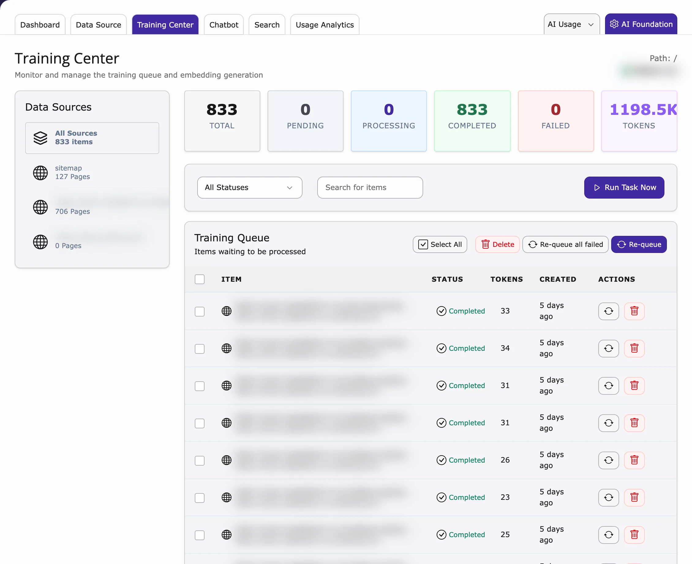

The Training Center shows every piece of content waiting to be learned, being learned, or already learned.

<div className="t3-embed"><iframe src="https://app.supademo.com/embed/cmrajhhoo0t19qmhxcu9sljuu?utm_source=link" loading="lazy" title="T3AS Training Center Demo" allow="clipboard-write; fullscreen" frameBorder="0" webkitallowfullscreen="true" mozallowfullscreen="true" allowfullscreen></iframe></div>

1. Go to **AI Universe → AI Chatbot/Search → Training Center**.
2. At the top you see the numbers: **Total**, **Pending**, **Processing**, **Completed**, **Failed** and **Tokens** (how much AI was used).
3. Below is the list of items. Use the filters to show only one source or one status.



**What the status means**

- **Pending** – waiting to be learned.
- **Processing** – being learned right now.
- **Completed** – learned. AI Search can use it.
- **Failed** – something went wrong.

**Train an item again**

1. Select the item (for example a **Failed** one).
2. Click **Re-queue**. The item goes back to **Pending**.
3. Click **Run Task Now** to start training.

**Delete an item**

1. Select the item.
2. Click **Delete**. AI Search will no longer use this content.

<Warning>
Deleted items only come back if you sync the data source again.
</Warning>

{/* SUPADEMO NEEDED: Training Center: re-queue and run */}

**Related:** [Data Source](/en/latest/ExtNsT3AS/Configuration/DataSource/Index) · [Scheduler](#scheduler) · [Dashboard](/en/latest/ExtNsT3AS/Configuration/Dashboard/Index)

{/* - **Summary counts**: Total items, Pending, Embedding (processing), Completed, Failed, and Tokens used. */}

{/* **Delete**

Removes selected queue items. */}

{/* **Run training**

Use the link to the **Scheduler** module and run the **T3AF Training** task for this site.

When the task runs, it:

- Processes all **Pending** queue items (generates embeddings).
- Runs cleanup of old completed/failed items according to the retention setting. */}

## Scheduler

Training runs in the background with the TYPO3 **Scheduler** (the TYPO3 tool that runs tasks automatically at set times).

<div className="t3-embed"><iframe src="https://app.supademo.com/embed/cmrakildl0wh8qmhx97rf9642?utm_source=link" loading="lazy" title="Scheduler Feature Demo" allow="clipboard-write; fullscreen" frameBorder="0" webkitallowfullscreen="true" mozallowfullscreen="true" allowfullscreen></iframe></div>

- Each website has one task called **T3CS Training (Site N)**. N is the page ID of your website's start page.
- AI Search creates this task for you when you save your first data source.
- To start training right away, click **Run All** on the Dashboard or **Run Task Now** in the Training Center.

When the task runs, it:

1. Reads the sources again that you marked with **Sync**.
2. Trains all new content (status **Pending**).
3. Deletes old **Failed** items after the number of days in **Retention Days**. Trained content is kept.

<Note>
**Sync** only marks content to be read again. The AI learns it when the training task runs.
</Note>

<Warning>
The Scheduler only runs if your server starts it regularly (a "cron job"). Ask your administrator or hosting provider if training never runs.
</Warning>

{/* SUPADEMO NEEDED: Scheduler task T3CS Training (Site N) */}

<a id="t3as-history-cleanup"></a>

**Delete old visitor history automatically**

You can delete old search history (what visitors searched) after a number of days.

1. Go to the **Scheduler** module.
2. Create a new task and choose **Execute console commands**.
3. Choose `t3af:history:cleanup`.
4. Enter the number of **days** to keep (default: 90).
5. Set how often it runs on the **Timing** tab.
6. Save.


**Related:** [Data Source](/en/latest/ExtNsT3AS/Configuration/DataSource/Index) · [Scheduler & CLI in AI Foundation](/en/latest/ExtNsT3AF/Configuration/Index#scheduler-and-cli)

{/* **T3AF Training** is the shared console command `nst3af:training` (AI Foundation / T3CS). It powers automatic indexing for **AI Search (T3AS)**.

When you create a data source, T3AS will automatically create the **T3AF Training** Scheduler task for this site (if it does not exist yet) and **run it at the frequency you set** (e.g. Hourly, Daily, Weekly). You do not need to create the scheduler task manually—it is created when the source is saved and will execute according to the chosen sync interval.

From the Dashboard you can open the TYPO3 Scheduler and locate the automatic training task (typically named **T3AF Training** for this site). Use **Run All** or **Run Task Now** to process the training queue immediately. */}

{/* When the scheduler runs this task for a site, it:

1. **Syncs** enabled data sources for that site (crawl or refresh content into the **training queue**).
2. **Trains** pending queue items (chunks content and **generates embeddings** via your configured AI provider or T3Planet Credits).
3. **Cleans up** old completed/failed queue rows according to the retention setting (optional archive to CSV).

<Note>
**Sync** in the Data Sources UI only marks content for refresh. It does **not** call the AI or create embeddings by itself. Embeddings are created when **T3AF Training** runs (scheduler, CLI, or **Training Center** actions that trigger the same pipeline).
</Note> */}

## Training settings

How content is split, embedded and searched is set on the shared **Training** card (**AI Features > Training card** in the AI Foundation backend module, badge **AI Chatbot/Search**). It applies to both AI Chatbot and AI Search, including the new **Retriever** (hybrid or legacy), **Repeated blocks**, **Query analysis** and **Keyword search** options. Run a sync after changing **Retriever** or **Repeated blocks**. The same settings are also described for [AI Chatbot](/en/latest/ExtNsT3AC/FeatureGuide/DataSource/Index#settings-used-by-training).


### Retrieval options explained {#retrieval-options}

These options change how the AI finds content for an answer. They apply to AI Chatbot **and** AI Search (same settings: [AI Chatbot: Retrieval options](/en/latest/ExtNsT3AC/FeatureGuide/DataSource/Index#retrieval-options)). Most websites can keep the defaults.

**Retriever** – default: `hybrid`

Decides which search finds the content for an answer.

- `hybrid` – runs a keyword search and an AI (vector) search at the same time and merges both rankings. Exact words (product names, article numbers) and similar meanings are both found. A site only uses it after its data sources were synced and trained with the new index; until then it keeps answering with the previous search, so nothing breaks while you switch.
- `legacy` – keeps the previous search only.

When to change: stay on `hybrid`. Choose `legacy` only as a temporary fallback, for example if answers got worse after an update, while you report the problem.

**Repeated blocks** – default: `0.5` (allowed `0.2`–`0.9`)

Removes text that repeats on many pages, such as promo banners, "shop the video" boxes, call-to-action boxes or legal notes. Such a block is kept once instead of on every page, so it does not push real content out of answers. A block counts as repeated when it appears on more than this share of the pages – across the whole site or within one URL folder (for example all `/products/` pages) – and on at least 5 pages. Headings are never removed. Sites or folders with fewer than 10 pages are left alone. Empty or invalid values use `0.5`.

- Lower (for example `0.3`) – removes more repeated text.
- Higher (for example `0.7`) – keeps content that is shared on purpose, for example the same product card in several collections.

When to change: lower it if answers keep quoting banners; raise it if shared content is missing in answers. It applies at the next sync, so run **Sync** and the training afterwards.

**Query analysis** – default: `history_or_complex` (only with the `hybrid` retriever)

Decides when a short extra AI call turns the visitor's question into a better search query. Follow-up questions such as "and how much is it?" are rewritten into a standalone question; comparison questions ("A vs B") are split into one search per item.

- `history_or_complex` – analyses follow-up questions, and also long or complex questions up front (more than 12 words, or with comparison, negation or "and/or" words). Costs one extra AI call (a few seconds) on those questions only.
- `history` – fastest. A question without earlier messages is searched as typed. Follow-ups that depend on the conversation are analysed, and a question is rewritten once when the first search finds little.
- `always` – every question is analysed. Most accurate, but slower and uses more AI credits.
- `off` – never analysed; every question is searched as typed. Follow-up questions may then find the wrong content.

Unreadable input (keyboard mash) is never analysed; the chatbot asks the visitor to rephrase. When to change: choose `history` if answers must be faster, `always` if visitors ask many comparison questions.

**Query analysis time limit** – default: `4` seconds

How long the extra AI call of **Query analysis** may take. If it takes longer, the question is searched as typed, so a slow AI service cannot block the answer. `0` uses the time limit of the AI provider. When to change: raise it if your AI provider is often slow and follow-up answers miss; lower it if answers must start faster.

**AI Search (result list)** – default: on (only with the `hybrid` retriever)

AI Search shows a numbered result list – one entry per page, with highlighted snippets – before the AI summary. The summary refers to these entries. Switch it off to show only the AI summary. It does not affect the chatbot.

**Keyword search of the hybrid retriever** – default: `auto`

Decides which engine runs the keyword part of the `hybrid` search.

- `auto` – content of Solr data sources is ranked by Solr; everything else by the database. Needs the EXT:solr connection in the site configuration. Sites without a Solr data source are not affected.
- `database` – the database is always used; Solr is never asked.

When to change: choose `database` if Solr is slow, not reachable or not set up on this server.

**Deprecated options (ignored)**

- **Retrieval vector scan cap** – no longer used. Every stored item is now compared, so no item can be missed because of a limit.
- **Minimum shortlist top score** – no longer used. The keyword shortlist no longer decides whether the AI (vector) search runs.

You can leave both fields as they are; changing them has no effect.

<Accordion title="All training settings and their defaults">

| Setting | Default | What it does |
|---|---|---|
| Chunk Size | 1000 | How many records are read from the database at a time. Lower it if your server runs out of memory. |
| Batch Size | 100 | How many items are sent to the AI provider in one go. |
| Retention Days | 30 | After how many days old **Failed** queue items are archived or deleted. Completed (trained) items are kept. |
| Retrieval confidence threshold | 0.62 | How well the best match must fit (0.40–0.90) before the AI answers with your content. Higher = stricter. |
| Embedding cache lifetime | 2592000 | How long (in seconds) search and chat questions are cached. 2592000 = 30 days. |
| Retrieval shortlist size | 300 | How many likely matches are first picked by keyword search and then compared with the AI data. |
| Retrieval vector scan cap | – | **Deprecated, ignored.** Every stored item is now scored. |
| Minimum shortlist top score | – | **Deprecated, ignored.** The keyword shortlist no longer limits the vector search. |
| Retriever | hybrid | **hybrid** combines keyword and AI (vector) search and merges the rankings. It is used once the new index is built for the site; until then the previous search answers. **legacy** keeps the previous search. |
| Repeated blocks | 0.5 | A block (banner, shared box) that appears on more than this share of a site's pages or of one URL folder is removed from the pages and kept once (0.2–0.9). Lower removes more repeated text; higher keeps content shared on purpose. Applies at the next sync. |
| Query analysis | history_or_complex | Hybrid only. Rewrites follow-up questions, and questions whose first search is weak, into one search query with a short AI call. **history_or_complex** also splits long and comparison questions ("A vs B") up front (one extra AI call on those questions). **history** is fastest. **always** or **off** are also possible. |
| Query analysis time limit | 4 | Seconds (0 = provider default). If the AI call takes longer, the question is searched as typed. |
| AI Search (result list) | on | Hybrid only. AI Search shows a numbered result list (one entry per page, with highlighted snippets) before the AI summary; the summary cites the entries. |
| Keyword search of the hybrid retriever | auto | **auto** ranks Solr data sources with Solr (needs the EXT:solr connection in the site configuration) and everything else with the database. **database** never asks Solr. |
| Maximum Requests per Minute | 10 | How many search or chat requests one visitor may send per minute. |
| Suspicious Pattern Threshold | 3 | How many suspicious requests are allowed before a visitor is blocked. |
| Cache Lifetime (seconds) | 60 | How long the rate limit counter is kept. |
| Maximum Links to Crawl | 30 | How many links are read per sitemap or web page source in one run. |

</Accordion>

### Command line {#command-line}

The same commands are described for [AI Chatbot](/en/latest/ExtNsT3AC/FeatureGuide/DataSource/Index#settings-used-by-training).

<Accordion title="For developers: run training on the command line">
You can start the training yourself on the command line instead of waiting for the Scheduler, for example to test it or to train everything again. The commands come from the shared AI Chatbot/Search core and work the same for AI Chatbot and AI Search.

Run them with `vendor/bin/typo3` (Composer), `php typo3/sysext/core/bin/typo3` (non-Composer) or `ddev typo3` (DDEV).

**Training – `nst3af:training [rootPageId]`**

Syncs the data sources of a site, trains all **Pending** items (creates the embeddings) and cleans up old **Failed** items. `rootPageId` is the ID of the site root page. The aliases `t3cs:training` and `aiuniverse:training` run the same command.

| Option | What it does |
|---|---|
| `--source=ID` | Only process the data source with this ID. |
| `--detailed` | Show each page URL or file while it is processed. |
| `--dry-run` | Show what would happen; no AI calls, no database changes. |
| `--limit=N` | Process at most N items per data source (default: all). |
| `--batch-size=N` | Items sent to the AI provider in one go (default: **Batch Size** setting or 100). |
| `--queue-failed` | Put **Failed** items back to **Pending** before training. |
| `-f`, `--force` | Train everything again (Completed, Failed and Processing items go back to Pending). |
| `--skip-cleanup` | Train without the cleanup step. |
| `--cleanup-only` | Only run the cleanup, no training. |
| `--retention-days=N` | Archive/delete **Failed** items older than N days (default: **Retention Days** setting or 30). Completed items are kept. |
| `--no-archive` | Delete old items without writing a CSV archive first. |
| `--optimize-db` | Run `OPTIMIZE TABLE` after the cleanup. |

```bash
# Composer
vendor/bin/typo3 nst3af:training 1 --detailed
# Non-Composer
php typo3/sysext/core/bin/typo3 nst3af:training 1 --detailed
# DDEV: test first, then train only data source 5 again
ddev typo3 nst3af:training 1 --dry-run
ddev typo3 nst3af:training 1 --source=5 --force
```

**Run the Scheduler task – `scheduler:run --task=<taskUid> -f`**

Runs the site's **T3CS Training (Site N)** task directly, with the options saved on the task. The task UID is shown in the Scheduler module.

```bash
vendor/bin/typo3 scheduler:run --task=12 -f
```

**Compound words – `t3cs:keyword:compounds`**

Adds the parts of compound words (for example "Sonnen" and "schutz" from "Sonnenschutz") to the keyword index of already trained content, so the keyword search of the hybrid retriever also finds the single words. No AI calls, no new embeddings. Run it after a training on sites with compound words, for example German.

| Option | What it does |
|---|---|
| `-s`, `--site=ID` | Only this site root page (default: every site with indexed content). |
| `--dry-run` | Count and show examples, write nothing. |
| `--show=N` | Number of examples to print (default 10). |

```bash
vendor/bin/typo3 t3cs:keyword:compounds --site=1 --dry-run
vendor/bin/typo3 t3cs:keyword:compounds --site=1
```

See all options with `vendor/bin/typo3 nst3af:training --help`.
</Accordion>

<Accordion title="For developers: run history cleanup on the command line">
`t3af:history:cleanup [days]` deletes AI Search and AI Chatbot usage history (visitor searches, conversations) and request traces older than `days` (default 90). It is separate from the training cleanup. The alias `t3cs:history:cleanup` runs the same command. You can also add it as a Scheduler task (**Execute console commands**).

```bash
vendor/bin/typo3 t3af:history:cleanup
ddev typo3 t3af:history:cleanup 90
```
</Accordion>


