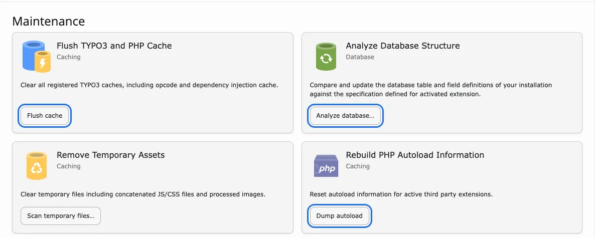

# Non-Composer Update Guide

## Minor Version Update

What's minor version update? It means, if you want to update product with security update or minor bug fixing; Example 1.1.0 to 1.2.0

### Step 1. Update New Version

- Open **System → T3Planet Shop** (TYPO3 v12/v13: Admin Tools → T3Planet Shop; older versions: NITSAN → T3Planet License)
- Click the "Get Updates" button
- If new version available then click on "Update to X.X.X" button of your particular product.

### Step 2. System Update & Flush Cache

Open **System → Maintenance** (TYPO3 v12/v13: Admin Tools → Maintenance):

- **Analyze database** (if any changes are listed)
- **Dump autoload**
- **Flush cache**

## Major Version Updates

What's major version update? It means, if you want to update product with major branch version; Example 1.1.0 to 2.0.0

### Step 1. Temporary De-Activate Extension

Go to **System → Extensions** (TYPO3 v12/v13: Admin Tools → Extensions) and deactivate the extension.

### Step 2. Update New Version

- Open **System → T3Planet Shop** (TYPO3 v12/v13: Admin Tools → T3Planet Shop)
- Click the "Get Updates" button
- If new version available then click on "Update to X.X.X" button of your particular product.

### Step 3. Update Dependent TYPO3 Extensions

Go to Extensions Manager and Update all third party dependent TYPO3 extensions to your purchased TYPO3 extension.

### Step 4. Activate Extension

Go to **System → Extensions** (TYPO3 v12/v13: Admin Tools → Extensions) and activate the extension.

### Step 5. System Update & Flush Cache

Open **System → Maintenance** (TYPO3 v12/v13: Admin Tools → Maintenance):

- **Analyze database** (if any changes are listed)
- **Dump autoload**
- **Flush cache**

